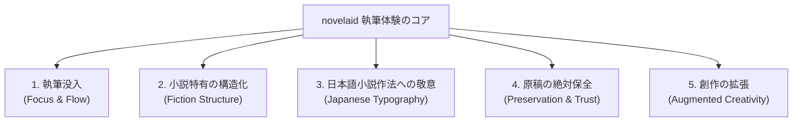
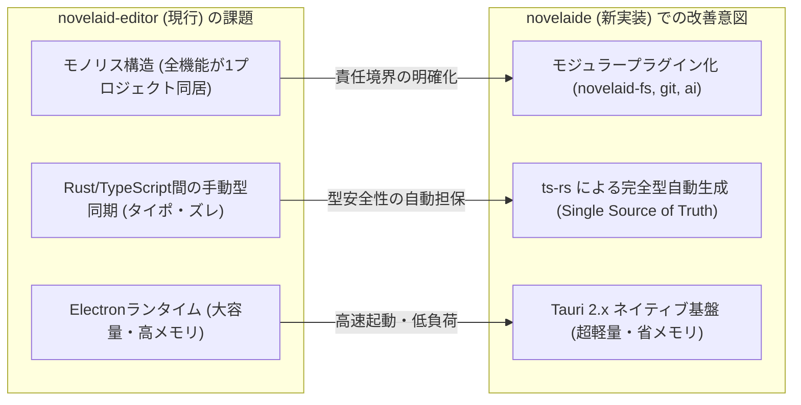

# 小説執筆エディターシリーズ 共通設計理念

## 1. はじめに：なぜ小説執筆専用のエディターが必要なのか

現代の創作環境には、VS Code をはじめとする高性能なコードエディターや、Word、各種メモアプリ、Web投稿プラットフォームのテキストエリアなど、無数の執筆手段が存在します。

しかし、一般的なコードエディターは「プログラムコードの構文解析やデバッグ」を目的として設計されており、ワードプロセッサは「印刷・レイアウト」を目的としています。
**小説執筆という創作行為は、それらとは根本的に異なる固有の要求を持っています。**

* **長編の世界観と設定の管理**: 数万〜数十万文字の長編原稿では、本文執筆と並行して「登場人物」「世界観」「用語」「時系列プロット」を常に参照・更新し続ける必要があります。
* **日本語組版・小説作法への配慮**: 段落冒頭の全角字下げ、会話文（台詞）と地の文の切り替え、ルビ（ふりがな）・傍点の表現、三点リーダー（`……`）やダッシュ（`――`）の適切な入力など、日本語小説特有の作法が存在します。
* **長時間の執筆と視覚的疲労**: 数時間・数日連続して画面と向き合うため、フォント、文字サイズ、行間、背景色（ダーク／ライト／セピア）の快適性が執筆の持続力に直結します。
* **大切な原稿の安全性**: 独自バイナリ形式に依存せず、何十年先も閲覧可能なプレーンテキスト（Markdown）として、執筆履歴を含めて確実に保護されなければなりません。

**`novelaid` シリーズ** は、これらの課題を正面から解決し、**「物語を紡ぐ作家が、最もストレスなく執筆に没頭できる究極の執筆環境を創る」** ことを共通の理念として開発されています。

---

## 2. シリーズ共通の 5大コアバリュー（設計理念）

### ① 執筆没入（Focus & Flow）
* 余計な通知、過密な行間、極小フォント、プログラミング用ミニマップなど、執筆の思考を妨げる視覚ノイズを徹底的に排除します。
* 目の疲労を最小限に抑えるため、ライト／ダークに加えて、文庫本の用紙を模した「セピア調」などの落ち着いたテーマを標準装備します。

### ② 小説特有の構造化（Fiction Structure）
* 本文原稿（`.txt` / `.md`）と、キャラクター設定・プロット・世界観メモ（YAMLフロントマターや設定ファイル）を明確に区別します。
* ファイルツリーやエクスプローラーでは、拡張子やフォルダ名から「本文」「プロット」「設定資料」「画像」「対話履歴」を自動判別し、直感的な専用アイコンで整理します。

### ③ 日本語小説作法への敬意（Japanese Typography）
* **全角スペースの可視化**: 段落冒頭の全角字下げの有無や誤入力を、視覚的な枠線デコレーションで瞬時に判別可能にします。
* **台詞とルビのハイライト**: 会話文（`「……」`、`『……』`）やルビ（`｜親文字《るび》`、`漢字《るび》`）、傍点（`《《強調》》`）を美しく色分けし、リズムを把握しやすくします。
* **小説記号の入力支援**: 入力に手間取る三点リーダー（`……`）やダッシュ（`――`）、閉じ括弧をスムーズにサジェストします。

### ④ 原稿の絶対保全（Preservation & Trust）
* 原稿データはベンダーロックインのない標準的な UTF-8 プレーンテキスト / Markdown 形式でローカルに保存されます。
* 万一アプリが動作しなくなっても、原稿は OS の標準テキストエディターや他のあらゆるツールでそのまま閲覧・編集できます。
* Git によるバージョン管理を統合し、小説家の言葉（「セーブポイント」「履歴の記録」）で大切な原稿の執筆過程を残せます。

### ⑤ 創作の拡張（Augmented Creativity）
* 助詞の連続使用やら抜き言葉を検出する校正支援エンジンを組み込みます。
* キャラクターのペルソナを持つ AI パートナーとの壁打ち対話を可能にし、孤独な執筆活動をブーストします。

---

## 3. シリーズの変遷と `novelaide` の位置付け

本シリーズは、技術の進歩と作家自身のニーズに合わせて進化を続けています。

| プロジェクト | プラットフォーム | 役割とステータス |
|---|---|---|
| **`novelaid-editor`** | Electron + React | **現行の運用アプリ（第1世代）**。 日常の小説執筆で実際に使用されており、必要な全機能の実績・仕様の基準となるマスター実装。 |
| **`novelaid-editor-next`** | Tauri 1.x〜2.x | **Tauri移行のプロトタイプ（第2世代）**。 軽量デスクトップ化および一部プラグイン分離の事前検証・実験用実装。 |
| **`novelaid-cli`** | Node.js / Rust | **AIエージェント・自動化ツール**。 ヘッドレス環境やコマンドラインからの作品解析・操作を担当。 |
| **`novelaide`** | Tauri 2.x + Rust Core | **新世代の標準実装（第3世代・コードネーム: novelaid-e）**。 `novelaid-editor` の優れた執筆体験を100%継承しつつ、構造と仕様の根本的改善を行う最新プロジェクト。 |

---

## 4. `novelaide` における構造・仕様の改善意図

`novelaide` は単なるフレームワークの載せ替えではなく、**「長期的な保守性」「極限の軽量性」「堅牢な型安全性」** を獲得するために、以下の構造改善を明確な意図を持って行っています。

1. **機能のプラグイン分離（モジュラーアーキテクチャ）**:
   - ファイルアクセス（`tauri-plugin-novelaid-fs`）、Git連携（`novelaid-git`）、AI機能（`novelaid-ai`）を独立したプラグインクレートとして分離。
   - アプリ本体（UI）の肥大化を防ぎ、コア機能をCLIや将来のWeb版でもそのまま再利用できる疎結合構造を確立します。
2. **`ts-rs` による型定義自動生成（Single Source of Truth）**:
   - Rust側のデータ定義（StructやEnum）から TypeScript の型定義を `cargo test` 経由で完全自動生成。
   - バックエンドとフロントエンドの間で型定義の二重管理を全廃し、変更漏れやタイポによる不具合を根絶します。
3. **初学者へのオープン化とメイキング連載**:
   - システム構築の過程そのものを詳細に記録・記事化し、プログラミング初心者が小説執筆ツールの仕組みを理解・追試できる教材としても機能させます。
