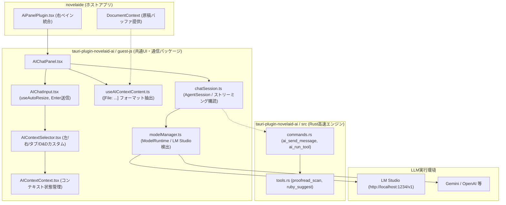

# AI関連機能および pi-coding-agent 連携設計計画書（tauri-plugin-novelaid-ai）

## 1. 概要と背景

本ドキュメントは、**`novelaide`** における AI 執筆支援機能の実装において、先行プロジェクト（`novelaid-editor`）の知見を取り込み、独立した Tauri プラグイン **`tauri-plugin-novelaid-ai`** として構築するとともに、**`@earendil-works/pi-coding-agent`** を共通バックボーンとして統合・連携するための設計仕様を定義するものです。

また、本プラグインで実装された UI コンポーネントやコンテキスト管理、エージェント通信ロジックは、最小の調整で **`novelaid-editor`（Electron版）および `novelaid-cli`（CLI版）へコードをフィードバック**できる高い互換性を維持して設計します。

### 1.1 基本方針
1. **独立Tauriプラグインへの完全カプセル化 (`tauri-plugin-novelaid-ai`)**:
   - ホストアプリ本体（`novelaide`）の `src/` にAIのロジックやUIを散らばらせず、通信・UI・コンテキスト管理のすべてを `tauri-plugin-novelaid-ai` プラグインパッケージ配下にカプセル化します。
   - ホストアプリ側は、プラグインが提供する `AIChatPanel` をインポートしてパネルに登録するだけの疎結合な関係を保ちます。
2. **モデルアクセスおよびツール利用の画一化 (`pi-coding-agent`)**:
   - LLM（LM Studio / ローカルLLM、Gemini、OpenAI 等）へのアクセスやストリーミング処理をアプリ独自で再実装せず、`novelaid-cli` と共通の `@earendil-works/pi-coding-agent` の規格に準拠します。
3. **責務分割とRust高速処理の最大活用**:
   - 重いデータ処理（メタデータ検索、Frontmatterキャッシュ参照、大容量原稿の校正スキャン、ルビ抽出）は Rust レイヤ（`tauri-plugin-novelaid-fs` / `tauri-plugin-novelaid-ai`）が担当し、ミリ秒単位で超高速処理します。
4. **`novelaid-editor` との100%コード互換・フィードバック設計**:
   - `novelaid-editor` の優れたコンテキスト選択機構（`AIContextSelector`：左/右ペイン、開いているタブ、D&Dカスタムパス）および入力機構（`AIChatInput`：自動伸縮、Enter送信、ツールトグル）を `guest-js/` 配下に完全互換で実装。
   - `novelaid-editor` 側にフィードバックする際、同一のコンポーネントコードとフック（`useAIContextContent`）がそのまま流用できる構造とします。

---

## 2. ディレクトリ構成 (`tauri-plugin-novelaid-ai`)

```text
tauri-plugin-novelaid-ai/
├── Cargo.toml                       # Rust クレート（高速テキスト解析、パーミッション）
├── src/
│   ├── lib.rs                       # プラグイン初期化
│   ├── commands.rs                  # IPCコマンド
│   └── tools.rs                     # Rust高速校正・ルビ・メタデータ参照
├── guest-js/                        # フロントエンド用 npm パッケージ ("tauri-plugin-novelaid-ai-api")
│   ├── client/                      # pi-coding-agent 通信層
│   │   ├── modelManager.ts          # LM Studio / Gemini 等の ModelRuntime 管理
│   │   └── chatSession.ts           # AgentSession 生成・ストリーミング購読
│   ├── contexts/                    # コンテキスト管理
│   │   ├── AIContextContext.tsx     # 左/右ペイン・タブ・D&D の選択状態
│   │   └── useAIContextContent.ts   # [File: ...]```...``` テキスト合成
│   ├── components/                  # novelaid-editor 互換の UI コンポーネント
│   │   ├── AIChatPanel.tsx          # チャットメインパネル
│   │   ├── AIChatPanel.css
│   │   ├── AIChatInput.tsx          # 自動伸縮 textarea・Enter送信・ツールトグル
│   │   ├── AIChatInput.css
│   │   ├── AIContextSelector.tsx    # アコーディオン式コンテキストセレクター
│   │   └── AIContextSelector.css
│   ├── types.ts                     # ChatMessage, Persona, AIContextState 等の共通型
│   └── index.ts                     # すべてを外部へエクスポート
├── package.json
├── rollup.config.js
└── tsconfig.json

novelaide/ (ホストアプリ)
└── src/
    └── plugins/
        └── panels/
            └── AiPanelPlugin.tsx    # プラグインから AIChatPanel を呼び出し登録
```

---

## 3. システムアーキテクチャ



---

## 4. `novelaid-editor` 互換コンテキスト抽出仕様

`novelaid-editor` の仕様に完全準拠し、以下のフォーマットでプロンプトにコンテキストを合成します。

```markdown
[File: 01_プロローグ.md]
```
（原稿本文）
```

[File: キャラクター設定_ルナ.md]
```
（設定資料本文）
```
```

- **左ペイン・右ペインの独立選択**:
  - `includeLeftActive`: エディターの未保存最新テキストを反映
  - `includeRightActive`: プレビューや設定資料パネルの内容を反映
- **その他の開いているタブ**:
  - `includeAllOpen`: 開いているすべてのドキュメントを結合
- **任意ファイルの Drag & Drop**:
  - `customPaths`: ファイルツリー等から直接ドロップされたファイルをディスクから読み込んで結合

---

## 5. 段階的実装ロードマップ

| フェーズ | 作業内容 |
| :--- | :--- |
| **Phase 1: プラグイン基盤・型定義の再編 (今回)** | ・`tauri-plugin-novelaid-ai/guest-js` 配下に `types.ts` を整理<br>・`AIContextContext.tsx`、`useAIContextContent.ts` を実装 |
| **Phase 2: UIコンポーネントの guest-js 内包化 (今回)** | ・`AIChatInput.tsx`、`AIContextSelector.tsx`、`AIChatPanel.tsx` を実装<br>・`tauri-plugin-novelaid-ai-api` からエクスポート |
| **Phase 3: pi-coding-agent 単純対話ストリーミングの実装 (今回)** | ・`modelManager.ts`、`chatSession.ts` の実装<br>・LM Studio 等への単純対話ストリーミング開通 |
| **Phase 4: ホストアプリ統合と検証** | ・`novelaide` の `AiPanelPlugin` をプラグインエクスポート品に切り替え<br>・Playwright 自動スクリーンショット撮影と動作確認 |

---

## 6. UI実装画面


