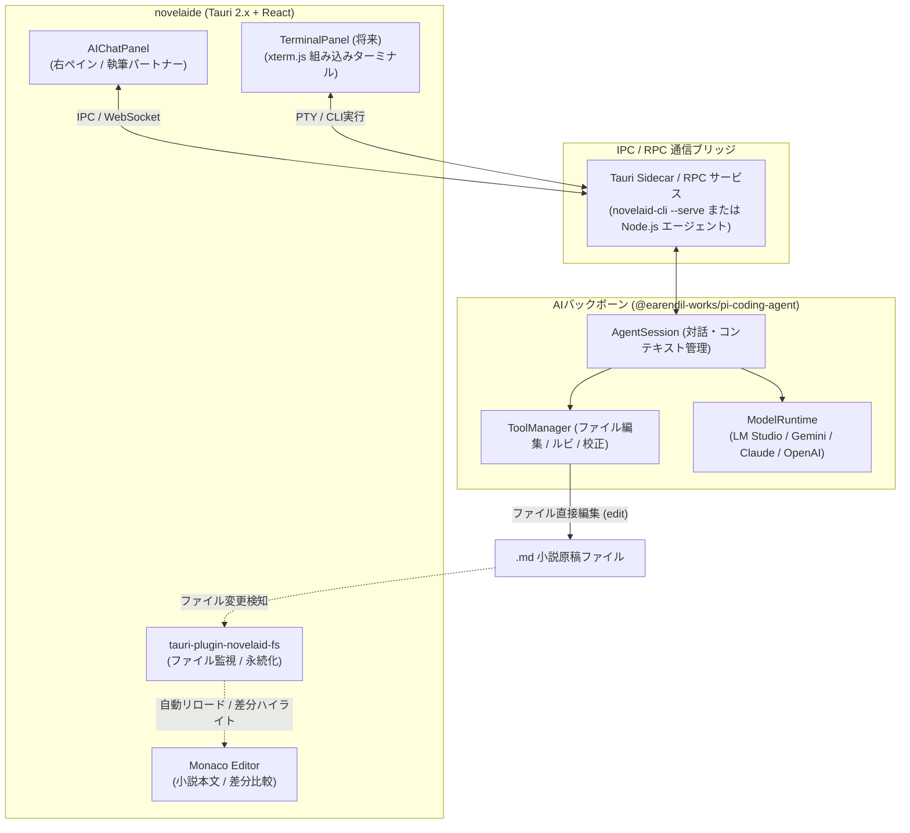

# AI関連機能および pi-coding-agent 連携設計計画書（tauri-plugin-novelaid-ai）

## 1. 概要と背景

本ドキュメントは、**`novelaide`** における AI 執筆支援機能の実装において、先行プロジェクト（`novelaid-editor`）の独自実装から方針を刷新し、独立した Tauri プラグイン **`tauri-plugin-novelaid-ai`** として構築するとともに、**`@earendil-works/pi-coding-agent` SDK** および **`novelaid-cli`** を共通バックボーンとして統合・連携するための設計仕様を定義するものです。

### 1.1 基本方針
1. **独立Tauriプラグイン化 (`tauri-plugin-novelaid-ai`)**:
   - `tauri-plugin-novelaid-fs`、`tauri-plugin-restar-settings`、`tauri-plugin-restar-git` と同様、AI機能も独立したTauriプラグインとして設計・構築し、アプリ本体との結合度を最小限に保ちます。
2. **モデルアクセスおよびツール利用の画一化**:
   - LLM（Gemini, OpenAI, Anthropic, LM Studio / ローカルLLM等）へのアクセスやストリーミング処理をアプリ独自で再実装せず、実績のある `@earendil-works/pi-coding-agent` に委ねて処理を大幅に簡略化します。
   - 原稿の読み込み・差分編集・校正などのツール呼び出し（Function Calling / Tools）を Pi SDK のプロトコルに画一化します。
3. **`novelaid-cli` との機能共有（二刀流アーキテクチャ）**:
   - `novelaid-cli` は「小説執筆補助特化型AIエージェントCLI」としてすでに Pi SDK エコシステム上に構築されています。
   - ルビ処理、文末重複・誤字脱字校正スキャン、フォルダー境界管理などの小説執筆ロジックを共有し、CLI と GUI で同一の知見・体験を提供します。
4. **GUIチャットパネルと組み込みターミナルの両面アプローチ**:
   - **GUI側**: 右ペインまたは専用ビューの `ChatPanel` で直感的にAIと相談・推敲・執筆。
   - **CLI側（将来・拡張）**: アプリ下部に統合ターミナル（`xterm.js` + PTY）を内蔵し、CLIのフルTUI対話画面を直接操作可能にする。

---

## 2. ディレクトリ構成 (`tauri-plugin-novelaid-ai`)

```text
tauri-plugin-novelaid-ai/
├── Cargo.toml                       # Rustクレート定義
├── build.rs                         # Tauriコマンドパーミッション生成
├── permissions/
│   └── default.toml                 # デフォルト許可パーミッション
├── src/
│   ├── lib.rs                       # プラグイン初期化
│   ├── commands.rs                  # AI IPC コマンド群
│   └── error.rs                     # エラー定義
├── guest-js/
│   ├── index.ts                     # APIエクスポート
│   ├── types.ts                     # AiMessage, AiPersona, AiModel, ToolCall
│   └── client.ts                    # invoke / listen ラッパー関数
├── package.json                     # "name": "tauri-plugin-novelaid-ai-api"
├── tsconfig.json
└── rollup.config.js                 # dist-js へのバンドル

novelaide/
├── src/
│   ├── contexts/
│   │   └── AiContext.tsx            # AIセッション状態管理
│   ├── components/
│   │   └── AI/
│   │       ├── ChatPanel.tsx        # 右ペイン AI 執筆チャットパネル
│   │       ├── ChatPanel.css
│   │       ├── PersonaSelector.tsx  # ペルソナ選択UI
│   │       └── MessageItem.tsx      # メッセージ吹き出し & 差分確認ボタン
│   └── plugins/
│       └── panels/
│           └── AiPanelPlugin.tsx    # PanelRegistry 登録 (novelaid.panel.ai)
```

---

## 3. IPC コマンドおよびAPI仕様

| コマンド名 | 引数 | 戻り値 | 説明 |
| :--- | :--- | :--- | :--- |
| `ai_is_available` | なし | `bool` | LM Studio などの AI サービスが接続可能か判定 |
| `ai_get_models` | なし | `Result<Vec<AiModel>, String>` | 利用可能なモデル一覧（LM Studio等）を取得 |
| `ai_send_message` | `prompt: String, persona: String, context: Option<String>` | `Result<String, String>` | メッセージを送信しAIの応答・推敲案を取得（ストリーミングイベント連動） |
| `ai_run_tool` | `tool_name: String, target_file: String, params: Value` | `Result<Value, String>` | ルビ振り、校正、差分生成等の執筆支援ツールを直接実行 |

---

## 2. アーキテクチャ構成案



---

## 3. `novelaid-cli` との機能共有方式の検討

`novelaide` は Tauri（Rust + ブラウザWebView）であり、`pi-coding-agent` は Node.js 環境前提の SDK です。機能共有および通信方式として以下の3方式を検討しました。

### 比較検討表

| 方式 | 概要 | メリット | デメリット | 推奨度 |
| :--- | :--- | :--- | :--- | :---: |
| **案1: Tauri Sidecar / ローカルRPC方式** | `novelaid-cli` をバックグラウンドの子プロセス（Sidecar）として起動し、JSON-RPC またはローカル WebSocket で GUI とストリーミング通信 | ・`novelaid-cli` の全資産・全ツールが 100% そのまま動作<br>・GUIの `ChatPanel` と完全連携<br>・モデル認証・LM Studio連携を共通化 | ・Node.js ランタイムまたはバイナリが必要 | **◎ 最推奨** |
| **案2: 共通ロジックのNPMパッケージ化** | `proofread.ts`, `ruby.ts` 等を共有パッケージ（`novelaid-agent-core`）として切り出す | ・コードの重複を防止 | ・モデル呼び出し部分は結局 Node.js 側で動かす必要がある | **◯ 併用推奨** |
| **案3: 組み込みターミナル方式 (xterm.js)** | Tauri 内に PTY（擬似端末）を立ち上げ、下部ペインで `novelaid-cli` の TUI 画面をそのまま描画 | ・CLIのフル機能（スラッシュコマンド、Tab補完）をアプリ内で直接体感可能 | ・GUIコンポーネントとの密な連携（ボタン操作など）は別途必要 | **◎ 将来実装として最適** |

### 結論と採用方針
- **AIバックボーン連携**: **「案1（Sidecar / ローカルRPC方式）」** を採用。`novelaid-cli` のエージェント機能（`AgentSession`）を GUI から呼び出し可能にする。
- **ターミナル連携**: **「案3」** を下部パネルの拡張機能として位置づけ、GUI チャットと CLI ターミナルのどちらからでも同一の小説プロジェクトを扱える構成とする。

---

## 4. 提供するAI機能とツール（Function Calling）

`pi-coding-agent` のツール機構を活用し、以下の執筆特化ツールを統一的に提供します。

1. **ルビ自動設定ツール (`ruby_suggest` / `apply_ruby`)**:
   - `novelaid-ruby` 準拠の `|親文字《ルビ》` 書式。
   - 初出の難読漢字や固有名詞を自動検出し、エディターに差分適用。
2. **文章校正・推敲ツール (`proofread_scan`)**:
   - 同音異義語の誤り（「以外 / 意外」など）、文末「〜た。」の連続使用、ら抜き言葉のスキャン。
   - 修正箇所のハイライトとワンクリック置換。
3. **ペルソナ別壁打ちチャット (`persona_chat`)**:
   - 「担当編集者」（プロット構成・展開のアドバイス）
   - 「校正係」（文章のリズム・誤字脱字の精査）
   - 「登場人物」（作中キャラクター視点でのセリフ・心情相談）
4. **原稿直接編集・差分レビュー (`edit_file`)**:
   - AIが提案した文章改変を Monaco Diff Editor で直接プレビューし、作家が確認・承認して取り込み。

---

## 5. 段階的実装ロードマップ

| フェーズ | 作業内容 |
| :--- | :--- |
| **Phase 1: バックボーン連携プロトタイプの構築** | ・`novelaid-cli` に GUI 連携用の RPC / IPC エンドポイント（対話・ストリーミング・ツール実行）を準備<br>・Tauri 側から Node.js / CLI プロセスとの通信導通を確認 |
| **Phase 2: GUIチャットパネル (`AIChatPanel`) の実装** | ・右ペインまたは左右対称ペインに `novelaid.panel.ai` を登録<br>・ストリーミングテキスト受信、ペルソナ切り替え UI<br>・現在開いている原稿やメタデータの自動コンテキスト注入 |
| **Phase 3: 執筆ツールの画一化と Monaco Diff 連携** | ・ルビ振り、校正指摘、文章改善のツール実行<br>・AIの修正案を Monaco Diff Editor で左右比較してワンクリック適用 |
| **Phase 4: 組み込みターミナルパネルの実装 (拡張)** | ・`xterm.js` を用いた下部ターミナルペインの実装<br>・`novelaid-cli` のフル TUI 画面を GUI 内で直接操作可能に |
