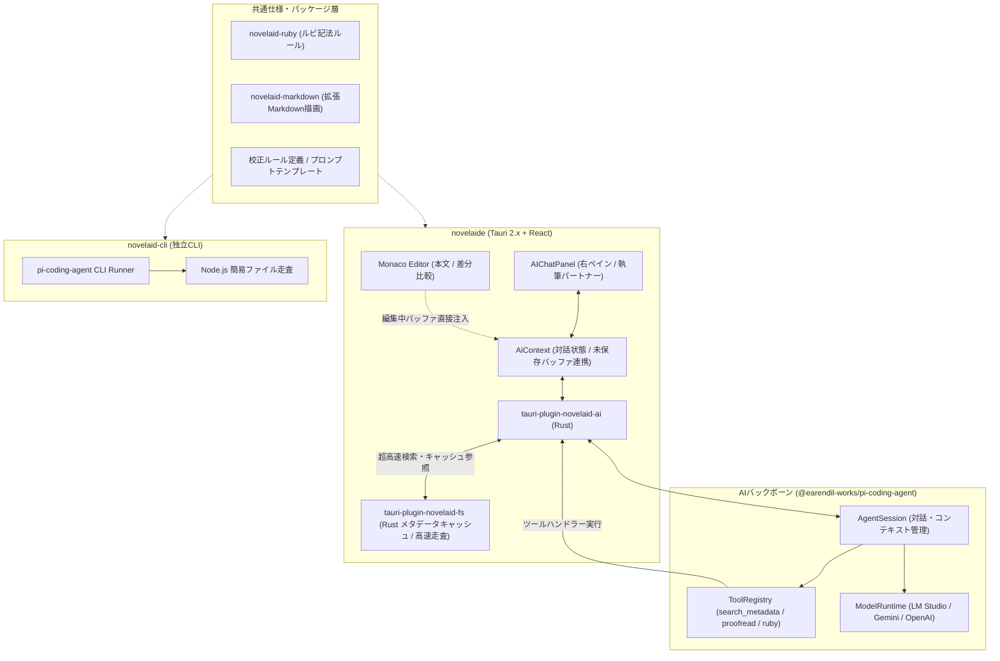

# AI関連機能および pi-coding-agent 連携設計計画書（tauri-plugin-novelaid-ai）

## 1. 概要と背景

本ドキュメントは、**`novelaide`** における AI 執筆支援機能の実装において、先行プロジェクト（`novelaid-editor`）の独自実装から方針を刷新し、独立した Tauri プラグイン **`tauri-plugin-novelaid-ai`** として構築するとともに、**`@earendil-works/pi-coding-agent` SDK** および **`novelaid-cli`** を共通バックボーンとして統合・連携するための設計仕様を定義するものです。

### 1.1 基本方針
1. **独立Tauriプラグイン化 (`tauri-plugin-novelaid-ai`)**:
   - `tauri-plugin-novelaid-fs`、`tauri-plugin-restar-settings`、`tauri-plugin-restar-git` と同様、AI機能も独立したTauriプラグインとして設計・構築し、アプリ本体との結合度を最小限に保ちます。
2. **モデルアクセスおよびツール利用の画一化**:
   - LLM（Gemini, OpenAI, Anthropic, LM Studio / ローカルLLM等）へのアクセスやストリーミング処理をアプリ独自で再実装せず、実績のある `@earendil-works/pi-coding-agent` に委ねて処理を大幅に簡略化します。
   - 原稿の読み込み・差分編集・校正などのツール呼び出し（Function Calling / Tools）を Pi SDK のプロトコルに画一化します。
3. **責務分割とRust高速処理の最大活用（内部プロセス内蔵方式の脱却）**:
   - `novelaid-cli` のプロセスを丸ごと GUI 内部で常駐・同期させる方法は、メタデータ走査の重複や未保存バッファとの同期不整合、メモリ消費などの無駄が大きいため採用しません。
   - 代わりに、**重いデータ処理（メタデータ検索、Frontmatterキャッシュ参照、大容量テキストの校正スキャンやルビ抽出）は Rust レイヤ（`tauri-plugin-novelaid-fs` / `tauri-plugin-novelaid-ai`）が担当**し、ミリ秒単位の超高速処理を実現します。
4. **`novelaid-cli` との共通化（共通ライブラリ・仕様レベルでの共有）**:
   - `novelaid-cli` とのコード共有は、独立した共通パッケージ（`novelaid-ruby`、`novelaid-markdown`、校正ルール・プロンプト定義）を通じて行います。
   - `novelaid-cli` 側は Node.js ベースの軽量・簡易版として独立して動作させ、GUI の複雑な内部キャッシュに依存しないシンプルな構造を保ちます。
5. **GUIチャットパネルと組み込みターミナルの両面アプローチ**:
   - **GUI側**: 右ペインの `ChatPanel` で直感的にAIと相談・推敲・執筆。エディターの未保存テキストや選択範囲ともリアルタイムに連携。
   - **CLI側（将来・拡張）**: アプリ下部に統合ターミナル（`xterm.js` + PTY）を内蔵し、CLIのフルTUI対話画面を直接操作可能にする。

---

## 2. アーキテクチャ構成

---

## 3. `novelaid-cli` との連携および機能共有方式の再検討

当初検討された「`novelaid-cli` プロセスをそのまま内部で常駐動作させる方式（Sidecar方式）」について再検討を行った結果、以下の構造的課題が判明しました。

1. **データ走査・キャッシュの二重化と同期不整合**:
   - `novelaide` ではすでに Rust（`tauri-plugin-novelaid-fs`）により、メタデータ（Frontmatter）のキャッシュ収集や高速走査が行われています。
   - 外部プロセスから `novelaid-cli` を動かすと、CLI 側で再度同一のファイルを走査・パースする必要があり、メモリやCPUの無駄が生じるだけでなく、エディターで編集中（未保存）のバッファデータと同期がとれなくなります。
2. **ランタイムの冗長性とオーバーヘッド**:
   - Tauri デスクトップアプリの内部に Node.js ランタイムや子プロセスを常駐させることで、メモリ消費やプロセス管理の複雑さが増大します。

### 採用する新方針：内部責務分割 ＆ コード・仕様レベルでの共通化

- **`novelaide`（GUI / `tauri-plugin-novelaid-ai`）側**:
  - `tauri-plugin-novelaid-ai` がホストアプリの Rust レイヤおよびフロントエンドと直接繋がります。
  - **メタデータ検索 (`search_metadata`)**: `tauri-plugin-novelaid-fs` の Rust メタデータキャッシュを直接参照し、数十万字の原稿でもミリ秒単位で応答。
  - **校正スキャン (`proofread_scan`)・ルビ抽出 (`ruby_suggest`)**: Rust 側の高速文字列処理・正規表現エンジンを活用。未保存のエディターバッファに対しても即座に実行可能。
- **`novelaid-cli`（CLI）側**:
  - ターミナル上で独立して動作する軽量なスタンドアローン版とし、Node.js ベースの簡易なファイル走査で動作。
  - GUIのような複雑なキャッシュ機構を持たない分、コードはシンプルで保守しやすくなります（「簡易版」としての位置づけ）。
- **共通化の手段**:
  - ルビ記法やMarkdown構文は `novelaid-ruby` / `novelaid-markdown` として共通化。
  - 校正ルール定義やプロンプトテンプレート（ペルソナ設定等）を共通の仕様・定義モジュールとして共有します。
  - 将来的なターミナル連携（組み込みターミナル）は、純粋な PTY（擬似端末UI）として下部ペインに配置し、CLI 自体を操作する用途に特化させます。

---

## 4. 提供するAI機能とツール（Function Calling）

`pi-coding-agent` のツール規格に準拠し、以下の執筆特化ツールを `tauri-plugin-novelaid-ai` でネイティブ提供します。

1. **メタデータ高速検索ツール (`search_metadata`)**:
   - `tauri-plugin-novelaid-fs` の Rust キャッシュから、登場人物の設定、地名、プロットメモを瞬時に検索・要約して AI の文脈に注入。
2. **ルビ候補抽出・設定ツール (`ruby_suggest` / `apply_ruby`)**:
   - `novelaid-ruby` 準拠の `|親文字《ルビ》` 書式。
   - 初出の難読漢字や固有名詞を自動検出し、エディターに差分適用。
3. **文章校正・推敲ツール (`proofread_scan`)**:
   - 同音異義語の誤り、文末「〜た。」の連続使用、ら抜き言葉のスキャンを Rust 側で高速解析。
   - 修正箇所のハイライトとワンクリック置換。
4. **ペルソナ別壁打ちチャット (`persona_chat`)**:
   - 「執筆パートナー」（共創・アイデア出し）
   - 「担当編集者」（プロット構成・展開のアドバイス）
   - 「校正係」（文章のリズム・誤字脱字の精査）
   - 「作中人物」（登場人物視点での台詞・心情相談）
5. **原稿直接編集・差分レビュー (`edit_file`)**:
   - AIが提案した文章改変を Monaco Diff Editor で直接プレビューし、作家が確認・承認して取り込み。

---

## 5. 段階的実装ロードマップ

| フェーズ | 作業内容 |
| :--- | :--- |
| **Phase 1: プラグイン基盤とUIの実装 (完了)** | ・独立プラグイン `tauri-plugin-novelaid-ai` の新設 ・4ペルソナ、モデル選択、原稿文脈注入、UIチャットパネル |
| **Phase 2: Rust高速ツール実行ハンドラーの実装 (今回)** | ・`tauri-plugin-novelaid-ai` の `ai_run_tool` にて `search_metadata`, `proofread_scan`, `ruby_suggest` を実装 ・未保存原稿バッファや `tauri-plugin-novelaid-fs` キャッシュとの連携 |
| **Phase 3: 執筆ツールの画一化と Monaco Diff 連携** | ・AIの文章改善案を Monaco Diff Editor で左右比較してワンクリック適用 |
| **Phase 4: 組み込みターミナルパネルの実装 (拡張)** | ・`xterm.js` を用いた下部ターミナルペインの実装 ・`novelaid-cli` を PTY 端末経由で操作可能に |

---

## 6. UI実装画面

*4種類のペルソナ（執筆パートナー、担当編集者、校正係、作中人物）の切り替え、モデル選択、原稿文脈注入、およびツール呼び出し（ルビ候補抽出・校正スキャン）を備えたAIチャットパネル。*
