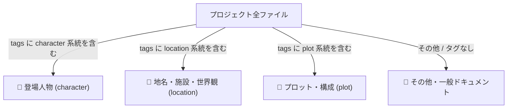

# Frontmatterメタデータ共通仕様

## 1. 概要と基本理念

本仕様は、小説執筆用エディターシリーズ（`novelaid-editor`, `novelaide`, `novelaid-cli`）および関連エコシステムにおいて、ドキュメントに属性情報を付与するための **YAML Frontmatter 共通仕様** を定義するものである。

本仕様は、特定のプログラミング言語（TypeScript, Rust, Python 等）や特定の実装フレームワーク（Electron, Tauri, React, WebAssembly 等）に一切依存しない、純粋なデータフォーマットおよびスキーマ仕様である。すべてのアプリケーションは本仕様に準拠してメタデータを読み書きするものとする。

---

## 2. ファイル保存形式と境界規約

### 2.1 保存形式（YAML Frontmatter）
メタデータは、対象ドキュメント（主に Markdown ファイル `.md` およびテキストファイル `.txt`）の**最先頭行**から記述される **YAML 形式の Frontmatter** として保持される。

- **開始行および終了行**: 行頭から `---`（半角ハイフン3つのみ、前後に空白を含まない行）で囲まれる。
- **文字コード**: `UTF-8`（BOMなし）。
- **本文との分離**: 終了の `---` の直後から通常のドキュメント本文（Markdown/Text）が開始する。

**記述例:**
```markdown
---
title: "第1話 目覚めの森"
type: chapter
description: "名もなき森で記憶を失った青年が目を覚ます。"
tags:
  - chapter
  - 本編
---
ここから本文が始まります。
```

### 2.2 非破壊原則（未定義キーの保持）
アプリケーションやツールは、自身が認識・処理しない未定義の独自キー（例: ユーザーが手動で記述した `summary`, `weather`, `pov` 等）が存在する場合、それらを勝手に削除・変換・統合してはならず、保存時に完全な形で維持（透過的に保持）しなければならない。

### 2.3 空キーの省略原則（クリーンアップ原則）
値が空文字（`""`）、空配列（`[]`）、空オブジェクト（`{}`）、または未定義（`null` / `None`）である項目は、YAML Frontmatter への出力時にキー自体を省略（削除）することを推奨する。これにより、不要な空行や無意味なキーが蓄積しないクリーンな状態を維持する。

---

## 3. コアメタデータスキーマ（全ドキュメント共通）

フォルダ単位の目次（`index.md`）自動生成やツール間連携において、すべてのドキュメントで共通して利用される標準項目は以下の通りである。

| フィールド名 | 型 | 必須性 | 説明・用途 |
| :--- | :--- | :--- | :--- |
| **`title`** | `string` | 任意（推奨） | ドキュメントの正式名称や話数タイトル（1行文字列）。`index.md` でのリンクテキスト（`[タイトル](./filename.md)`）や見出し名として使用。未指定時はファイル名から自動フォールバック。 |
| **`type`** | `string` | 任意 | ドキュメントの種別・分類（1行文字列）。`index.md` 生成時の抽出フィルタリングやグルーピングに使用。未入力時は Frontmatter にキーを出力しない（既存・自由記述互換）。 |
| **`description`** | `string` | 任意 | ドキュメントの要約・1行説明（1行文字列）。`index.md` の一覧リストにおける補足文（箇条書きの説明文やテーブル行の概要列）として使用。一覧性を維持するため1行に制限。 |
| **`tags`** | `string[]` | 任意 | ドキュメントの分類や属性を示すタグ配列。プロジェクト内での横断検索や一覧抽出（登場人物・地名・プロット等）に使用。 |
| **`author`** | `string` | 任意 | ドキュメントの著者名・作者名（1行文字列）。 |

### 3.1 `type` の予約・推奨プリセット

`type` は自由な文字列入力を許容するオプショナル型であるが、システム間での相互運用性および `index.md` 自動生成のため、以下の予約・推奨値を定義する。

- **`chapter`**: 小説本編の章・エピソード原稿
- **`character`**: 登場人物・キャラクター設定シート
- **`location`**: 地名・施設・世界観設定資料
- **`plot`**: プロット・構成案・タイムライン
- **`index`**: 目次・フォルダインデックス
- **`memo`**: 執筆メモ・アイデア出し・作業用ノート
- **`conlang` / `conlang-meta`**: 人工言語（Conlang）機能における言語設定資料・辞書構造化データ

---

## 4. 標準タグ体系（予約・分類体系）

プロジェクト内のファイルを走査して特定のカテゴリ（登場人物一覧、地名一覧など）へ自動分類するために、以下の標準タグおよびシノニム（同義語）を規定する。



### 4.1 👤 登場人物（`character` 系統）
- **代表タグ**: `character`
- **同義語（認識対象）**: `登場人物`, `人物`, `人名`, `chara`
- **用途**: キャラクター設定資料シートとして認識され、登場人物パネルやAIペルソナ生成、表記揺れ検知の対象となる。

### 4.2 📍 地名・施設・世界観（`location` 系統）
- **代表タグ**: `location`
- **同義語（認識対象）**: `places`, `place`, `地名`, `施設`, `場所`, `舞台`, `世界観`, `拠点`, `国`, `都市`, `ダンジョン`
- **用途**: 地名・施設設定資料として認識され、世界観・地名パネルや地図連携、用語補完の対象となる。

### 4.3 📜 プロット・構成（`plot` 系統）
- **代表タグ**: `plot`
- **同義語（認識対象）**: `構成`, `案`, `timeline`, `時間軸`, `年表`, `章`, `エピソード`
- **用途**: プロット・構成資料として認識され、プロットパネルや構成ツリー表示の対象となる。

### 4.4 🔖 執筆管理・補助タグ
- **`index`**: フォルダの目次ドキュメント
- **`memo`**: 執筆用メモ・未整理情報
- **`wip`**: 執筆中（Work In Progress）
- **`completed`**: 脱稿・執筆完了

---

## 5. エンティティ詳細メタデータ（設定資料用スキーマ）

登場人物（`character`）や世界観（`location`）などの設定シートにおいて推奨される標準フィールドは以下の通りである。

```yaml
---
title: "神代 玲央"
type: character
tags:
  - character
  - 主人公
id: "chara_reo"
name: "神代 玲央"
reading: "かみしろ れお"
age: "17"
gender: "男性"
role: "主人公"
aliases:
  - "玲央"
  - "レオ"
description: "記憶を失った元錬金術師の青年。"
---
```

| フィールド名 | 型 | 説明 |
| :--- | :--- | :--- |
| **`id`** | `string` | ドキュメントまたはエンティティの一意識別子（例: `chara_reo`）。 |
| **`name`** | `string` | エンティティの正式名称・本名（例: `神代 玲央`）。未指定時は `title` からフォールバック。 |
| **`reading`** | `string` | 読み仮名・フリガナ（例: `かみしろ れお`）。ルビ自動推測や校正で使用。 |
| **`age`** | `string` / `number` | 年齢情報。 |
| **`gender`** | `string` | 性別情報。 |
| **`role`** | `string` | 作中での役割（例: `主人公`, `ヒロイン`, `ライバル`, `味方`, `敵役`, `サブ`）。 |
| **`aliases`** | `string[]` | 別名・愛称・通称のリスト（例: `["レオ", "神代くん"]`）。表記揺れ検知やAI補完で使用。 |
| **`icon`** | `string` / `object` | アバターやアイコンの指定（Lucideアイコン名、画像相対パス、URL）。 |
