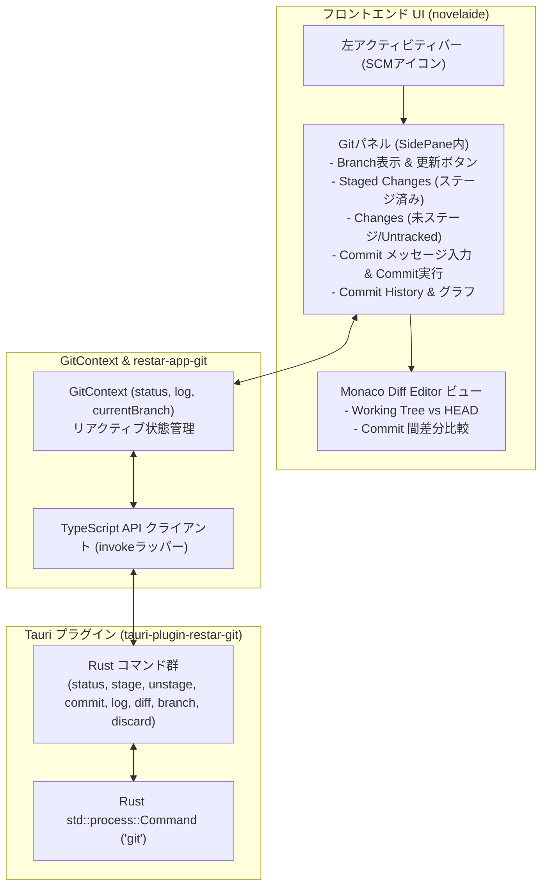

# Gitソース管理機能仕様書

## 1. 概要

本ドキュメントは、**`novelaide`**（および `restar-app` エコシステム）における **Gitソース管理（SCM: Source Control Management）機能** の仕様を定義するものです。

エディター上で原稿や設定資料の変更状態の追跡、ステージング、コミット、ブランチ確認、コミットグラフを含む履歴閲覧、Monaco Diff Editor による美麗な差分比較を実現します。
本機能の用語は開発者向けGit用語（`Commit`, `Stage / Unstage`, `Branch`, `Diff`, `Log` 等）をそのまま使用し、操作方式はシステムの `git` CLI を直接実行する堅牢なアーキテクチャを採用します。

---

## 2. アーキテクチャ設計

将来の別アプリでの再利用を見据え、Git操作基盤を **独立したTauriプラグイン（`tauri-plugin-restar-git` / npm: `restar-app-git`）** としてモジュール分離します。



---

## 3. Git操作の実行方式

- **実行エンジン**: Rustの `std::process::Command` を使用してシステムの `git` バイナリを直接呼び出します。
- **カレントディレクトリ**: 現在開いている作品フォルダー（`projectPath`）を作業ディレクトリとして指定して実行します。
- **環境設定の継承**: ユーザーの `~/.gitconfig`（名前、メールアドレス、SSH鍵、GPG署名、Credential Helper 等）をそのまま活用します。
- **文字コード**: 出力は UTF-8 で処理し、日本語ファイル名やコミットメッセージが文字化けしないよう `-c core.quotepath=false` を適用します。

---

## 4. Tauri IPC コマンド仕様

### 4.1 型定義

```typescript
export interface GitFileStatus {
  path: string;
  status: 'modified' | 'added' | 'deleted' | 'renamed' | 'untracked';
  isStaged: boolean;
}

export interface GitCommitLog {
  hash: string;
  shortHash: string;
  authorName: string;
  authorEmail: string;
  date: string;          // ISO 8601
  message: string;
  parents: string[];
}

export interface GitRepoStatus {
  isRepo: boolean;
  currentBranch: string;
  staged: GitFileStatus[];
  unstaged: GitFileStatus[];
  untracked: GitFileStatus[];
}

export interface GitDiffResult {
  filePath: string;
  originalContent: string;
  modifiedContent: string;
  diffText: string;
}
```

### 4.2 提供コマンド一覧

| コマンド名 | 引数 | 戻り値 | 説明 |
| :--- | :--- | :--- | :--- |
| `git_is_repo` | `path: String` | `bool` | 指定パスがGitリポジトリ（`.git` が存在）かどうか判定 |
| `git_init` | `path: String` | `Result<(), String>` | `git init` を実行 |
| `git_status` | `path: String` | `Result<GitRepoStatus, String>` | `git status --porcelain=v1 -u` およびブランチ情報を取得して構造化返却 |
| `git_stage` | `path: String, files: Vec<String>` | `Result<(), String>` | 指定ファイル（または空で全件）を `git add` |
| `git_unstage` | `path: String, files: Vec<String>` | `Result<(), String>` | 指定ファイルを `git reset HEAD <files>` |
| `git_commit` | `path: String, message: String, stage_all: bool` | `Result<String, String>` | `git commit -m <message>` を実行 |
| `git_log` | `path: String, max_count: Option<u32>` | `Result<Vec<GitCommitLog>, String>` | `git log --all --format=...` を実行してコミット履歴を取得 |
| `git_diff_file` | `path: String, file_path: String, staged: bool` | `Result<GitDiffResult, String>` | ファイルの差分（HEADと作業ツリー、またはステージ差分）を取得 |
| `git_diff_commit`| `path: String, commit_hash: String, file_path: String` | `Result<GitDiffResult, String>` | 特定コミットにおける親との差分を取得 |
| `git_discard` | `path: String, file_path: String` | `Result<(), String>` | 未ステージの変更を破棄（`checkout --` または `clean -f`） |

---

## 5. UIコンポーネント設計

### 5.1 `GitPanel`（左サイドペイン）
`PanelRegistry` にパネルプラグイン（`novelaid.panel.git`）として登録されます。

- **ヘッダー部**:
  - 現在のブランチ名（例: `🌿 main`）バッジ
  - リポジトリ状態の再読み込みボタン（Refresh）
- **コミット入力部**:
  - コミットメッセージ入力テキストエリア
  - プレースホルダー（例: `コミットメッセージを入力 (Ctrl+Enterでコミット)`）
  - 「Commit」ボタン（未ステージ変更がある場合は「Commit All」トグル可能）
- **アコーディオンセクション**:
  1. **Staged Changes（ステージ済み）**:
     - ファイル名、変更ステータス（`M`, `A`, `D`）
     - アンステージボタン（`-`）
     - 一括アンステージボタン（`-`）
  2. **Changes（未ステージ）**:
     - ファイル名、変更ステータス
     - ステージボタン（`+`）
     - 一括ステージボタン（`+`）
     - 変更破棄ボタン（元に戻す）
  3. **Commit History（コミット履歴）**:
     - コミットグラフ（`GitGraph`）
     - 短縮ハッシュ、コミットメッセージ、コミッター、経過日時（例: `3時間前`）

### 5.2 差分表示ビュー（`DiffView` / `DiffEditor`）
- `Changes` や `Staged Changes`、または `Commit History` 内のファイルをクリックすると、中央エディター領域で **Monaco `<DiffEditor />`** が起動。
- 左ペインに「変更前（Original / HEAD）」、右ペインに「変更後（Modified / Working Tree）」を並べて表示。
- 小説原稿の行単位・単語単位の加筆・修正・削除が色分け表示される。

---

## 6. 実装フェーズ

1. **Phase 1: プラグイン基盤の作成 (`tauri-plugin-restar-git` / `restar-app-git`)**
   - Rust側の `git` コマンドラッパー実装
   - `guest-js` の型定義・IPCクライアント実装
2. **Phase 2: `novelaide` への統合と `GitPanel` 実装**
   - 左アクティビティバーへのSCMアイコン追加
   - ステージング、コミット、ブランチ表示、変更一覧
3. **Phase 3: コミットグラフ & Monaco Diff Editor 連携**
   - コミット履歴グラフ（`GitGraph`）の描画
   - ファイルクリック時の Monaco Diff Editor 差分表示
4. **Phase 4: 自動スクリーンショット撮影・ドキュメント・メイキング更新**
   - `docs/manual/Gitソース管理の使い方.md`
   - メイキング連載第15回記事
