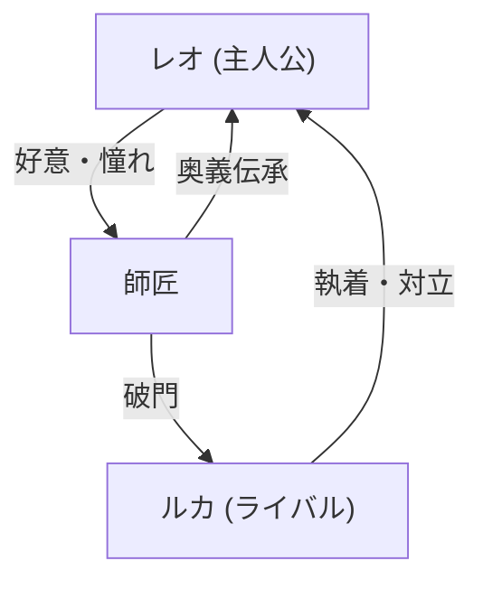

# Markdown拡張描画仕様（novelaid-markdown）

## 1. 概要と設計理念

本ドキュメントは、`novelaid` シリーズ（`novelaid-editor`, `novelaide` 等）における **設定資料・プロット・世界観設定（`.md`）の表現力を高めるための「Markdown拡張描画仕様」** を定義するものです。

小説執筆におけるMarkdownは、単なるWebブログ用のテキスト整形にとどまりません。
登場人物の能力値（レーダーチャート）、勢力図・関係図（Mermaid / D2）、作中舞台のロケーション（インタラクティブ地図）、および小説本文と共通の日本語ルビ・傍点記法など、**「作家の世界観構築を視覚的に支援する」** ための特別な描画機能が求められます。

この目的のため、シリーズ共通のMarkdown表示エンジンとして独自ライブラリ **`novelaid-markdown`** を採用・連携します。

```mermaid
graph TD
    subgraph Input ["Markdown原稿 (.md)"]
        RubyText["日本語小説記法<br/>(|漢字《かんじ》, 《《傍点》》)"]
        MermaidCode["```mermaid<br/>(相関図・タイムライン)"]
        RadarCode["```radar<br/>(キャラクター能力値・ステータス)"]
        D2Code["```d2<br/>(宣言型アーキテクチャ図)"]
        MapCode["```map<br/>(舞台地図・重要施設ピン)"]
    end

    subgraph Engine ["novelaid-markdown プロセッサ"]
        Preprocess["プリプロセッサ<br/>(ルビ・傍点変換, radar変換)"]
        CodeBlockRouter["コードブロックルーター"]
        MermaidRenderer["Mermaid レンダラー"]
        MapRenderer["MapLibre / OSM 地図レンダラー"]
        D2Renderer["D2 WASM/SVG レンダラー"]
    end

    subgraph Output ["プレビュー表示"]
        PreviewArea["MarkdownPreview<br/>(リッチHTML & インタラクティブUI)"]
    end

    Input --> Preprocess
    Preprocess --> CodeBlockRouter
    CodeBlockRouter --> MermaidRenderer
    CodeBlockRouter --> MapRenderer
    CodeBlockRouter --> D2Renderer
    MermaidRenderer --> PreviewArea
    MapRenderer --> PreviewArea
    D2Renderer --> PreviewArea
```

---

## 2. 追加描画種類の仕様一覧

| 描画種類 | 記法・コードブロック | 内部処理 / 技術基盤 | 用途・作家向け利用シーン |
|---|---|---|---|
| **日本語ルビ・傍点** | `|漢字《かんじ》`<br/>`《《強調傍点》》` | `rehype-raw` / `novelaid-ruby` 準拠 | 設定資料やキャラクター名にルビ・傍点を混在記述。 |
| **Mermaid ダイアグラム** | ````mermaid```` | `mermaid.js` | キャラクター相関図、勢力図、ストーリー進行フロー、タイムライン。 |
| **ステータスレーダーチャート** | ````radar```` | Mermaid `radar-beta` への自動変換 | 主人公やモンスターの能力値（力、魔力、敏捷、運等）の多角形チャート。 |
| **D2 ダイアグラム** | ````d2```` | `@terrastruct/d2` | 直感的な構文による組織図、階層関係、因果関係図。 |
| **マップ（地図）表示** | ````map```` | `react-map-gl/maplibre` + OpenStreetMap (OSM) | 作中世界の都市マップ、学園敷地、ダンジョン位置、ピン留め・解説。 |

---

## 3. 各拡張記法の構文と詳細仕様

### 3.1 日本語ルビおよび傍点記法
小説本文原稿と同様の記法がMarkdown文中でもそのまま利用可能です。

```markdown
主人公の|神代玲央《かみしろれお》は、《《選ばれし者》》として覚醒した。
```
- **出力結果**:
  `<ruby>神代玲央<rt>かみしろれお</rt></ruby>は、<span class="bouten">選ばれし者</span>として覚醒した。`

---

### 3.2 Mermaid ダイアグラム (`mermaid`)
`mermaid` コードブロックで記述されたダイアグラムを動的にSVGレンダリングします。

````markdown

````

---

### 3.3 レーダーチャート簡易記法 (`radar` / `novelaid-radar`)
キャラクターのステータスや能力値を直感的に定義できる簡易記法です。内部的に Mermaid の `radar-beta` 構文へ自動変換されます。

````markdown
```radar{width=400}
---
title: "レオ・カミシロ 能力値"
color: "#4A90E2"
max: 100
---
攻撃力: 85
防御力: 60
素早さ: 92
魔力: 45
知力: 70
運: 95
```
````

#### パラメータ仕様（YAMLフロントマター形式）:
- **`title`**: チャート上部に表示されるタイトル。
- **`color`**: ポリゴン領域の塗りつぶし色（HEX値）。
- **`max`**: 各軸の最大値（デフォルト: 100）。
- **属性 `{width=数値}`**: 表示幅（px）。

---

### 3.4 D2 ダイアグラム (`d2`)
テキストによる洗練された宣言型ダイアグラム言語 D2 をサポートします。

````markdown
```d2{width=500}
王国: {
  王宮 -> 近衛兵団: 命令
  近衛兵団 -> 冒険者ギルド: 討伐要請
}
魔王軍: {
  魔王 -> 四天王: 侵略開始
}
王国.近衛兵団 -> 魔王軍.四天王: 最前線で激突
```
````

---

### 3.5 インタラクティブ・マップ表示 (`map`)
作中舞台となる現実のロケーションや都市の地図を埋め込み、重要ポイントにカスタムマーカーと説明ポップアップを表示します。

````markdown
```map
id: story-main-stage
width: 100%
height: 420px
lat: 35.681236
long: 139.767125
defaultZoom: 13
minZoom: 3
maxZoom: 18
marker:
  - default, 35.681236, 139.767125, 中央駅, "物語の出発点となるターミナル駅"
  - school, 35.689506, 139.691701, 都立高校, "主人公たちが通う学園"
  - book, 35.696123, 139.758231, 古書店街, "禁断の魔道書が眠る古本街"
```
````

#### マップ設定項目:
- **`lat`, `long`**: 地図の中心緯度・経度。
- **`defaultZoom`**: 初期ズームレベル（1〜20）。
- **`marker`**: マーカー定義リスト（`[アイコン種別], [緯度], [経度], [タイトル], [説明文]`）。
  - アイコン種別: `default` (ピン), `school` (学校), `book` (本/図書館), `home`, `shop` 等（Lucideアイコンと自動対応）。
- **注意（User-Agent）**:
  OpenStreetMapのタイル利用規約に適合するため、アプリ固有の識別文字列を設定します。

---

### 3.6 ドキュメント間リンク連携 (`onLinkClick`)
Markdown内のリンク（`[第1話プロット](./01_plot.md)`）をクリックした際、OS標準ブラウザを開くのではなく、エディター内の新規タブやスプリットペインで該当ドキュメントを開くナビゲーションを提供します。

---

## 4. `novelaide` への組み込み設計

1. **`novelaid-markdown` の依存関係追加**:
   - `package.json` に `"novelaid-markdown": "^0.7.0"` を追加。
2. **プラグイン化**:
   - `src/plugins/views/MarkdownPreviewPlugin.ts` を改修し、従来のプレーンな `react-markdown` から `NovelaidMarkdown` コンポーネントへ差し替え。
3. **CSSの適用**:
   - `import 'novelaid-markdown/index.css';` をプレビュー側でインポートし、Mermaid、マップ、マーカーのスタイルを完全に適用。
