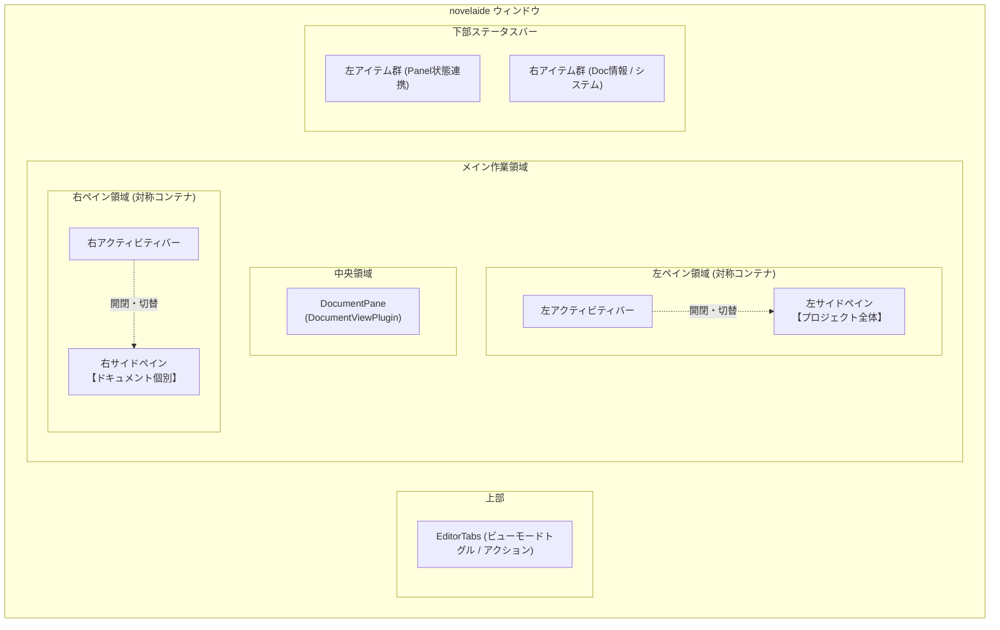

# 統合UIプラグインアーキテクチャ仕様

## 1. 概要と設計理念

本ドキュメントは、`novelaid` シリーズにおける **すべてのUI要素（左右ペイン、パネル、中央ドキュメントビュー、下部ステータスバー）をプラグインとして分離・拡張可能にする「統合UIプラグインアーキテクチャ」** の設計仕様を定義するものです。

### 1.1 背景と課題
これまでの実装では、ドキュメントビュー（エディター、縦書きプレビュー、Markdownプレビュー）は `ViewRegistry` によってプラグイン分離されていましたが、サイドペイン（エクスプローラー等）やステータスバーはメインレイアウト内に固定的に配置されていました。
しかし、小説執筆環境においては以下のような多様な要求が存在します：
- **左右ペインへの柔軟なパネル配置**:
  - 左ペイン: 作品全体・プロジェクト全体に関わるパネル（ファイルツリー、執筆目標、作品全体検索、Gitセーブポイント履歴など）
  - 右ペイン: 開いているドキュメント個別に関わるパネル（見出しアウトライン、登場人物・用語抽出、文体校正Textlint、メモなど）
- **左右ペインの対称性（Symmetry）**:
  - 左ペインと右ペインは「配置場所が異なるだけ」で、機能的な差（コンテナとしての構造）は存在しない。
  - 将来的にユーザーが好みに応じて「アウトラインを左に、ファイルツリーを右に」配置換えできる柔軟性を保証する。
- **ステータスバーのモジュール化**:
  - 各パネルの状態（Gitブランチ名、同期状況）やドキュメント情報（文字数、原稿用紙枚数、校正エラー数）を、個別のプラグインアイテムとして動的に追加・配置可能にする。

---

## 2. 全体アーキテクチャ構造



---

## 3. UIプラグインの種類とインターフェース仕様

### 3.1 パネルプラグイン (`PanelPlugin`)
左右ペインに配置される各機能パネル（ファイルツリー、アウトライン、Git履歴等）を定義します。

```typescript
export interface PanelProps {
  paneSide: 'left' | 'right';
  activeDocument: DocumentState | null;
  onClose?: () => void;
}

export interface PanelPlugin {
  /** 一意なパネルID (例: 'novelaid.panel.files', 'novelaid.panel.outline') */
  readonly id: string;
  /** 表示名 (ツールチップやヘッダータイトル) */
  readonly title: string;
  /** アクティビティバーに表示するアイコン */
  readonly icon: React.ComponentType<{ size?: number; className?: string }>;
  /** デフォルトの配置先 ('left' | 'right') */
  readonly defaultPlacement: 'left' | 'right';
  /** 配置可能なペイン ('left' | 'right' の両方、または一方) */
  readonly allowedPlacements?: ('left' | 'right')[];
  /** スコープ（'project': プロジェクト全体 / 'document': 開いている原稿個別） */
  readonly scope: 'project' | 'document';
  /** アイコン横のバッジ表示 (例: 校正エラー件数、Git変更件数など) */
  readonly badge?: () => number | string | null;
  /** 表示優先順位 (アクティビティバーでの並び順) */
  readonly priority?: number;
  /** パネル本体コンポーネント */
  readonly component: React.ComponentType<PanelProps>;
}
```

#### パネル配置の役割分担
| ペイン | 主な役割 | スコープ | 組み込みパネル例 |
|---|---|---|---|
| **左ペイン** | **プロジェクト全体**に関わるもの | `project` | - **ファイルツリー** (`novelaid.panel.files`)<br/>- **作品全体検索・置換** (`novelaid.panel.search`)<br/>- **執筆履歴 / セーブポイント** (`novelaid.panel.git`)<br/>- **作品全体の執筆進捗・目標管理** (`novelaid.panel.goals`) |
| **右ペイン** | **個々のドキュメント**に関わるもの | `document` | - **目次・見出しアウトライン** (`novelaid.panel.outline`)<br/>- **登場人物・用語抽出リスト** (`novelaid.panel.entities`)<br/>- **文体・誤字脱字校正 (Textlint)** (`novelaid.panel.lint`)<br/>- **ドキュメントメタデータ設定** (`novelaid.panel.metadata`) |

---

### 3.2 ドキュメントビュープラグイン (`DocumentViewPlugin`)
中央の執筆領域で表示するエディター・プレビュー・キャンバス（`DocumentViewMode`）を定義します。
*※ 本機能は既に導入済み（`ViewRegistry`）。*

- 対応種別: `novel`, `markdown`, `chat`, `image`, `css` 等
- ビューモード: `editor`, `reader`, `preview`, `canvas`

---

### 3.3 ステータスバーアイテムプラグイン (`StatusBarItemPlugin`)
最下部ステータスバーに表示する情報項目を定義します。

```typescript
export interface StatusBarItemProps {
  activeDocument: DocumentState | null;
}

export interface StatusBarItemPlugin {
  /** 一意なアイテムID (例: 'novelaid.status.charCount', 'novelaid.status.git') */
  readonly id: string;
  /** 配置先 ('left' | 'right') */
  readonly alignment: 'left' | 'right';
  /** 表示優先順位 (数値が大きいほど外側に配置) */
  readonly priority: number;
  /** 表示条件 (例: ドキュメントが開いている時のみ) */
  readonly isVisible?: (activeDocument: DocumentState | null) => boolean;
  /** アイテム本体コンポーネント */
  readonly component: React.ComponentType<StatusBarItemProps>;
}
```

---

## 4. レジストリとプラグイン管理

各UI要素ごとに専用のレジストリクラスを設け、シングルトンインスタンスを通じて管理します。

1. **`PanelRegistry`**:
   - `register(plugin: PanelPlugin)`: パネルの登録
   - `getPanelsForSide(side: 'left' | 'right')`: 指定ペインに属するパネル一覧を取得
   - `findPanel(id: string)`: IDによるパネル検索
2. **`ViewRegistry`**:
   - `register(plugin: DocumentViewPlugin)`: ドキュメントビューの登録
   - `findPlugin(docType, viewMode)`: ビューの動的解決
3. **`StatusBarRegistry`**:
   - `register(plugin: StatusBarItemPlugin)`: ステータスアイテムの登録
   - `getItems(alignment: 'left' | 'right')`: 左右別アイテム一覧（priority順ソート済み）

---

## 5. 設計上のメリット

1. **左右ペインコンテナの完全なコード共通化**:
   - `SidePane` コンポーネントは左右対称の単一実装となり、`side="left"` / `side="right"` のプロパティのみで動作。
2. **開放閉鎖原則（OCP）の遵守**:
   - 新しいパネル（例: AIチャット、Textlint校正）や新しいステータス項目を追加する際、メインレイアウトを改修する必要が一切なく、プラグイン登録のみで完了。
3. **ユーザーカスタマイズ性**:
   - 将来的にドラッグ＆ドロップで「パネルを右から左へ移動」「ステータス項目の非表示」といったUIカスタマイズへ容易に発展可能。
