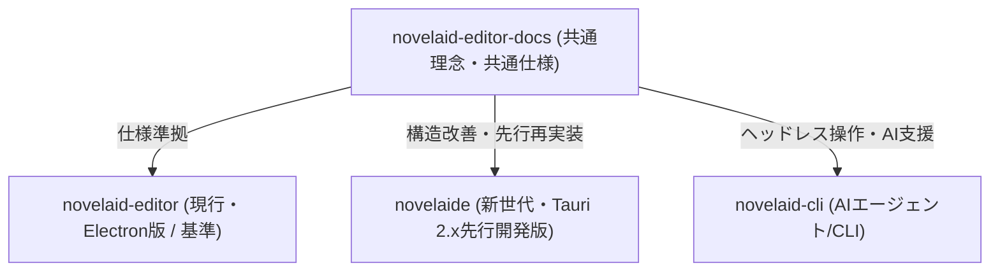

# 開発者向け仕様書一覧

本ディレクトリでは、小説執筆用エディターシリーズ（`novelaid-editor`, `novelaide`, `novelaid-cli`）の共通理念、アーキテクチャ設計、および各機能の仕様書をまとめています。

---

## 📖 設計理念・機能一覧

* **[小説執筆エディターシリーズ 共通設計理念](./00_小説執筆エディターシリーズ設計理念.md)**
  - なぜ小説専用エディターが必要なのか、シリーズ共通の5大コアバリュー、および歴代プロジェクトの変遷と新標準 `novelaide` の改善意図。
* **[機能一覧および各アプリ対応状況](./機能一覧および各アプリ対応状況.md)**
  - `novelaid-editor`（基準）、`novelaide`（先行開発・Tauri）、`novelaid-cli`（AI特化CLI）の3アプリにおける機能一覧と現在の対応状況マトリクス。

---

## 🛠️ 機能共通仕様書

| 仕様書名 | 概要 | 主な内容 |
|---|---|---|
| **[ドキュメントビューモード仕様](./ドキュメントビューモード仕様.md)** | ドキュメント表示モードの根本基盤 | `editor`, `reader`, `preview`, `canvas` の体系、種別マッピング、2ペイン管理 |
| **[ビュープラグインアーキテクチャ仕様](./ビュープラグインアーキテクチャ仕様.md)** | ビューの疎結合分離と拡張設計 | プラグイン共通インターフェース、`ViewRegistry`、将来の独立パッケージ化 |
| **[統合UIプラグインアーキテクチャ仕様](./UIプラグインアーキテクチャ仕様.md)** | 全UI要素（左右ペイン・パネル・中央ビュー・ステータスバー）のプラグイン構造 | 対称サイドペイン、PanelPlugin、StatusBarItemPlugin、役割分担 |
| **[エディター共通仕様](./エディター共通仕様.md)** | 小説本文エディターの表示・執筆仕様 | 小説特化パラメータ（フォント・行間）、全角スペース可視化、会話文・ルビハイライト、補完 |
| **[プレビューおよびスプリットビュー共通仕様](./プレビューおよびスプリットビュー共通仕様.md)** | 小説縦書き/横書き・Markdownプレビュー | 縦書き組版、novelaid-rubyルビ変換、左右スプリットビュー、読者視点の推敲 |
| **[Markdown拡張描画仕様](./Markdown拡張描画仕様.md)** | novelaid-markdown による表現力拡張 | ルビ・傍点、Mermaid、ステータスレーダーチャート、D2、OSMマップ表示 |
| **[novelaid-fs 仕様](./novelaid-fs仕様.md)** | 小説特化のファイルアクセス基盤 | ドキュメント種別自動判定、YAMLフロントマター分離、非同期メタデータキャッシュ |
| **[novelaidattributes 共通仕様](./novelaidattributes仕様.md)** | プロジェクト内ドキュメント属性定義 | 局所性（非再帰）、ファイル/フォルダ/自身判定、ワイルドカード、構文仕様 |
| **[DocumentContext 仕様](./DocumentContext仕様.md)** | ドキュメント状態管理仕様 | メモリ上のバッファ、2ペイン/マルチタブ、Dirty（未保存）管理、保存フロー |
| **[FileExplorer 仕様](./FileExplorer仕様.md)** | 小説ファイルツリー仕様 | 階層表示、専用アイコン、右クリック操作、ファイル/フォルダ作成・削除 |
| **[汎用エクスプローラーパネル仕様](./汎用エクスプローラーパネル仕様.md)** | 汎用アコーディオン式閲覧パネル | ExplorerSectionPlugin、開いている原稿、ツリー、アウトライン統合 |
| **[汎用検索パネル仕様](./汎用検索パネル仕様.md)** | プラグイン式多角検索パネル | SearchProviderPlugin、全文検索、メタデータ検索、セリフ特化検索 |
| **[ルビ関連仕様](./ルビ関連仕様.md)** | 小説ルビ記法とパーサー仕様 | カクヨム/なろう記法、HTML変換、novelaid-ruby ライブラリ仕様 |
| **[文字数カウント仕様](./文字数カウント仕様.md)** | 小説文字数・原稿用紙換算仕様 | 空白除外、ルビ親文字換算、400字詰原稿用紙枚数計算ロジック |
| **[ステータスバー仕様](./ステータスバー仕様.md)** | 執筆進捗表示仕様 | リアルタイム文字数、行・列、エンコーディング、Gitブランチ表示 |
| **[GitUI 仕様](./GitUI仕様.md)** | 小説家向け執筆履歴管理 | セーブポイント、版の記録、タイムライン差分表示 |
| **[Frontmatterメタデータ共通仕様](./Frontmatterメタデータ仕様.md)** | ファイルフォーマット・標準スキーマ層 | YAML Frontmatter構文、コア項目（title, type, description, tags）、標準タグ体系、エンティティ詳細 |
| **[メタデータ編集パネル仕様](./メタデータ編集パネル仕様.md)** | 単一ドキュメント編集UI概念層 | 1行コア項目フォーム、クイックタグトグル、空キー削除、非破壊編集 |
| **[メタデータリストパネル仕様](./メタデータリストパネル仕様.md)** | プロジェクト横断一覧UI概念層 | 登場人物・地名・プロット・総合・カスタムリスト、階層絞り込み、DnD連携 |
| **[プロジェクトナレッジ基盤仕様](./プロジェクトナレッジ基盤仕様.md)** | 広義メタデータ・作品知識ハブ層 | 属性キャッシュ、エンティティ・別名リレーション、作品固有ルビ辞書、校正・補完連携 |
| **[インデックス自動生成共通仕様](./インデックス自動生成共通仕様.md)** | index.md 自動生成規約層 | フォルダ目次・カタログ生成、リスト形式／テーブル形式レイアウト、type別フィルタリング |
| **[外部ファイル変更検知および競合制御方針仕様](./外部ファイル変更検知および競合制御方針仕様.md)** | 外部変更検知と作家原稿保護の基本方針 | オンデマンド同期（フォーカス復帰時）、競合制御マトリクス、モーダル排除、mtime連携 |
| **[日本語文章校正および形態素解析共通仕様](./日本語文章校正および形態素解析共通仕様.md)** | 文章校正と形態素解析基盤の仕様 | Lindera形態素解析、ルールベース校正、ルビ支援、AI前処理・後処理パイプライン |
| **[関連ライブラリ](./関連ライブラリ.md)** | 共通npmパッケージ一覧 | `novelaid-ruby`, `novelaid-markdown`, `restar-app` 等の役割 |

---

## 🔄 プロジェクト構成と実装の対応

