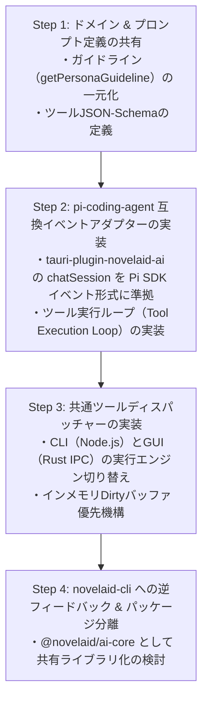

# novelaid-cli との共通化を視野に入れた pi-coding-agent 連携実装計画

## 1. 概要と背景

### 1.1 背景
`novelaid` プロジェクト群では、以下の異なるインターフェースで小説執筆支援システムを開発しています。
1. **`novelaid-cli`**: ターミナル上で動作するAI執筆支援エージェント（CLI/TUI）。`@earendil-works/pi-coding-agent` をバックボーンとして採用。
2. **`novelaide`**: Tauri (Rust + React) による最新デスクトップIDE環境。`tauri-plugin-novelaid-ai` により高速RustツールとUIをプラグイン化。
3. **`novelaid-editor`**: Electronベースの現行エディター。将来的に `novelaide` のAI基盤を逆フィードバック予定。

### 1.2 目的
AI機能の開発において、モデル呼び出し・ツール定義・コンテキスト構築・プロンプトガイドラインの重複開発を排除し、**`@earendil-works/pi-coding-agent` のエージェント機構を標準規格として共有**します。  
これにより、CLIで開発した小説補助機能（ルビ抽出、校正推敲、セマンティック移動、設定参照）が最小の変更でGUI（`novelaide`）および現行エディター（`novelaid-editor`）でも即座に利用可能となる共通基盤を確立します。

---

## 2. 実行環境の差異と課題分析

| 観点 | `novelaid-cli` (CLI) | `novelaide` (Tauri GUI) | `novelaid-editor` (Electron GUI) |
| :--- | :--- | :--- | :--- |
| **実行ランタイム** | Node.js (v18+) | WebView (Browser) + Rust | Node.js + Chromium |
| **原稿データ源** | ディスク上の実ファイル (`fs`) | エディターメモリ上の未保存バッファ (`Dirty`) | エディターメモリ上の未保存バッファ (`Dirty`) |
| **高速処理基盤** | Node.js / JavaScript | Rust ネイティブ (`tools.rs`) | Node.js / C++アドオン |
| **UI/UX** | `@earendil-works/pi-tui` (Slashコマンド, Tab補完) | React パネル (`AIChatPanel`, コンテキストセレクター) | React パネル |
| **ストリーミング** | `stdout` 逐次出力 | Server-Sent Events / IPC 逐次描画 | IPC 逐次描画 |

### 主要な課題
1. **環境依存の分離**: `pi-coding-agent` はNode.jsのファイルシステム操作やプロセスコマンドを標準ツールとして持っていますが、Tauriのフロントエンド（ブラウザ環境）では直接Node.jsの `fs` は使用できません。
2. **インメモリバッファの整合性**: GUIでは「編集中でまだ保存していない状態」の文章をAIに渡す必要があります。CLIのようにディスクからファイルを再読込するだけでは未保存の変更が反映されません。
3. **ツール実行の責務分担**: 重い形態素解析や正規表現スキャンは、GUIではRustバックエンド（`tauri-plugin-novelaid-ai`）で数ミリ秒で実行できるため、環境に応じた最適な実行エンジンを選択できる抽象化が必要です。

---

## 3. アーキテクチャ設計：3層レイヤー構造

```
┌──────────────────────────────────────────────────────────────────┐
│                      アプリケーション層                          │
│   novelaid-cli (TUI)   │  novelaide (Tauri)  │ novelaid-editor   │
└────────────┬───────────┴──────────┬───────────┴──────────┬───────┘
             │                      │                      │
┌────────────▼──────────────────────▼──────────────────────▼───────┐
│               Layer 2: エージェント・セッション統合層             │
│   - pi-coding-agent AgentSession / Event Protocol                │
│   - ストリーミング購読 (message_start, delta, turn_end)          │
│   - ツールディスパッチャー (Tool Dispatcher)                     │
└───────────────────────────────────┬──────────────────────────────┘
                                    │
┌───────────────────────────────────▼──────────────────────────────┐
│               Layer 1: 共通ドメイン・プロトコル層                │
│   - 小説特化プロンプト & ペルソナ定義 (Prompt Guidelines)       │
│   - 共通ツールスキーマ (JSON-Schema: ruby, proofread, metadata)  │
│   - 小説記法仕様 (novelaid-ruby: |親文字《ルビ》)               │
└──────────────────────────────────────────────────────────────────┘
```

### Layer 1: 共通ドメイン・プロトコル層 (Shared Domain & Schemas)
すべてのツール・プロンプト・記法の唯一の真実（Single Source of Truth）を定義します。
* **小説執筆ガイドライン・ペルソナ**:
  - `novel`: 文学表現、リズム、情景描写、感情深度の向上。ルビ・校正ガイドライン。
  - `plot`: 論理的整合性、伏線、プロット構成、因果関係の精査。
  - `chat`: アイデア出し、ブレインストーミング、壁打ち。
  - `proofread`: 誤字脱字、文末連続（〜た。重複）、ら抜き言葉、冗長表現の検出。
* **ツールスキーマ仕様 (Tool Call Specification)**:
  `pi-coding-agent` の Tool 規格（JSON-Schema）に準拠した引数・返却値の共通定義。
  - `extract_ruby`: 未ルビ漢字・固有名詞の抽出
  - `scan_proofread`: 原稿の文末重複・ら抜き言葉・冗長表現のスキャン
  - `search_metadata`: キャラクター・世界観設定の検索

### Layer 2: エージェント・セッション統合層 (Pi Coding Agent Adapter)
`pi-coding-agent` の `AgentSession` を中核とし、環境の差異を吸収するアダプターを提供します。
* **コンテキスト・プロバイダー (Context Provider)**:
  - CLI: `WorkspaceNavigator` 経由でカレントディレクトリの実ファイルを取得。
  - GUI: `AIContextContext` 経由でアクティブエディターの未保存バッファ（Dirty）を最優先取得。
* **ツール・エグゼキューター (Tool Executor)**:
  - CLI: `novelaid-cli/src/workspace/` の TypeScript 実装を実行。
  - Tauri GUI: `tauri-plugin-novelaid-ai` の Rust ネイティブコマンド（`ai_run_tool`）を IPC 経由で高速実行。
* **ストリーミング・イベント購読 (Event Subscription)**:
  `pi-coding-agent` のイベント形式（`message_start`, `message_update`, `turn_end`, `tool_call`）を標準化し、GUIの `AIChatPanel` と CLI の `stdout` の双方が全く同一のイベントストリームで駆動する構造にします。

### Layer 3: プラットフォーム実装層 (Platform Implementations)
各アプリ固有のUIとライフサイクルを管理します。
* **`novelaid-cli`**:
  - `createNovelaidExtension` により `pi-coding-agent` のネイティブ機能（`/cd`, `/ruby`, `/proofread` 等）を提供。
* **`novelaide` (`tauri-plugin-novelaid-ai`)**:
  - プラグイン配下の `guest-js/client/` で `pi-coding-agent` 互換のセッションプロトコルを処理し、`AIChatPanel` にリアルタイム描画。

---

## 4. 共通ツール仕様（シグネチャと契約）

`pi-coding-agent` の Tool として登録される各ツールの共通仕様です。

### 4.1 `scan_proofread`（校正・推敲スキャン）
* **パラメータ**:
  ```json
  {
    "type": "object",
    "properties": {
      "content": { "type": "string", "description": "対象の本文テキスト" },
      "fileName": { "type": "string", "description": "原稿ファイル名（任意）" }
    },
    "required": ["content"]
  }
  ```
* **返却値**:
  ```json
  {
    "consecutivePastTense": [{ "line": 12, "phrase": "〜だった。" }],
    "raNukiWords": [{ "line": 45, "word": "見れる", "suggested": "見られる" }],
    "redundantExpressions": [{ "line": 80, "phrase": "することができる" }]
  }
  ```

### 4.2 `extract_ruby`（ルビ抽出・候補提案）
* **パラメータ**:
  ```json
  {
    "type": "object",
    "properties": {
      "content": { "type": "string", "description": "対象の本文テキスト" },
      "knownWords": { "type": "array", "items": { "type": "string" }, "description": "除外または既知の単語リスト" }
    },
    "required": ["content"]
  }
  ```
* **返却値**:
  ```json
  {
    "candidates": [
      { "word": "神代玲央", "ruby": "かみしろれお", "line": 5 },
      { "word": "漆黒", "ruby": "しっこく", "line": 12 }
    ]
  }
  ```

### 4.3 `search_metadata`（設定・プロット参照）
* **パラメータ**:
  ```json
  {
    "type": "object",
    "properties": {
      "query": { "type": "string", "description": "検索キーワード（キャラクター名、用語等）" }
    },
    "required": ["query"]
  }
  ```
* **返却値**:
  ```json
  {
    "results": [
      { "filePath": "settings/characters.md", "title": "登場人物設定", "snippet": "..." }
    ]
  }
  ```

---

## 5. 段階的実装ロードマップ



### フェーズ 1: ドメイン・プロンプト定義の統一
1. `novelaid-cli` の `getPersonaGuideline`（小説・プロット・ブレスト・校正ガイドライン）を `novelaide` の `tauri-plugin-novelaid-ai` に同期。
2. ペルソナ（編集者、校正者、執筆パートナー、ブレスト）のシステムプロンプトに上記ガイドラインを組み込み。

### フェーズ 2: `pi-coding-agent` イベント互換ストリーミングの実装
1. `tauri-plugin-novelaid-ai` の `chatSession.ts` を改修し、`pi-coding-agent` の標準イベント形式（`message_start`, `message_update`, `turn_end`）を受け渡すイベントエミッター構成にする。
2. LLMからの Tool Call レスポンスをパースし、Rust ネイティブツール（`ai_run_tool`）を呼び出して結果をセッションに再送する自律ツール実行ループを整備。

### フェーズ 3: ツールシグネチャの完全一致とインメモリ優先連携
1. `scan_proofread`, `extract_ruby`, `search_metadata` の入出力形式を完全一致させる。
2. エディターで編集中（未保存）のテキストを最優先でツールに渡すインメモリフォールバック機構を確立。

### フェーズ 4: 共通パッケージ（`@novelaid/ai-core`）化
1. 安定した段階で、共通の型定義・プロンプト・ツールスキーマを `@novelaid/ai-core`（npmパッケージ）として切り出し。
2. `novelaid-cli`, `novelaide`, `novelaid-editor` のすべてがこのコアパッケージを参照する究極の DRY（Don't Repeat Yourself）アーキテクチャを完成させる。
