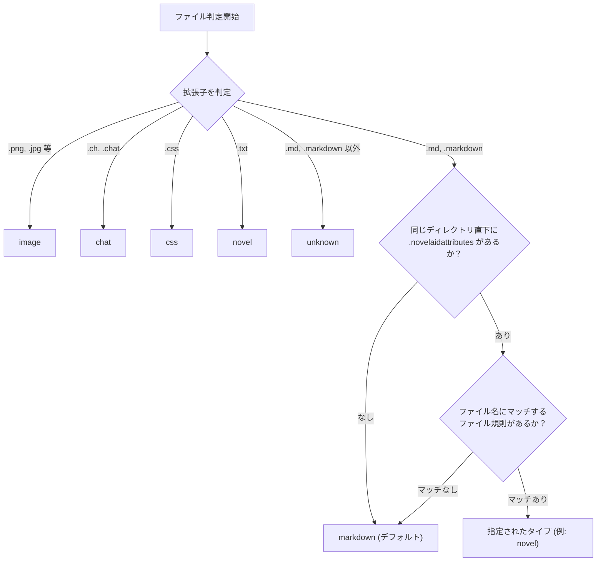
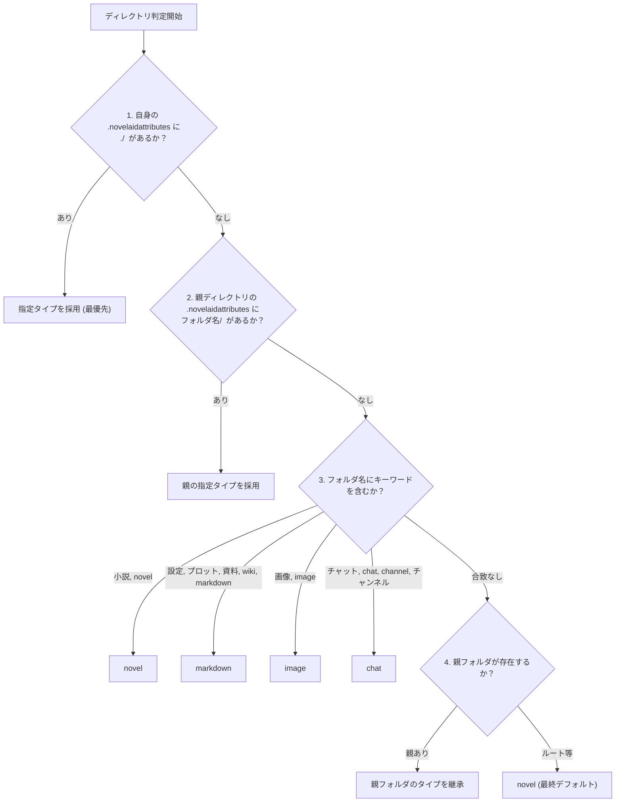

# novelaidattributes 共通仕様

## 1. 概要

`.novelaidattributes` は、小説執筆用エディターシリーズ（`novelaid-editor`, `novelaide`, `novelaid-cli` 等）において、プロジェクト内のファイルやディレクトリのドキュメントタイプ（`NovelaidDocumentType`）をローカルに定義・カスタマイズするための共通設定ファイルです。

### 導入の背景と目的
- **Markdown形式による小説原稿の互換管理**:
  Novelaidシリーズでは標準で小説本文を `.txt`、設定資料を `.md` として区別しますが、Obsidian等のMarkdownベースの他ツールと併用して小説本文を `.md` で執筆・管理しているプロジェクトが存在します。
- **局所的な属性カスタマイズ**:
  グローバルな設定を変更することなく、特定のフォルダ内の `.md` ファイルのみを小説原稿（`novel`）として扱い、縦書きプレビューや文字数カウント、AI執筆パートナーの原稿コンテキストとして即座に機能させるために用意されています。
- **言語非依存の標準化**:
  Electron（Node.js）、Tauri（Rust）、CLIエージェント（TypeScript）など、実装言語やフレームワークを問わず同一の規則で判定できるように共通仕様として定義します。

---

## 2. 設計原則

### 局所性の原則（非再帰）
Gitの `.gitattributes` や `.gitignore` とは異なり、**下位サブディレクトリへの再帰的な伝播・継承は行いません**。
- 影響を及ぼすのは、**`.novelaidattributes` が配置されたディレクトリ直下のファイルおよび直下のサブフォルダのみ**です。
- サブディレクトリ側にも独自のルールを適用したい場合は、そのサブディレクトリ直下に個別の `.novelaidattributes` を配置します。
- これにより、深い階層での意図しないルール衝突や、プロジェクト構造変更時の予期せぬ副作用を完全に防止します。

---

## 3. 構文仕様（Syntax）

### 3.1. 基本ルール
- 1行につき1つのマッピング規則を記述します（行指向フォーマット）。
- 行頭・行末の空白文字はトリムされます。
- `#` で始まる行はコメントとして無視されます。
- 空行は無視されます。
- パターンとドキュメントタイプの間は、1つ以上の半角空白またはタブで区切ります。
- パターン照合は大文字小文字を区別しません（Case-Insensitive）。

```text
# <パターン> <NovelaidDocumentType>
*.md novel
設定/ markdown
./ markdown
```

### 3.2. パターンの種類

| パターンの形式 | 対象 | 説明・例 |
| :--- | :--- | :--- |
| **ファイルパターン** (`/` を含まない) | 直下のファイル | 直下のファイル名に対して照合します。<br/>例: `*.md novel`, `第*.md novel`, `プロット.md markdown` |
| **直下サブディレクトリパターン** (末尾が `/`) | 直下のサブフォルダ | 直下のサブフォルダ名（末尾に `/` を付与した文字列）に対して照合します。<br/>例: `novel*/ novel`, `設定/ markdown`, `*資料*/ markdown` |
| **自ディレクトリ指定** (`./`) | 配置ディレクトリ自身 | `.novelaidattributes` が置かれているディレクトリ自体のタイプを明示的に指定します。<br/>例: `./ markdown`, `./ novel` |

### 3.3. ワイルドカード規則
- `*` : 0文字以上の任意の文字列にマッチします。
- `?` : 任意の1文字にマッチします。
- 上記以外の正規表現特殊文字（`.`, `+`, `^`, `$`, `(`, `)`, `[`, `]`, `{`, `}` 等）はリテラル文字としてエスケープ処理されます。

---

## 4. ドキュメントタイプ判定アルゴリズム

### 4.1. ファイルタイプの判定 (`getDocumentType`)
ファイルパスから該当ファイルの `NovelaidDocumentType` を決定するアルゴリズムです。



1. **拡張子による基本判定**:
   - 画像拡張子（`.png`, `.jpg`, `.jpeg`, `.gif`, `.webp`, `.svg`, `.bmp`, `.tiff`, `.ico`） → `image`
   - `.ch` / `.chat` → `chat`
   - `.css` → `css`
   - `.txt` → `novel`
   - `.md` / `.markdown` 以外の未定義拡張子 → `unknown`
2. **マークダウンファイルの場合の属性判定**:
   - 対象ファイルの親ディレクトリ直下に `.novelaidattributes` が存在するか確認。
   - 存在する場合、末尾が `/` で終わらないファイル規則（上から順、または末尾定義優先）とファイル名を照合。
   - パターンに一致した場合、定義されているドキュメントタイプ（例: `novel`）を採用。
   - 一致しない場合、または属性ファイルが存在しない場合はデフォルトの `markdown` と判定。

---

### 4.2. ディレクトリタイプの判定 (`getDirectoryType`)
新規ファイル作成時のデフォルト拡張子決定や、ツリー表示での分類のため、ディレクトリ自体に推奨ドキュメントタイプを割り当てるアルゴリズムです。



1. **優先度 1: 自ディレクトリの明示指定 (`./`)**:
   - ディレクトリ直下に `.novelaidattributes` が存在し、`./ <type>` のエントリが定義されていればそれを最優先で採用。
2. **優先度 2: 親ディレクトリからの指定 (`フォルダ名/`)**:
   - 親ディレクトリ直下の `.novelaidattributes` 内に、当ディレクトリ名（末尾に `/` を付与）に合致するディレクトリパターンがあればそれを採用。
3. **優先度 3: フォルダ名キーワードによる判定**:
   - `小説`, `novel` を含む場合 → `novel`
   - `設定`, `プロット`, `資料`, `wiki`, `markdown` を含む場合 → `markdown`
   - `画像`, `image` を含む場合 → `image`
   - `チャット`, `chat`, `channel`, `チャンネル` を含む場合 → `chat`
4. **優先度 4: 親ディレクトリからの継承**:
   - キーワードからも判定できない場合、親ディレクトリのドキュメントタイプを再帰的に引き継ぐ。
5. **優先度 5: 最終デフォルト**:
   - ルート階層等、親からも引き継げない場合のデフォルトは `novel`。

---

## 5. ファイルシステムおよび実装上の要件

各実装環境（Rustプラグイン、Node.jsバックエンド、CLI等）は、以下の要件を満たす必要があります。

1. **メモリ内キャッシュ機構の導入**:
   - ドキュメント判定はファイル一覧取得時やスキャン時に大量に呼び出されるため、ディレクトリごとの `.novelaidattributes` パース結果およびファイルの更新時刻（`mtime`）をメモリ内にキャッシュすること。
   - ディスクの `mtime` がキャッシュ時と一致している間は、パース済みルールを再利用して不要なファイル読み込み（I/O）を回避する。
2. **キャッシュの無効化（Invalidation）**:
   - ファイルの作成・保存・更新・削除・名前変更等の処理において、操作対象が `.novelaidattributes` である場合、直ちに該当ディレクトリの属性キャッシュを破棄すること。
3. **ディレクトリスキャン時の除外ルールとの両立**:
   - `.git` などのドットで始まるディレクトリ（フォルダ）はスキャンから一括除外するが、**ファイル名が `.` で始まるファイル（`.novelaidattributes`, `.gitignore` 等）は除外してはならない**。
   - エクスプローラー上での表示や属性判定のため、スキャン結果のエントリに含めること。

---

## 6. 実運用における設定例

### 例1: 小説原稿フォルダ直下に配置（Obsidian等との互換運用）
小説本文を `.md` で作成しつつ、同フォルダ内の特定プロットファイルだけを設定資料として除外する場合：
```text
# 小説/.novelaidattributes

# .md ファイルを一括で小説本文として扱う
*.md novel

# 設定用のMarkdownは個別に明示指定
プロット*.md markdown
キャラクター設定.md markdown
```

### 例2: 資料フォルダ自体のタイプを明示
フォルダ名にキーワードが含まれていなくても、フォルダ自体を設定資料扱いにする場合：
```text
# docs/.novelaidattributes

# このディレクトリ自身を markdown タイプにする
./ markdown
```

### 例3: 親フォルダから子フォルダの種別を一括管理
親ディレクトリから配下の特定フォルダの扱いを定義する場合：
```text
# .novelaidattributes (ルート)

# マークダウン/ 配下フォルダを資料用として定義
マークダウン/ markdown

# 本文フォルダを定義
草稿*/ novel
```
