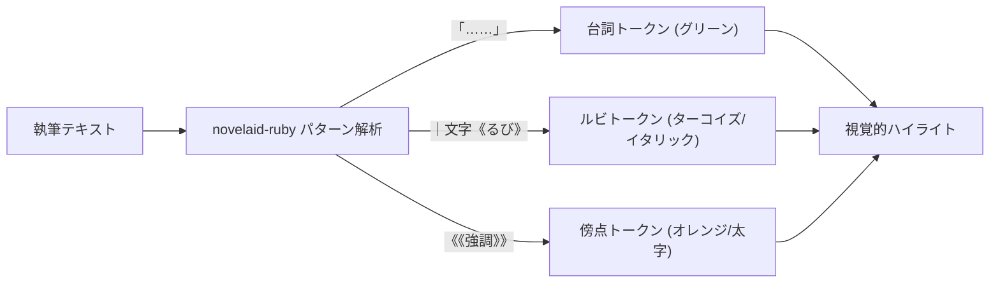

# 小説執筆エディター共通仕様

## 1. 概要と設計理念

本ドキュメントは、`novelaid` シリーズ（`novelaid-editor`, `novelaid-editor-next`, `novelaide`）における **小説本文エディターの共通仕様、表示パラメータ、小説特化の記法ハイライト、および入力支援の設計理念** を定義するものです。

一般的なプログラミング用コードエディターとは異なり、**「長時間の執筆における眼精疲労の低減」「日本語小説特有の組版・作法への配慮」「物語のテンポ感とリズムの視覚化」** を最優先に設計されています。

---

## 2. 小説特化の表示パラメータ仕様

プログラミング用エディターの初期設定（極小フォント、過密な行間、ミニマップ、全角スペース警告等）は、小説執筆においては深刻な視覚ノイズとなります。
シリーズ共通として以下の表示設定を標準とします。

| 設定項目 | 推奨パラメータ | 設計理念・執筆体験上の意図 |
|---|---|---|
| **文字サイズ (`fontSize`)** | `16px` | 長時間原稿を見つめても目が疲れにくく、文字の識別が容易な適度な大きさ。 |
| **行間 (`lineHeight`)** | `28px` (約1.75倍) | 活字書籍や文庫本に近い、ゆったりとした読み心地と余白の確保。 |
| **フォント (`fontFamily`)** | 游明朝 / メイリオ / ヒラギノ明朝 等 | 日本語の美しさと視認性を両立するフォントスタック。 |
| **行折り返し (`wordWrap`)** | `'on'` | 画面幅に応じた自然な自動折り返し（横スクロールの排除）。 |
| **ミニマップ (`minimap`)** | 非表示 (`enabled: false`) | コードとは異なり全体の縮小図を見る意義が薄く、本文領域を広くすっきり保つため。 |
| **行番号 (`lineNumbers`)** | 表示（任意でオフ可） | 構成や校正時の位置目安として機能。 |
| **全角記号警告の無効化** | オフ (`ambiguousCharacters: false`) | 日本語の句読点（`、` `。`）や全角ダッシュ・感嘆符が警告色になるのを防止。 |

---

## 3. 日本語小説作法支援の理念

### 3.1. 全角スペース（字下げ）の可視化
日本語の小説作法では、**「段落の冒頭を全角1文字分字下げする」** のが基本ルールです。
しかし、一般的なテキストエディターでは全角スペースが透明であるため、以下の問題が生じます。
- 段落頭の字下げを忘れてしまう。
- 誤って半角スペースを打ってしまう。
- セリフ直後に誤って不要なスペースが入ってしまう。

**【仕様】**
* 全角スペース（`\u3000`）の箇所に、**薄い四角い枠線のデコレーション** を自動描画します。
* 半角スペースと明確に区別でき、投稿や印刷出力時に形式違反のない原稿を安心して作成できます。

### 3.2. 小説特有記号のスマート補完
* **三点リーダー（`……`）**:
  日本語入力ソフトで「てん」と変換して「…」を2回打つ手間を省き、補完候補から即座に2倍角の `……` を挿入可能にします。
* **ダッシュ（`――`）**:
  補完候補から2倍角の `――` をスムーズに入力可能にします。
* **閉じ括弧の自動サジェスト**:
  `「` や `『` を開いた状態で執筆している際、文末で自動的に `」` `』` の閉じ括弧を候補提示します。

---

## 4. 小説専用言語（`novel`）トークナイザー仕様（`novelaid-ruby` 連携）

Monaco Editor の Monarch 構文解析器を用い、共通ライブラリ **`novelaid-ruby`** の正規表現パターンに基づいて色分け表示します。

### 4.1. 会話文（台詞）のハイライト理念
* **意図**: 小説は「地の文（情景描写・心理描写）」と「会話文（キャラクターの発言）」の掛け合いでリズムが作られます。
* **効果**: 台詞部分（`「……」`、`『……』`）を落ち着いたグリーン系でハイライトすることで、シーン全体のテンポ感や台詞の連続が一目で把握でき、推敲のスピードと精度が向上します。
* **ステートマシン**: 台詞の内部にルビが含まれている場合（例: `「私の｜魔力《マナ》が……」`）でも、台詞とルビの両方が破綻せず正しく色分けされます。

### 4.2. ルビ・傍点記法
* **ルビ記法**: カクヨム記法およびなろう記法に準拠（`｜親文字《るび》`、`漢字《るび》`）。ルビ部分をイタリック＆アクセント色で識別。
* **傍点（圏点）記法**: `《《強調文字列》》` をボールド＆強調色でハイライト。

---

## 5. テーマ設計思想（ダーク／ライト／セピア）

作家が執筆する時間帯や好みに合わせ、3つのエディターテーマを提供します。

1. **ダークモード (`novel-dark`)**:
   - 暗い部屋での夜間執筆に適した黒に近いダークグレー背景。コントラストを抑えた中間色の文字。
2. **ライトモード (`novel-light`)**:
   - 日中の明るい環境に適した清潔感のあるホワイト背景とくっきりとした濃色テキスト。
3. **セピアモード (`novel-sepia`)**:
   - **【小説特有の重要テーマ】**: 文庫本の用紙（クリームキンマリ等）を模した生成り色背景（`#F4ECD8`）と濃茶テキスト（`#433422`）。
   - コントラストが柔らかく、数時間に及ぶ長編執筆や読書において眼精疲労が最も少ないテーマです。

---

## 6. ドキュメント状態管理と保存思想

1. **マルチタブ管理**:
   - 複数話を同時に開き、タブで行き来して整合性を確認しながら推敲可能。
2. **未保存インジケーター (`isDirty`)**:
   - テキストの編集が発生すると、タブに `●` マークが即座に点灯。
3. **安全な保存フロー**:
   - ショートカットキー `Ctrl + S`（Cmd + S）で即座にローカルストレージへ安全に保存され、`●` マークが消去。
   - バックエンドのファイルアクセスプラグイン（`novelaid-fs`）と連携し、途中でクラッシュしても原稿が失われない堅牢性を保ちます。

---

## 7. 実装の変遷と novelaide での改善点

* **現行（novelaid-editor）**:
  - `CodeEditor.tsx` および `EditorSupport.ts` として Monaco Editor 上に小説執筆の基本体系を完成させました。
* **新世代（novelaide）での改善**:
  - **`novelaid-ruby` の共通パッケージ活用**: 正規表現や文字カウントの共通ロジックを独立ライブラリとして集約。
  - **React 19 最適化**: コンポーネント再レンダリングの最適化と入力遅延の最小化。
  - **Tauri プラグイン連携**: 保存処理を `tauri-plugin-novelaid-fs` の API 経由で行い、フロントエンドとバックエンドの関心事を分離。
