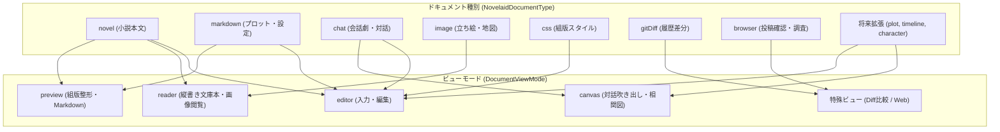
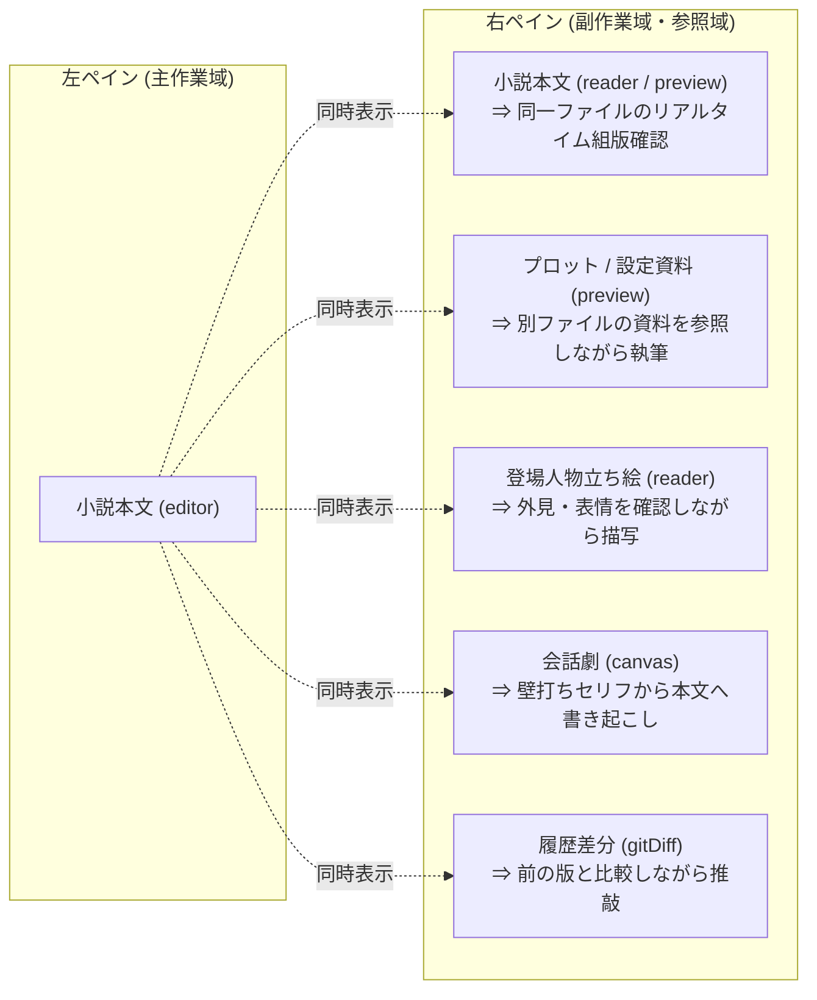

# ドキュメントビューモード仕様

## 1. 概要と設計理念

本ドキュメントは、`novelaid` シリーズ（`novelaid-editor`, `novelaid-editor-next`, `novelaide`）における **ドキュメント表示の根本概念である「ビューモード（`DocumentViewMode`）」** と、それを支える **「ドキュメント種別（`NovelaidDocumentType`）」** の共通仕様と設計理念を定義するものです。

一般的な汎用テキストエディターは、ファイルを開くと一律に「文字入力画面（テキストエディター）」を表示します。
しかし、小説執筆という総合的な創作活動では、本文原稿だけでなく、プロット・設定資料・キャラクター立ち絵・対話形式の会話劇・執筆履歴の差分比較・Web投稿サイトの確認など、多種多様なドキュメントを扱い、それぞれに最適な「接し方（見方・操作感）」が求められます。



すべてのペイン表示、スプリットビュー、プレビュー機能は、この **「ドキュメント種別 × ビューモード」** の基盤の上に成り立っています。

---

## 2. ビューモードの種類 (`DocumentViewMode`)

シリーズ共通で以下の 5 つのビューモードが定義されています。

```typescript
export type DocumentViewMode = 'none' | 'editor' | 'canvas' | 'reader' | 'preview';
```

| ビューモード | 名称 | 概要・表示内容 | 目的・用途 |
|---|---|---|---|
| **`editor`** | エディターモード | Monaco Editor によるテキスト入力画面。全角スペース可視化、小説記法ハイライト、行番号、三点リーダー補完が有効。 | 本文執筆、プロット・設定入力、CSS編集 |
| **`reader`** | リーダーモード | 編集カーソルや枠線を消し、文庫本のような縦書き用紙（`vertical-rl`）や画像閲覧レイアウトで表示。 | 完成原稿の通読、誤字脱字チェック、没入読書、画像・資料鑑賞 |
| **`preview`** | プレビューモード | `novelaid-ruby` による `<ruby>` / `<rt>` 組版や、Markdownの見出し・表・リンクを整形した最終読者表示。 | 投稿前・印刷前の組版確認、Markdown設定資料の閲覧 |
| **`canvas`** | キャンバスモード | 会話劇（`.chat`）の対話吹き出しUIや、ノードベースの相関図・時系列プロットカード等のグラフィカル表示。 | キャラクター同士の壁打ち対話、関係性・タイムライン整理 |
| **`none`** | 非表示 | ペイン上に何も表示しない、または当該ペインでタブが非アクティブな状態。 | スプリット解除時や初期プレースホルダー |

---

## 3. 全ドキュメント種別 (`NovelaidDocumentType`) と役割定義

ファイルシステム層（`novelaid-fs`）で定義されるドキュメント種別、および将来予定される拡張種別の体系です。

```typescript
export type NovelaidDocumentType = 
  | 'novel'     // 小説本文原稿 (.txt)
  | 'markdown'  // プロット・設定資料 (.md)
  | 'image'     // 立ち絵・地図・挿絵 (.png, .jpg, .webp, .svg 等)
  | 'chat'      // 会話劇・対話プロット (.chat, .ch)
  | 'gitDiff'   // 執筆履歴差分ビュー (gitDiff://)
  | 'browser'   // 内蔵Webブラウザ (browser://)
  | 'css'       // カスタム組版スタイル (.css)
  | 'unknown'   // 未知の形式 (フォールバック)
  | 'external'; // OS既定アプリ連携 (.pdf, .docx 等)
```

### 3.1 実装済み・コア種別

#### 1. `novel` (小説本文原稿)
* **拡張子**: `.txt`（プロジェクトルートまたは小説フォルダ配下）
* **設計理念**: 作家の思考を妨げない純粋なプレーンテキスト。全角スペースやルビ記法（カクヨム/なろう形式）を直接記述。
* **サポートモード**: `['editor', 'reader', 'preview']`（デフォルト: `editor`）
* **振る舞い**:
  - `editor`: 小説専用Monaco Editor（行間28px、三点リーダー・ダッシュ補完、全角スペース枠、ルビ色分け）。
  - `reader`: 縦書き文庫本ビュー。ページ送りアニメーションや用紙テクスチャで読者として没入読書。
  - `preview`: 縦書き/横書き切り替え可能なリアルタイム組版プレビュー。

#### 2. `markdown` (設定資料・プロット)
* **拡張子**: `.md`
* **設計理念**: キャラクター設定、世界観、プロット構成など、階層見出しや箇条書き、表を活用する構造化資料。
* **サポートモード**: `['editor', 'reader', 'preview']`（デフォルト: `editor`）
* **振る舞い**:
  - `editor`: Markdownハイライト付きテキスト編集。
  - `preview`: 見出し・リスト・テーブル・コードブロック・ルビが整形されたリッチHTMLプレビュー。
  - `reader`: 余計なUIを削ぎ落としたドキュメント読書レイアウト。

---

### 3.2 未実装・段階的開発ドキュメント種別

#### 3. `chat` (会話劇・キャラクター壁打ち)
* **拡張子**: `.chat`, `.ch`, または専用JSON
* **設計理念**:
  - 小説のセリフ起こしやキャラクター同士の掛け合いは、地の文なしの「対話劇」としてブレインストーミングされることが多い。
  - また、AIアシスタントとの作中キャラクターになりきった対話（インタビュー、壁打ち相談）を直接作品フォルダ内に記録・管理する。
* **サポートモード**: `['editor', 'canvas']`（デフォルト: `canvas`）
* **振る舞い**:
  - `canvas`: メッセージアプリ（チャットUI）形式の吹き出し表示。キャラクターアイコン、発言者ごとの左右配置、感情アイコン。
  - `editor`: 対話データの生テキスト/JSON編集。一括置換や台本形式スクリプト編集が可能。

#### 4. `image` (キャラクター立ち絵・世界地図・挿絵)
* **拡張子**: `.png`, `.jpg`, `.jpeg`, `.gif`, `.webp`, `.svg`
* **設計理念**:
  - 執筆中に登場人物の容姿（立ち絵資料）や地理（世界地図）、家系図を即座に参照したいという作家の強いニーズに応える。
  - エディターの横（スプリットペイン）に開いて常時参照しながら執筆可能にする。
* **サポートモード**: `['reader']`（デフォルト: `reader`）
* **振る舞い**:
  - `reader`: パン（移動）・ズーム（拡大縮小）・原寸表示・回転が可能な画像ビューアー。背景色透過グリッド表示に対応。

#### 5. `css` (カスタムテーマ・組版スタイルシート)
* **拡張子**: `.css`
* **設計理念**:
  - プレビューの文庫本組版（フォント、文字サイズ、行間、マージン、傍点の形状等）をユーザー自身がCSSで自在にカスタマイズできるようにする。
* **サポートモード**: `['editor']`（デフォルト: `editor`）
* **振る舞い**:
  - `editor`: CSSシンタックスハイライト、カラーピッカー、構文チェック付きエディター。

#### 6. `gitDiff` (執筆履歴・版の比較ビュー)
* **仮想URI**: `gitDiff://<commit-hash>/<path>` または `gitDiff://workdir/<path>`
* **設計理念**:
  - 小説の推敲において、「昨日削ったあの段落を復活させたい」「前バージョンと何が変わったかを比較したい」という要求は日常茶飯事である。
  - プログラミング用の難解なGit差分ではなく、小説家が読みやすい「削除・追加・変更」の並列比較（Side-by-Side Diff）を提供する。
* **サポートモード**: 特殊ビュー（`editor` ベースの Monaco Diff Editor）
* **振る舞い**:
  - 左右に旧バージョンと現バージョンを並べ、変更行・変更文字をハイライト。ワンクリックで旧テキストの差し戻しが可能。

#### 7. `browser` (内蔵Webブラウザ)
* **仮想URI**: `browser://<url>`
* **設計理念**:
  - 小説投稿サイト（カクヨム、小説家になろう、note等）の投稿管理画面や、Wikipedia・辞書サイト・参考文献ページをアプリ内で直接開く。
  - OSブラウザに画面を切り替えることなく、右ペインに資料サイトを開いたまま左ペインで執筆を継続できる。
* **サポートモード**: 特殊ビュー（Tauri Webview / iframe）
* **振る舞い**:
  - 戻る・進む・更新・URLバーを備えたタブ型ブラウザペイン。

#### 8. `external` (外部連携ドキュメント)
* **拡張子**: `.pdf`, `.docx`, `.xlsx`, `.clip` 等
* **設計理念**:
  - エディター内での直接編集が困難なバイナリ形式の資料について、プロジェクトツリーからワンクリックでOS既定の関連付けアプリ（Word, Excel, ClipStudio, Adobe Acrobat等）で起動・連動させる。
* **サポートモード**: 外部起動ハンドラ
* **振る舞い**:
  - タブを開くとプレースホルダー画面が表示され、「OS標準アプリで開く」ボタンを提供。ファイルの外部更新を検知してツリーに反映。

#### 9. `unknown` (未知のファイル形式)
* **拡張子**: 上記以外の任意のファイル
* **サポートモード**: `['editor']`（フォールバック）
* **振る舞い**:
  - プレーンテキストとして読み込みを試み、Monaco Editorで表示。バイナリファイルの場合は警告とHexダンプまたはサイズ情報を表示。

---

### 3.3 将来構想・拡張ドキュメント種別（ロードマップ）

今後、創作支援の深化に伴い追加が予定されているドキュメント種別です。

| ドキュメント種別 | 拡張子 / 識別 | サポート予定モード | 設計理念・用途 |
|---|---|---|---|
| **`plot`** (プロット・構成案) | `.plot` (JSON/YAML) | `['canvas', 'editor']` | 起承転結や三幕構成のカードを並び替え、各話への展開をシミュレーションするカンバンビュー。 |
| **`timeline`** (作中年表・タイムライン) | `.timeline` | `['canvas', 'editor']` | 作中世界の歴史や、事件の発生時刻と各キャラクターの行動を時系列チャートで視覚化。 |
| **`character`** (登場人物相関図・シート) | `.char` / `.json` | `['canvas', 'editor']` | キャラクターのプロフィールカードおよび、人物間の好意・対立・血縁関係をノードグラフで可視化。 |
| **`dictionary`** (作中用語集・架空言語辞書) | `.dict` | `['preview', 'editor']` | 専門用語や固有名詞の辞典ビュー。執筆中のエディターからホバーで解説をポップアップ参照。 |

---

## 4. ドキュメント種別とビューモードの対応マッピング表

| ドキュメント種別 (`NovelaidDocumentType`) | サポートする ViewMode | デフォルト ViewMode | 実装ステータス |
|---|---|---|:---:|
| **`novel`** | `['editor', 'reader', 'preview']` | `editor` | **実装済み (Phase 3-4)** |
| **`markdown`** | `['editor', 'reader', 'preview']` | `editor` | **実装中 (Phase 4)** |
| **`chat`** | `['editor', 'canvas']` | `canvas` | 未実装 (Phase 5予定) |
| **`image`** | `['reader']` | `reader` | 未実装 (Phase 5予定) |
| **`css`** | `['editor']` | `editor` | 未実装 (Phase 5予定) |
| **`gitDiff`** | 特殊 (Diff Editor) | 特殊 | 未実装 (Phase 6予定) |
| **`browser`** | 特殊 (Webview) | 特殊 | 未実装 (Phase 6予定) |
| **`external`** | 外部アプリ起動 | 外部起動 | 未実装 (Phase 5予定) |
| **`unknown`** | `['editor']` | `editor` | 実装済み |

### 判定ユーティリティ仕様

```typescript
/**
 * ドキュメント種別がサポートするビューモード配列を返却
 */
export function getSupportedViewModes(docType: NovelaidDocumentType | string | undefined): DocumentViewMode[] {
  switch (docType) {
    case 'novel':
    case 'markdown':
      return ['editor', 'reader', 'preview'];
    case 'chat':
      return ['editor', 'canvas'];
    case 'image':
      return ['reader'];
    case 'css':
      return ['editor'];
    case 'gitDiff':
    case 'browser':
      return []; // 特殊仮想ビュー
    default:
      return ['editor'];
  }
}

/**
 * 指定されたビューモードが利用可能かを判定
 */
export function isViewModeSupported(
  docType: NovelaidDocumentType | string | undefined,
  viewMode: DocumentViewMode,
): boolean {
  if (!docType) return viewMode === 'editor';
  const supported = getSupportedViewModes(docType);
  return supported.includes(viewMode);
}

/**
 * ドキュメントを開く際の初期推奨ビューモードを取得
 */
export function getInitialViewMode(docType?: NovelaidDocumentType): DocumentViewMode {
  if (docType === 'chat') return 'canvas';
  if (docType === 'image') return 'reader';
  return 'editor';
}
```

---

## 5. 2ペイン・スプリットビューとの連携アーキテクチャ

ビューモードの概念は、左右2画面のスプリットビューにおいて最大の効果を発揮します。
執筆者が創作中に直面する「参照しながら書く」「推敲しながら確認する」というワークフローを、以下の組み合わせで実現します。



### スプリットパターンの分類

1. **同ファイル・異ビューモード（リアルタイム確認）**:
   - `left: novel (editor)` + `right: novel (preview)`
   - 入力したテキストやルビが右ペインの文庫本組版へ即座に反映される。
2. **異ファイル・異ドキュメント種別（資料参照執筆）**:
   - `left: novel (editor)` + `right: markdown (preview)`（設定資料を見ながら執筆）
   - `left: novel (editor)` + `right: image (reader)`（世界地図を見ながら執筆）
3. **推敲・版比較（セーブポイント比較）**:
   - `left: novel (editor)` + `right: gitDiff (diff)`（推敲前の過去リビジョンと比較）

---

## 6. まとめと今後のロードマップ

1. **Phase 4**: `novel` の `preview`（縦書き/横書き文庫本組版）および `markdown` の `preview` の完成とスプリットビュー統合。
2. **Phase 5**: `image` の `reader`（画像ビューアー）、`chat` の `canvas`（会話劇吹き出しUI）、`external` 連携の実装。
3. **Phase 6**: `gitDiff`（小説特化差分比較）、`browser`（投稿サイト内蔵ブラウザ）の統合。
4. **Phase 7以降**: `plot`, `timeline`, `character` 等のノード＆カードベースの創作支援キャンバスの拡張。
