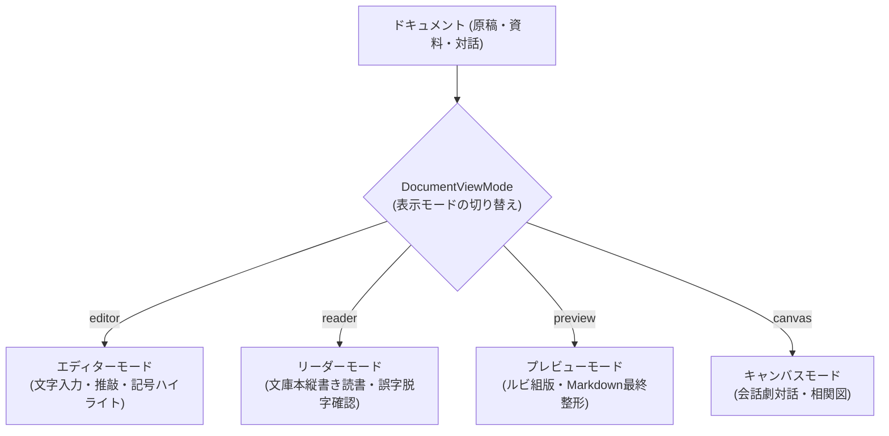

# ドキュメントビューモード仕様

## 1. 概要と設計理念

本ドキュメントは、`novelaid` シリーズ（`novelaid-editor`, `novelaid-editor-next`, `novelaide`）における **ドキュメント表示の根本概念である「ビューモード（`DocumentViewMode`）」** の仕様と設計理念を定義するものです。

エディターやプレビュー、リーダー、画像表示などのあらゆる画面表示は、すべてこの **「ドキュメントのビューモード仕様」** の基盤の上に成り立っています。

---

## 2. なぜ「ビューモード」という概念が必要なのか（設計理念）

一般的なテキストエディターは、ファイルを開くと一律に「文字入力画面（エディター）」を表示します。
しかし、小説執筆という総合的な創作活動では、**1つの原稿や資料に対して複数の異なる「見方・接し方」** が求められます。



1. **目的による認知の切り替え**:
   - **書くとき（`editor`）**: 全角スペース枠やルビ記法、行番号、補完が表示される「作業場」。
   - **読むとき（`reader`）**: 編集用ノイズをすべて消し、文庫本と同じ縦書き組版で「読者として物語に浸る」。
   - **確認するとき（`preview`）**: ルビが正しく乗っているか、Markdownの表や見出しが意図通り組版されているかを「チェックする」。
2. **2画面分割（スプリット）との自然な調和**:
   同じファイルであっても「左ペインでは `editor` で入力し、右ペインでは `preview` や `reader` で完成形を眺める」という、執筆と読者目線の同時進行が可能になります。
3. **将来の多様なファイル形式への拡張性**:
   本文原稿（`.txt`）だけでなく、プロット（`.md`）、会話劇・インタビュー（`.chat`）、キャラクター立ち絵・世界地図（画像）、設定スタイルシート（`.css`）など、ファイル種別ごとに最適な複数のビューを提供できます。

---

## 3. ビューモードの種類 (`DocumentViewMode`)

シリーズ共通で以下の 5 つのビューモードが定義されています。

```typescript
export type DocumentViewMode = 'none' | 'editor' | 'canvas' | 'reader' | 'preview';
```

| ビューモード | 名称 | 概要・表示内容 | 目的・用途 |
|---|---|---|---|
| **`editor`** | エディターモード | Monaco Editor によるテキスト入力画面。全角スペース可視化、小説記法ハイライト、行番号、補完が有効。 | 本文執筆、プロット入力、コード編集 |
| **`reader`** | リーダーモード | 編集カーソルや枠線を消し、文庫本のような縦書き用紙（`vertical-rl`）または集中読書レイアウトで表示。 | 完成原稿の通読、誤字脱字チェック、没入読書 |
| **`preview`** | プレビューモード | `novelaid-ruby` による `<ruby>` / `<rt>` 組版や、Markdownの見出し・表・リンクを整形した最終読者表示。 | 投稿前・印刷前の組版確認、設定資料の閲覧 |
| **`canvas`** | キャンバスモード | 会話劇（`.chat`）の対話吹き出しUIや、ノードベースの相関図・プロットカード表示。 | キャラクター同士の壁打ち対話、関係性整理 |
| **`none`** | 非表示 | ペイン上に何も表示しない、または当該ペインでタブが非アクティブな状態。 | スプリット解除時や初期状態 |

---

## 4. ドキュメント種別 (`NovelaidDocumentType`) と対応マッピング

すべてのドキュメントがすべてのビューモードをサポートするわけではありません。
ファイル種別の特性に応じて、サポートされるビューモードが厳密にマッピングされます。

```typescript
export function getSupportedViewModes(docType: NovelaidDocumentType | string | undefined): DocumentViewMode[] {
  switch (docType) {
    case 'novel':
    case 'markdown':
      return ['editor', 'reader', 'preview'];
    case 'chat':
      return ['editor', 'canvas'];
    case 'image':
      return ['reader'];
    case 'css':
      return ['editor'];
    case 'git-diff':
    case 'browser':
      return []; // 特殊仮想ビュー
    default:
      return ['editor'];
  }
}
```

### マッピング一覧

| ドキュメント種別 (`NovelaidDocumentType`) | サポートする ViewMode | デフォルト ViewMode | 特徴・振る舞い |
|---|---|---|---|
| **`novel` (小説本文)** | `['editor', 'reader', 'preview']` | `editor` | 執筆時は `editor`、推敲時は `reader`（縦書き文庫本）や `preview`（ルビ組版）へ切り替え可能。 |
| **`markdown` (設定・プロット)** | `['editor', 'reader', 'preview']` | `editor` | メモ編集時は `editor`、資料閲覧時は `preview`（Markdown組版）へ切り替え可能。 |
| **`chat` (会話劇・対話)** | `['editor', 'canvas']` | `canvas` | 対話形式の吹き出しUI（`canvas`）と、JSON/テキスト編集（`editor`）を両立。 |
| **`image` (画像資料)** | `['reader']` | `reader` | 拡大・縮小・中央配置が可能な画像ビューアーとして動作。 |
| **`css` (スタイル)** | `['editor']` | `editor` | CSSシンタックスハイライト付きエディター。 |

---

## 5. ペイン（左右スロット）とビューモードの管理アーキテクチャ

`DocumentState` では、各ペイン（左 `left` / 右 `right`）ごとに、メインスロットとプレビュースロットのビューモードを独立して保持します。

```typescript
export interface DocumentState {
  path: string;
  baseName: string;
  fileTitle: string;
  content: string;
  metadata: Record<string, any>;
  documentType: NovelaidDocumentType;
  isDirty: boolean;

  // 左右ペインごとの表示ビューモード
  leftMainView: DocumentViewMode;     // 左ペインのメイン表示 (通常 'editor')
  rightMainView: DocumentViewMode;    // 右ペインのメイン表示
  leftPreviewView: DocumentViewMode;  // 左ペインのプレビュー表示
  rightPreviewView: DocumentViewMode; // 右ペインのプレビュー表示 (通常 'preview' または 'reader')
}
```

### スプリットビュー（左右連動）の成立原理
プレビューやスプリットビューは、この構造によって以下のように自然に表現されます。

* **通常エディター時**:
  - `leftMainView = 'editor'`
  - `rightMainView = 'none'`（分割なし）
* **小説と縦書きプレビューのスプリット時**:
  - `leftMainView = 'editor'`（左で入力）
  - `rightPreviewView = 'reader'` または `'preview'`（右で縦書き表示）
  - 両者が同一の `path` を参照しているため、左で入力した内容が右のリーダー/プレビューへリアルタイムに即座に反映される。

---

## 6. ビュー切り替えのユーザー体験（UX）

1. **タブ上の表示と識別**:
   - プレビューとして開かれているタブには、ファイル名の横に `[プレビュー]` や `[リーダー]` のバッジを表示。
2. **ワンクリック切り替え**:
   - タブバー右端またはツールバーのアクションボタン（`[横書きへ]` / `[縦書きへ]`、`[プレビュー]`）をクリックするだけで、モード間をシームレスに往復可能。
3. **未保存状態（`isDirty`）の同期**:
   - どのビューモードを表示していても、ドキュメントの未保存フラグやバッファ内容は完全に単一のドキュメント状態（`DocumentState`）として共有されます。
