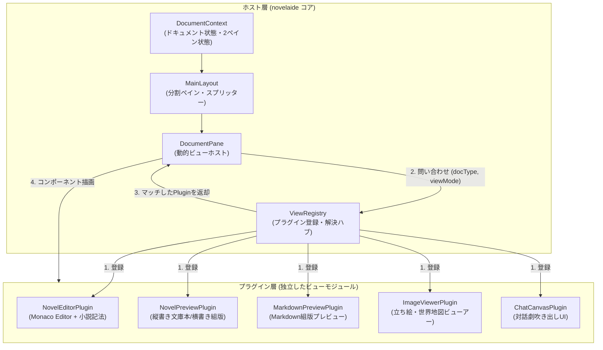

# ビュープラグインアーキテクチャ仕様

## 1. 概要と設計理念

本ドキュメントは、`novelaid` シリーズにおける **エディター・プレビュー・リーダー等の表示コンポーネントを疎結合に保ち、将来的な機能拡張や他プロジェクトへの流用を容易にする「ビュープラグイン（View Plugin）アーキテクチャ」** の設計仕様を定義するものです。

### 1.1 従来の課題
従来のエディター実装では、メインレイアウトやタブ切り替えロジック内に以下のようなハードコードされた分岐（`switch` 文や `if-else`）が存在しがちでした。

```tsx
// 従来の課題：モノリシックな条件分岐
if (documentType === 'novel') {
  if (viewMode === 'preview') return <NovelPreview />;
  return <CodeEditor />;
} else if (documentType === 'markdown') {
  if (viewMode === 'preview') return <MarkdownPreview />;
  return <MarkdownEditor />;
}
```

このアプローチには以下の問題がありました：
1. **開放閉鎖原則（OCP）の破綻**: 新しいファイル形式（`chat`, `image`, `plot`）や表示モード（`canvas`）を追加するたびに、レイアウトやコンテキストのコアコードを書き換える必要がある。
2. **流用性の低さ**: エディターやプレビューのロジックがアプリのレイアウトや独自Contextと密結合し、単体コンポーネント（npmパッケージやWebビューアー）として再利用しづらい。
3. **テスタビリティの低下**: ビューコンポーネントを独立して単体テスト・モック表示することが難しい。

### 1.2 ビュープラグインアーキテクチャの目指す姿
本アーキテクチャでは、**「コア（タブ・2ペイン・ファイル管理）」と「ビュー（表示・編集の実装）」を完全に分離** します。
すべてのビューはプラグインインターフェースに従う独立モジュールとして実装され、プラグインレジストリ（`ViewRegistry`）を通じて動的に解決・描画されます。



---

## 2. プラグインインターフェース定義

### 2.1 ドキュメントビュープロパティ (`DocumentViewProps`)
各ビューコンポーネントが受け取る標準プロパティです。ホスト側の内部状態に過剰に依存せず、必要な入出力のみを定義します。

```typescript
export interface DocumentViewProps {
  /** 対象ドキュメントの絶対パス */
  path: string;
  /** ドキュメントのテキスト内容 */
  content: string;
  /** ドキュメント種別 */
  documentType: NovelaidDocumentType;
  /** 読み取り専用モードかどうか */
  isReadOnly?: boolean;
  /** 内容変更時のコールバック (編集系プラグイン用) */
  onChangeContent?: (newContent: string) => void;
  /** 左右ペインのどちらに配置されているか ('left' | 'right') */
  paneSide?: 'left' | 'right';
  /** 追加メタデータ (YAMLフロントマター等) */
  metadata?: Record<string, any>;
}
```

### 2.2 ビュープラグイン仕様 (`DocumentViewPlugin`)

```typescript
export interface DocumentViewPlugin {
  /** 一意なプラグインID (例: 'novelaid.view.novel.editor', 'novelaid.view.novel.preview') */
  readonly id: string;
  /** 表示名 (ツールバーやタブ等で表示されるラベル) */
  readonly name: string;
  /** 対応する表示モード ('editor' | 'reader' | 'preview' | 'canvas') */
  readonly viewMode: DocumentViewMode;
  /** サポートするドキュメント種別配列 (例: ['novel', 'markdown']) */
  readonly supportedDocumentTypes: NovelaidDocumentType[];
  /** 優先度 (同一条件で競合した場合に高い値が優先。通常 0) */
  readonly priority?: number;

  /** レンダリングを行うReactコンポーネント */
  readonly component: React.ComponentType<DocumentViewProps>;

  /** ツールバーに追加配置するアクションコンポーネント (任意) */
  readonly toolbarComponent?: React.ComponentType<{
    path: string;
    viewMode: DocumentViewMode;
    paneSide?: 'left' | 'right';
  }>;
}
```

---

## 3. ビュープラグインレジストリ (`ViewRegistry`)

プラグインの一元管理、動的登録、最適なプラグインの検索を行うシングルトンレジストリです。

```typescript
export class ViewRegistry {
  private plugins: Map<string, DocumentViewPlugin> = new Map();

  /** プラグインを登録 */
  register(plugin: DocumentViewPlugin): void {
    this.plugins.set(plugin.id, plugin);
  }

  /** プラグインを解除 */
  unregister(pluginId: string): void {
    this.plugins.delete(pluginId);
  }

  /**
   * ドキュメント種別とビューモードから最適なプラグインを検索
   */
  findPlugin(
    documentType: NovelaidDocumentType,
    viewMode: DocumentViewMode
  ): DocumentViewPlugin | undefined {
    const candidates = Array.from(this.plugins.values()).filter(
      p => p.viewMode === viewMode && p.supportedDocumentTypes.includes(documentType)
    );

    if (candidates.length === 0) return undefined;

    // priority が最も高いものを優先
    return candidates.sort((a, b) => (b.priority ?? 0) - (a.priority ?? 0))[0];
  }

  /**
   * 特定のドキュメント種別がサポートしている全ビューモードを取得
   */
  getSupportedViewModes(documentType: NovelaidDocumentType): DocumentViewMode[] {
    const modes = new Set<DocumentViewMode>();
    for (const plugin of this.plugins.values()) {
      if (plugin.supportedDocumentTypes.includes(documentType)) {
        modes.add(plugin.viewMode);
      }
    }
    return Array.from(modes);
  }

  /** 登録されている全プラグインを取得 */
  getAllPlugins(): DocumentViewPlugin[] {
    return Array.from(this.plugins.values());
  }
}

export const viewRegistry = new ViewRegistry();
```

---

## 4. ホストペイン描画 (`DocumentPane`)

各ペイン（左ペイン／右ペイン）のレンダリング部です。
ハードコードされたコンポーネント呼び出しを排除し、レジストリ経由で動的にプラグインを描画します。

```tsx
export const DocumentPane: React.FC<{
  document: DocumentState;
  viewMode: DocumentViewMode;
  paneSide: 'left' | 'right';
  onChangeContent: (content: string) => void;
}> = ({ document, viewMode, paneSide, onChangeContent }) => {
  // レジストリから適切なプラグインを解決
  const plugin = viewRegistry.findPlugin(document.documentType, viewMode);

  if (!plugin) {
    return (
      <div className="empty-view-placeholder">
        <p>「{document.documentType}」形式の「{viewMode}」表示に対応するプラグインが見つかりません。</p>
      </div>
    );
  }

  const Component = plugin.component;

  return (
    <div className={`document-pane-content pane-${paneSide} view-${viewMode}`}>
      <Component
        path={document.path}
        content={document.content}
        documentType={document.documentType}
        isReadOnly={viewMode !== 'editor'}
        onChangeContent={onChangeContent}
        paneSide={paneSide}
        metadata={document.metadata}
      />
    </div>
  );
};
```

---

## 5. 初期の組み込みプラグイン一覧

| プラグインID | 名前 | 対応 ViewMode | 対応 DocumentType | 実装コンポーネント |
|---|---|---|---|---|
| `novelaid.view.editor.text` | テキストエディター | `editor` | `novel`, `markdown`, `css`, `unknown` | `CodeEditor` (Monaco Editor) |
| `novelaid.view.novel.preview` | 小説組版プレビュー | `preview` | `novel` | `NovelPreview` (横書き組版) |
| `novelaid.view.novel.reader` | 小説縦書きリーダー | `reader` | `novel` | `NovelPreview` (縦書き文庫本) |
| `novelaid.view.markdown.preview` | Markdownプレビュー | `preview`, `reader` | `markdown` | `MarkdownPreview` |
| `novelaid.view.image.viewer` (Phase 5) | 画像ビューアー | `reader` | `image` | `ImageViewer` |
| `novelaid.view.chat.canvas` (Phase 5) | 会話劇キャンバス | `canvas` | `chat` | `ChatCanvas` |

---

## 6. 将来の独立パッケージ化・流用ロードマップ

本アーキテクチャにより、以下の独立モジュール化（npmパッケージ化やWebサイトでの再利用）が可能になります。

1. **`@novelaid/novel-preview`**:
   - 縦書き文庫本組版エンジン（`writing-mode: vertical-rl`、フォントサイズ・行間制御、ルビ・傍点レンダリング、用紙テクスチャ）。
   - 小説投稿サイトや作者自身のWebサイト、ポートフォリオで「自作小説を縦書き文庫風に読ませるWebパーツ」としてそのまま流用可能。
2. **`@novelaid/monaco-novel`**:
   - 小説専用のMonaco Editorトークナイザー（会話文色分け、ルビ記法、全角スペース枠可視化、三点リーダー補完）。
   - 他のデスクトップツールやWeb版エディターに即座に組み込み可能。
3. **サードパーティ拡張（ユーザー自作プラグイン）**:
   - 将来的に外部からJSスクリプトを読み込み、ユーザーが自作のプレビューアやグラフビューを `viewRegistry.register()` で追加できるエコシステムへと発展可能。
