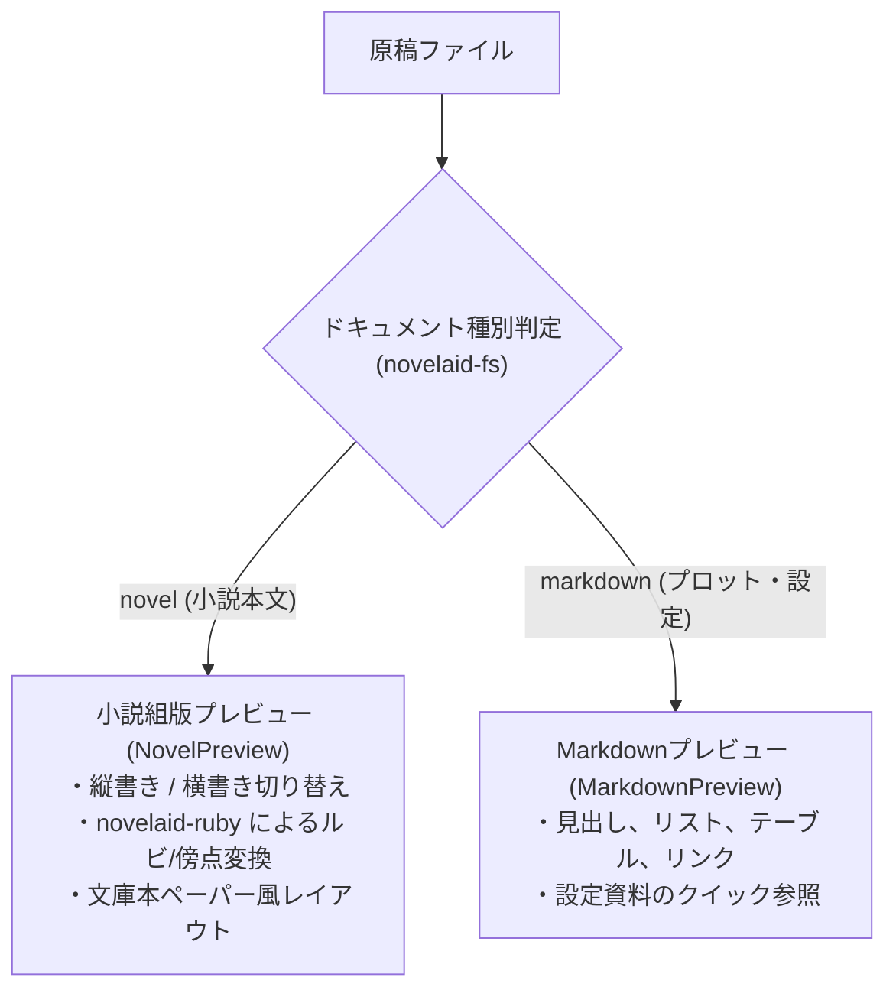

# プレビューおよびスプリットビュー共通仕様

## 1. 概要と設計理念

本ドキュメントは、`novelaid` シリーズ（`novelaid-editor`, `novelaid-editor-next`, `novelaide`）における **小説プレビュー（縦書き・横書き）、Markdownプレビュー、およびエディターとの分割表示（スプリットビュー）** の共通仕様と設計理念を定義するものです。

### なぜ小説執筆においてプレビューが必要なのか（設計理念）
1. **「書く画面」と「読む画面」の認知的ギャップ**:
   エディターは「文字を入力・編集するための作業場」であり、記号や全角スペース枠などの編集用補助情報が表示されます。一方、読者が手にする書籍やWeb画面は「純粋な組版結果」です。執筆中にワンクリックで「読者の視点」に切り替えられることが、推敲の質を決定づけます。
2. **縦書き組版におけるリズムの確認**:
   日本の商業出版や同人誌、文庫本の多くは **縦書き（右から左へ進行）** です。横書きのエディターで書いているときには気づきにくい「行頭の揃い」「会話文の連続感」「三点リーダーの長さ」は、縦書きプレビューで確認して初めてリズムの乱れに気づくことができます。
3. **ルビ（ふりがな）・傍点の実際の見え方確認**:
   ルビ（`｜親文字《るび》`）が実際に文字の上にどう乗るのか、傍点がどう打たれるかを、ブラウザネイティブの `<ruby>` / `<rt>` 組版で確認できます。

---

## 2. プレビューの2大モード

ドキュメント種別および作家の用途に応じて、2種類のプレビューモードを提供します。



### 2.1. 小説組版プレビュー (`NovelPreview`)
* **対象**: 小説本文ファイル（`.txt`, `novel` 種別）。
* **ルビ・傍点変換**: 共通ライブラリ **`novelaid-ruby`** の `transformToHtml(text)` を使用し、カクヨム・なろう記法を標準の `<ruby>親文字<rt>るび</rt></ruby>` および傍点スタイルに自動変換。
* **縦書き／横書き切り替え**:
  - **縦書きモード (`vertical-rl`)**: 本のページのように右から左へスクロール。文庫本を思わせるペーパーシャドウと余白。
  - **横書きモード**: Web投稿サイト（小説家になろう、カクヨム等のPCブラウザ表示）を想定した標準横書き。
* **ワンクリック切り替え**: ツールバーのボタン（`[横書きへ]` / `[縦書きへ]`）で瞬時に表示方向をトグル。

### 2.2. Markdownプレビュー (`MarkdownPreview`)
* **対象**: プロット、世界観設定、登場人物資料（`.md`, `markdown` 種別）。
* **標準Markdown組版**: 見出し（H1〜H6）、箇条書き、太字、表（Table）、引用等を美しく整形。
* **内部リンク連携**: 作品内の別ドキュメント（例: `[登場人物一覧](./characters/index.md)`）へのリンククリックで、対象ファイルをエディターに自動オープン。

---

## 3. スプリットビュー（エディターとプレビューの分割・連動）

作家の執筆スタイルに合わせて、以下の2つの画面配置をシームレスに切り替えられます。

```
【単一ビュー (Full Editor)】
+-------------------------------------------------------+
|  エディタータブバー                                   |
+-------------------------------------------------------+
|                                                       |
|   本文エディター (Monaco Editor)                      |
|                                                       |
+-------------------------------------------------------+
|  ステータスバー (文字数・行数)                        |
+-------------------------------------------------------+

【スプリットビュー (Split Editor & Preview)】
+-------------------------------------------------------+
|  エディタータブバー                      [プレビュー閉じる] |
+---------------------------+---------------------------+
|                           | [横書きへ]                |
|   左: 本文エディター      |   右: 縦書きプレビュー    |
|   (リアルタイム入力)      |   (リアルタイム反映)      |
|                           |                           |
+---------------------------+---------------------------+
|  ステータスバー (文字数・行数)                        |
+---------------------------+---------------------------+
```

### 3.1. リアルタイム連動
* 左側のエディターで文章を編集すると、右側のプレビューが即座に最新の組版結果へ再描画されます。
* 思考を中断せずに、「入力しながら完成形を横目で確認する」スムーズな推敲が可能です。

### 3.2. スプリット比率の調整
* 境界バー（スプリッター）をドラッグすることで、エディターとプレビューの幅比率（例: 50:50、70:30 等）を自由に変更できます。

---

## 4. テーマ設計との調和

プレビュー画面も、アプリ全体のテーマシステム（ダーク／ライト／セピア）と完全に連動します。

* **ダークモード**: まぶしさを抑えたダークグレーの用紙と読みやすい明朝体テキスト。
* **ライトモード**: 清潔感のある白用紙とクッキリした活字。
* **セピアモード**: **【小説プレビューの真骨頂】**。文庫本の印刷用紙（クリームキンマリ）を模した温かみのある生成り色用紙（`#F4ECD8`）と墨色の文字により、まるで実際の文庫本を読んでいるかのような没入感を提供。

---

## 5. 新旧エディターの実装と novelaide での改善点

* **現行（novelaid-editor）**:
  - `NovelPreview.tsx` と `MarkdownPreview.tsx` が個別に実装され、縦書き組版と `novelaid-ruby` 変換の実績を確立。
* **新世代（novelaide）での改善**:
  - **`novelaid-ruby` の `transformToHtml` を標準パイプラインとして一本化**: ルビ・傍点・全角スペースの解析をエディター側と完全に同一のエンジンで行い、表示のズレを根絶。
  - **CSS変数ベースの軽量縦書きスタイル**: 重厚な外部CSSに依存せず、TauriのWebview2ネイティブなCSS縦書き組版（`writing-mode: vertical-rl; text-orientation: upright;`）を最大限に活用。
