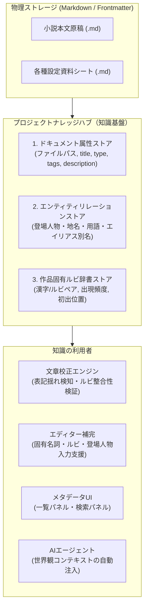

# プロジェクトナレッジ基盤仕様（広義のメタデータ・知識ハブ概念）

## 1. 概要と背景

小説の執筆において「メタデータ」とは、単にファイル先頭に付与された YAML Frontmatter（狭義のメタデータ）に留まりません。
長編小説を矛盾なく執筆・推敲するためには、**「登場人物シート」「地名・世界設定資料」「本文中に出現する固有ルビの履歴」** などの作品知識全般（広義のメタデータ）をプロジェクト全体から収集・構造化し、エディターや校正エンジン、AI執筆パートナーへ即座に供給できる **「ナレッジハブ（知識基盤）」** が不可欠です。

本仕様は、小説エディターシリーズにおけるプロジェクト知識基盤の概念とデータ提供モデルを定義するものである。

---

## 2. 知識基盤の構造モデル

ナレッジハブは、物理ファイルI/Oから完全に分離されたインメモリ知識ストアとして構築され、以下の3つのサブストアから構成される。

### 2.1 3大知識サブストア
1. **ドキュメント属性ストア (`MetadataCache`)**:
   - プロジェクト内の全ファイルの `title`, `type`, `tags`, `description`, `mtime`（更新日時）をキャッシュ。
   - 高速なフォルダ走査や目次生成の基底データとなる。
2. **エンティティリレーションストア (`EntityStore`)**:
   - `character` や `location` などの設定資料から、正式名称（`name`）、読み（`reading`）、作中役割（`role`）、および別名リスト（`aliases`）を抽出・インデックス化。
   - 「ソラ・アルスター」「ソラ」「アルスター」「ソラくん」などの表記を同一人物として名寄せ（リレーション化）し、校正やAIへのコンテキストとして提供。
3. **作品固有ルビ辞書ストア (`RubyDictionaryStore`)**:
   - 小説本文（`content`）に出現するルビ記法（例: `｜神代《かみしろ》`, `｜魔法《マギ》`）を自動走査。
   - 漢字とルビの対応関係、出現頻度、作品内での初出章などを追跡。
   - 表記揺れ（同じ漢字に異なるルビが振られているケースなど）を検知可能にする。

---

## 3. クライアント機能へのナレッジ供給モデル

- **文章校正への供給**:
  - 本文中の単語が「登録されている登場人物の別名」であるかを判定し、誤記（タイポ）や表記揺れを警告する。
  - ルビ辞書と照合し、一般的な読みと異なる特殊ルビの整合性を検証する。
- **エディター補完（IntelliSense）への供給**:
  - 作家が文字を入力した際、ナレッジハブから該当する登場人物名や世界観用語、ルビ記法をサジェスト候補として提供する。
- **AI執筆パートナーへの供給**:
  - AIプロンプトの実行時、関係する登場人物設定や世界観ルールを動的にコンテキストへ注入し、ハルシネーション（設定無視）を防止する。
