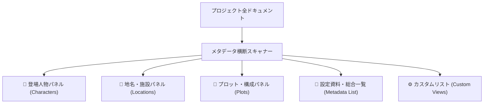

# メタデータリストパネル仕様（UI概念・要件）

## 1. 概要と目的

本ドキュメントは、小説執筆用エディターにおいて、プロジェクト内に存在する多数のファイルから YAML Frontmatter メタデータ（タグや種別、属性）を自動収集し、カテゴリごとに分類・一覧表示する **メタデータリストパネル（`MetadataListPanel`）** のUI概念および機能要件を定義するものである。

本仕様は、特定の実装（Electron版、Next.js版、Tauri版等）に依存せず、すべてのクライアントアプリが提供すべき横断カタログ機能の要件を規定する。

---

## 2. パネル構成モデル

メタデータリストパネルは、サイドペイン（主に左ペインのアクティビティバー、またはエクスプローラーパネルのアコーディオンセクション）に配置され、以下のカテゴリを提供・展開する。

### 2.1 標準固定カテゴリ
1. **👤 登場人物パネル (`character` 系統)**:
   - `character`, `登場人物`, `人物`, `chara` などのタグを持つファイルを網羅。
   - 作中役割（`role`）別（主人公・主要人物、サブ、敵対、その他）のアコーディオン事前分類表示。
2. **📍 地名・施設パネル (`location` 系統)**:
   - `location`, `places`, `place`, `地名`, `施設`, `場所`, `舞台`, `世界観`, `拠点`, `国`, `都市` 等のタグを持つファイルを網羅。
   - 地域や勢力別の階層表示。
3. **📜 プロット・構成パネル (`plot` 系統)**:
   - `plot`, `構成`, `案`, `timeline`, `時間軸`, `年表`, `章`, `エピソード` 等のタグを持つファイルを網羅。
   - 巻・本別、章別のアコーディオン分類。
4. **🔖 設定資料・総合一覧パネル**:
   - プロジェクト内の全設定資料を横断的に閲覧・検索できる総合カタログ。

### 2.2 ユーザー定義カスタムリスト
- ユーザーが任意の抽出条件（例: `tags: [魔法, 詠唱]`, `type: spell`）を指定して独自のリスト枠を作成・命名・保存できる機能。

---

## 3. インタラクション要件

### 3.1 フィルタリングと検索
- **シリーズ・巻セレクタ**:
  - メタデータの `series`（シリーズ名）や `books`（巻番号・巻名）に基づいて、長編シリーズ内の特定巻のみを絞り込み表示する。
- **複数タグ AND 絞り込み**:
  - 複数のタグを選択することで、すべての条件に一致する設定資料のみを動的に抽出する。
- **インクリメンタル検索**:
  - 検索窓に入力されたテキストに基づき、タイトル（`title`）、表示名（`name`）、フリガナ（`reading`）、概要（`description`）、タグ（`tags`）をリアルタイムに絞り込み検索する。

### 3.2 エディターとの連携
- **ワンクリックオープン**:
  - 一覧内のカードやアイテムをクリックすると、中央エディターで該当ファイルがアクティブタブとして即座に開く。
- **ドラッグ＆ドロップ（DnD）連携**:
  - 一覧からアイテムをドラッグし、執筆中のエディター本文へドロップすることで、該当エンティティの名称やルビ記法、リンクを挿入可能とする。
- **ファイル変更への自動追従**:
  - ファイルの保存や外部変更によってメタデータが更新された際、画面のリロードを伴わずに一覧の表示内容が自動的に再フェッチ・同期されること。
