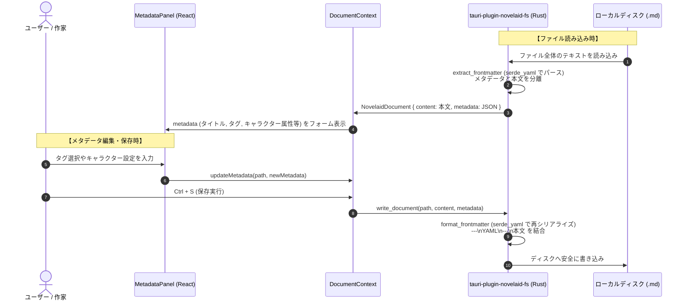
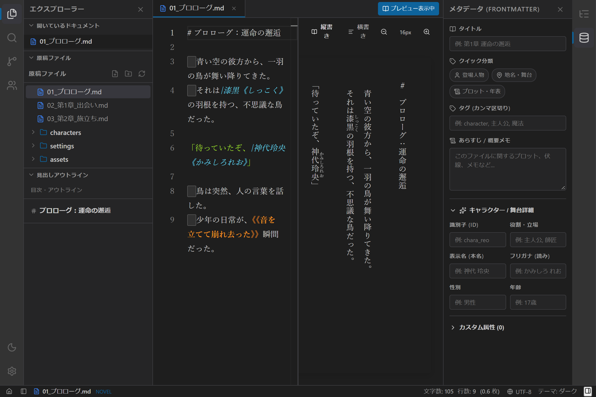

# メタデータ管理およびFrontmatter編集実装仕様書

## 1. 概要と背景

小説の執筆において、キャラクター設定、地名・施設、プロット、伏線、年表などの「設定資料」は作品のクオリティを左右する重要な情報です。
本仕様は、**`novelaide`** において Markdown ファイル先頭の **YAML Frontmatter** を活用し、執筆者が設定資料や原稿の属性を直感的に閲覧・入力できる **メタデータ管理機能（`MetadataPanel` / `MetadataListPanel`）** の実装仕様を定義するものです。

先行プロジェクトである `novelaid-editor`（Electron版）および `novelaid-editor-next`（Tauri版）の知見を継承し、`novelaide` の統合UIプラグインアーキテクチャ（`PanelRegistry`）に完全に適合した疎結合な形で実装します。

---

## 2. アーキテクチャ設計

Frontmatter の実際の抽出（パース）および保存時の再結合（シリアライズ）は、**Rust 側（`tauri-plugin-novelaid-fs`）** のネイティブ処理（`serde_yaml`）によって安全・高速に行われます。
フロントエンドは純粋な小説本文と JSON メタデータオブジェクトを受け取り、`MetadataPanel` から `updateMetadata` を呼び出すだけでディスクへの YAML 変換・保存が完結します。

---

## 3. 機能要件

### 3.1 Rustバックエンドとフロントエンドの同期基盤
1. **パース（読み込み / `tauri-plugin-novelaid-fs`）**:
   - `read_document` 実行時、Rust側が `extract_frontmatter`（`serde_yaml`）で先頭の `---\n...---\n` をパース。
   - エディターには純粋な小説本文（`content`）のみが渡され、メタデータは `metadata: serde_json::Value` として分離されます。
2. **シリアライズ（保存 / `tauri-plugin-novelaid-fs`）**:
   - `write_document` 実行時、Rust側が `format_frontmatter`（`serde_yaml::to_string`）でメタデータを YAML 化し、先頭に `---\n...---\n` を付与して本文と結合した上でディスクに書き込みます。
3. **フロントエンド状態管理 (`DocumentContext`)**:
   - `DocumentState` に保持されている `metadata` を、`updateMetadata(path: string, metadata: Record<string, any>)` によって更新・ダーティフラグ（`isDirty: true`）管理します。

### 3.2 ドキュメントメタデータ編集パネル (`MetadataPanel`)
右ペイン用プラグイン（`novelaid.panel.metadata` / アイコン: `Database` または `Tag` / `defaultPlacement: 'right'`）として提供。

1. **基本プロパティ**:
   - **タイトル (`title`)**: ドキュメントの正式名称や話数タイトル
   - **クイック分類タグ (`tagGroups`)**:
     - 👤 **登場人物** (`character` / `chara`)
     - 📍 **地名・施設** (`location` / `place`)
     - 📜 **プロット・年表** (`plot` / `timeline`)
     - ワンクリックでトグル追加/削除可能
   - **タグ入力欄 (`tags`)**: カンマ区切りの自由なキーワードタグ
   - **あらすじ / 概要メモ (`summary` / `description`)**: 複数行テキストエリア
2. **キャラクター・設定資料用 詳細プロパティ**:
   - **ID (`id`)**: 固有識別子（例: `chara_reo`）
   - **表示名 / 本名 (`name`)**: キャラクター名（例: `神代 玲央`）
   - **フリガナ (`reading`)**: 読み仮名（例: `かみしろ れお`）
   - **年齢 / 性別 (`age`, `gender`)**: 属性情報
   - **立場・役割 (`role`)**: 主人公、ヒロイン、敵役など
3. **カスタムフィールドの動的追加・削除**:
   - ユーザーが独自のキー（例: `magic_attribute`, `birthday`, `faction` など）と値を自由に追加・削除できる拡張フォーム。

### 3.3 プロジェクト設定資料・登場人物一覧パネル (`MetadataListPanel`)
プロジェクト内の全ファイルからメタデータを抽出し、カテゴリごとに一覧・検索・クイックアクセスできるパネル。

- **登場人物一覧**: `character` タグを持つファイル（キャラクター設定シート）を一覧表示。クリックでそのファイルを開く。
- **地名・世界観一覧**: `location` タグを持つファイルの一覧表示。
- **プロット・構成一覧**: `plot` タグを持つファイルの一覧表示。

---

## 4. UIデザイン方針

- **右ペインとの自然な統合**:
  - 見出しアウトライン（`novelaid.panel.outline`）と並ぶ右ペインの第2パネルとして配置。
  - 右アクティビティバーに `Database` または `Tags` アイコンを追加。
- **テーマ連動**:
  - ダーク・ライト・セピアの各テーマに最適化された入力フォーム、ボタンスタイル、バッジ配色。
- **キーボードショートカット**:
  - `Ctrl + Shift + M`（macOS: `Cmd + Shift + M`）でメタデータパネルの表示/非表示をトグル可能にする。

---

## 5. 段階的実装計画（全4ステップ）

| ステップ | 作業内容 | 対象ファイル |
| :--- | :--- | :--- |
| **Step 1** | **Frontmatter パース & 双方向同期基盤の構築** - YAMLパース/シリアライズユーティリティの導入 - `DocumentContext` への `metadata`, `updateMetadata` 統合 | `src/utils/frontmatter.ts` `src/contexts/DocumentContext.tsx` `src/types/document.ts` |
| **Step 2** | **ドキュメントメタデータ編集パネルの実装** - `MetadataPanel` コンポーネント作成 - 基本情報、クイックタグ、キャラクター属性、カスタムフィールド - 右ペインプラグイン（`novelaid.panel.metadata`）登録 | `src/components/Metadata/MetadataPanel.tsx` `src/components/Metadata/MetadataPanel.css` `src/plugins/panels/MetadataPanelPlugin.tsx` `src/core/panelRegistry/index.ts` |
| **Step 3** | **設定資料・登場人物一覧パネルの実装** - プロジェクト横断でのタグ別メタデータ抽出フック - `MetadataListPanel` コンポーネント作成 - アコーディオンツリーによる一覧・ワンクリックオープン | `src/hooks/useProjectMetadata.ts` `src/components/Metadata/MetadataListPanel.tsx` `src/plugins/panels/MetadataListPanelPlugin.tsx` |
| **Step 4** | **検証・自動スクリーンショット撮影 & ドキュメント更新** - Playwright撮影スクリプト更新（メタデータパネル表示状態） - `docs/manual/メタデータと設定資料の使い方.md` 作成 - メイキング連載第16回記事の執筆と目次更新 - バージョン更新 & Gitコミット | `scripts/capture-screenshots.js` `docs/manual/メタデータと設定資料の使い方.md` `making/notes/16_メタデータ管理とFrontmatter編集パネルの実装.md` `making/logs/2026-10-24.md` |

---

## 6. UIスクリーンショット

