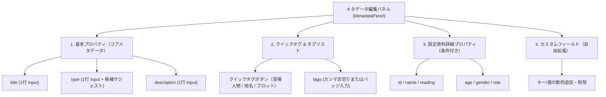

# メタデータ編集パネル仕様（UI概念・要件）

## 1. 概要と目的

本ドキュメントは、小説執筆用エディターにおいて、エディターで開いている個別ドキュメントの属性（YAML Frontmatter）を作家が直感的に閲覧・編集するための **メタデータ編集パネル（`MetadataPanel`）** のUI概念および機能要件を定義するものである。

本仕様は、特定の実装フレームワーク（React, Vue, Svelte, DOM直接操作 等）に依存せず、すべてのクライアントアプリが共通して提供すべきユーザーインターフェースとしての要件を規定する。

---

## 2. パネルの配置と表示モデル

- **配置位置**: エディター画面のサイドペイン（推奨: 右ペイン）。見出しアウトライン等と並ぶ補助ツールとして提供される。
- **アクティブドキュメント連動**: 中央エディターで現在アクティブになっているタブ（ドキュメント）のメタデータを自動追従して表示する。未保存状態のメタデータ変更は、ドキュメントのダーティ状態（未保存フラグ）と連動する。
- **ショートカット**: キーボードショートカット（例: `Ctrl + Shift + M`）により、エディターから手を離さずにパネルの開閉・トグルが可能であること。

---

## 3. UIコンポーネント構成と入力要件

### 3.1 コアメタデータ編集フォーム（基本プロパティ）
将来的な目次（`index.md`）自動生成との連携を視野に入れ、一覧性と入力しやすさを両立した1行入力インターフェースを提供する。

1. **タイトル (`title`)**:
   - 1行テキスト入力。ドキュメントの正式名称や話数タイトル。
   - `index.md` 生成時のリンク表記や一覧の項目名として使用される。
2. **種別 (`type`)**:
   - 1行テキスト入力（入力候補サジェスト付き）。
   - 代表的なプリセット（`chapter`, `character`, `location`, `plot`, `index`, `memo` 等）を選択肢として提示しつつ、任意の自由入力を許容する。
   - オプショナル型であり、未入力時は Frontmatter にキー自体を出力しない。
3. **概要 (`description`)**:
   - 1行テキスト入力。ドキュメントの要約・1行説明。
   - 目次やカタログでの一覧性・視認性を重視し、1行テキストとして入力させる。
   - ※ 複数行メモやあらすじ（`summary` 等）が既存ドキュメントに含まれている場合でも、システムがそれを勝手に消去・強制変換してはならない。

### 3.2 タグ編集とクイックタグ
1. **クイックタグトグル群**:
   - ワンクリックで代表的な分類タグを付与・解除できるショートカットボタン群。
   - 👤 **登場人物** (`character` 系統のタグをトグル)
   - 📍 **地名・施設** (`location` 系統のタグをトグル)
   - 📜 **プロット・年表** (`plot` 系統のタグをトグル)
2. **自由タグ入力**:
   - カンマ区切り入力、または個別タグバッジ形式によるタグの自由な追加・削除。

### 3.3 設定資料・キャラクター詳細プロパティ
ドキュメントに `character` や `location` などの設定資料タグが付与されている場合（またはユーザーが展開を選択した場合）、以下の詳細プロパティ入力フォームを提供する。
- **`id`**: 固有識別子
- **`name`**: 正式名称・表示名
- **`reading`**: 読み仮名・フリガナ
- **`age` / `gender`**: 年齢・性別
- **`role`**: 作中での役割（主人公、ヒロイン、敵役等）

### 3.4 カスタムフィールドの動的拡張
- ユーザーが独自のキー（例: `magic_attribute`, `birthday`, `faction` など）と値を自由に追加・編集・削除できる拡張リスト。
- ユーザー任意のキー（`summary` 等）もカスタムフィールドとして透過的に表示・編集される。

---

## 4. データ反映とクリーンアップ原則

1. **空値の自動削除**:
   - パネル上で入力値を空文字（`""`）にした、またはタグを全削除して空配列（`[]`）にした場合、Frontmatter 内部に空のキーを残さず、キー自体を削除して保存する。
2. **非破壊性**:
   - パネル上に専用入力欄が存在しない未知のキーであっても、保存時に破棄せず透過的に維持する。
