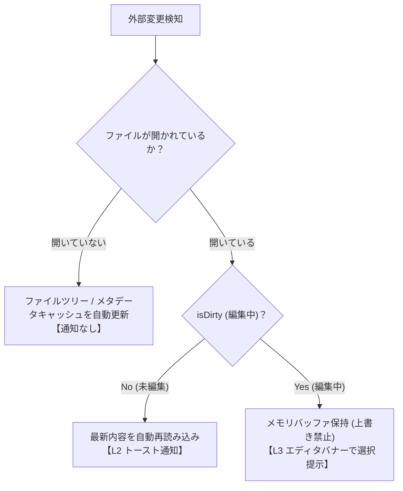

# 外部ファイル変更検知および競合制御方針仕様

## 1. 概要と共通理念

小説執筆用エディターシリーズ（`novelaid-editor`, `novelaide`, `novelaid-cli`）において、原稿ファイルが外部ツール（Git、外部エディター、スクリプト等）によって変更された場合の検知方式、およびユーザーの執筆内容を保護するための競合制御のシリーズ共通方針を定義します。

### 1.1. 小説執筆における競合制御のコア理念
1. **作家の思考と執筆の没入を絶対阻害しない**:
   - 執筆中に突如モーダルダイアログがポップアップし、思考を遮断したり操作を強制することを禁止します。
2. **作家のメモリ上の未保存原稿（Dirty）を最優先で保護する**:
   - 外部変更があった場合でも、作家が編集中である原稿を勝手に上書き・破棄することは決して行いません。
3. **自己保存エコー（自作自演イベント）の徹底排除**:
   - アプリ自身が保存した処理によって外部変更と誤認し、作家を混乱させる不具合を設計レベルで防止します。

---

## 2. 検知方式の方針比較と新世代での採用

| 方式 | 概要 | 利点 | 課題 / 欠点 | シリーズでの位置付け |
| :--- | :--- | :--- | :--- | :--- |
| **方式A: ウィンドウフォーカス復帰時オンデマンド検証** | ウィンドウ復帰時（`window.onfocus`）にのみ開いているファイルのタイムスタンプ（`mtime`）を検証 | ・執筆中の誤判定リスクが原理的にゼロ ・リソース消費最小 ・作家の認知モデル（他ツールから戻る）と合致 | 他ツール編集時、フォーカスを戻すまで画面が更新されない | **新標準（novelaide採用）** |
| **方式B: バックエンド常時監視（Watcher）** | chokidar / notify によるディレクトリ常時監視 | 他モニター等での変更もリアルタイム反映 | ・自己保存エコー対策が極めて複雑 ・OSのI/Oイベント多重発火の調停が困難 ・リソース消費 | 現行 `novelaid-editor` で採用（誤判定ダイアログ課題あり） |
| **方式C: AIエージェント書き込み調停** | エディター専用API経由の安全書き込み | 外部変更扱いにならず、エディター状態と即時調停可能 | - | **シリーズ共通（AIツール統合仕様）** |

---

## 3. 共通競合制御マトリクス

外部変更を検知した際の振る舞いは、シリーズ各アプリ共通で以下のルールに従います。

1. **開いていないファイル**:
   - 原稿本文の競合は存在しないため、ファイルツリーやメタデータキャッシュをサイレント更新（通知なし）します。
2. **開いているファイル（未編集 / `isDirty: false`）**:
   - 作家の未保存テキストと競合しないため、最新内容を自動再読み込みし、邪魔にならないトースト通知（3秒程度で自然消滅）で通知します。
3. **開いているファイル（編集中 / `isDirty: true`）**:
   - **作家の入力内容を最優先で保護**します。
   - 作業を遮断するモーダル確認ダイアログ（`dialog:confirm`）は出さず、エディター上部のインラインバナー（L3）に「外部で変更されました [最新を取り込む] [現在の編集を保持]」を提示し、作家のタイミングで解決できるようにします。

---

## 4. タイムスタンプフィードバックの共通要件

ファイル保存および読み込みAPIは、必ず**ファイルシステム上の確定した最終更新日時（`mtime`）をフロントエンドへフィードバック**しなければなりません。
フロントエンドはドキュメント状態（`DocumentState`）に `mtime` を保持し、ディスク上の最新タイムスタンプと比較することで、高速かつ確実に外部変更を判定します。
