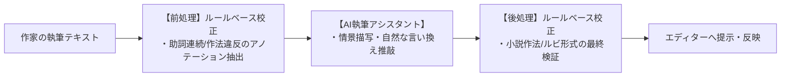

# 日本語文章校正および形態素解析共通仕様

## 1. 概要とシリーズ共通理念

本仕様は、小説執筆用エディターシリーズ（`novelaid-editor`, `novelaide`, `novelaid-cli`）における**日本語文章校正（Calibration / Proofreading）**および**形態素解析基盤**の共通アーキテクチャと基本方針を定義する。

### 1.1. コア設計方針
1. **AIを使用しないルールベース・形態素解析の高速ローカル処理**:
   - 外部APIやLLMに依存せず、完全ローカルかつオフラインで動作し、ミリ秒単位で確実な指摘を行う。
2. **形態素解析エンジン（Lindera）による共通化**:
   - Rust（Tauri版）および Node.js/Wasm（Electron/CLI版）の両系統で、共通して **`Lindera`** を採用し、辞書・ユーザー辞書（キャラクター名・造語）の相互運用性を確保する。
3. **AI機能との多層的パイプライン（前処理・後処理）**:
   - AI推敲前の前処理（タイポ・作法違反のアノテーション付与）およびAI生成文の後処理（小説作法適合チェック）として連携する。
4. **形態素解析を活用したルビ（ふりがな）支援**:
   - 形態素の「読み」情報を用いたルビ候補自動推測と、作品内でのルビ揺れ検出・一括管理を提供する。

---

## 2. 共通校正ルール体系

| 分類 | ルール項目 | 対象・判定内容 |
| :--- | :--- | :--- |
| **文法・語法** | 助詞の連続検知 | 一文内に同一助詞（「の」「が」「を」等）が一定回数以上連続する重複の検出 |
| | ら抜き言葉検知 | 「見れる」「来れる」等のら抜き言葉の検出と正規表現への修正提案 |
| | 二重否定検知 | 「〜ないわけではない」等の過度な二重否定の抑制 |
| **小説固有作法** | 三点リーダー・ダッシュ | `……` `――` の2マス（偶数）ルール違反の検出 |
| | 会話文末の句点 | `「〜〜。」` となっている場合の句点除去提案 |
| | 感嘆符後の全角空白 | 文中感嘆符（`！` `？`）直後の全角スペース欠落の検出 |
| | 文末表現の連続重複 | 同一助動詞（「〜た。〜た。〜た。」等）の連続による単調さの警告 |
| **表記・用字** | 漢字の開き | 形式名詞（「事→こと」「時→とき」「所→ところ」等）の平仮名推奨 |
| | 固有名詞・表記揺れ | 設定資料（キャラクター名・地名）の辞書と本文の表記不統一検出 |

---

## 3. 形態素解析とルビ支援

1. **ルビ候補の自動推測**:
   - 単語の漢字部分に対し、形態素解析結果の「読み」から `｜親文字《ルビ》` 形式を自動生成。
2. **ユーザー辞書の動的登録**:
   - 登場人物設定や世界観用語から、簡易CSV形式（表層形・品詞・読み）でユーザー辞書を動的構築し、新語・造語の誤分割を防止。
3. **ルビ揺れの検出**:
   - 同一原稿内で同じ単語に異なるルビが振られているケース（例: `｜魔導《まどう》` と `｜魔導《マジック》`）の可視化。

---

## 4. AI連携パイプライン（前処理・後処理）

