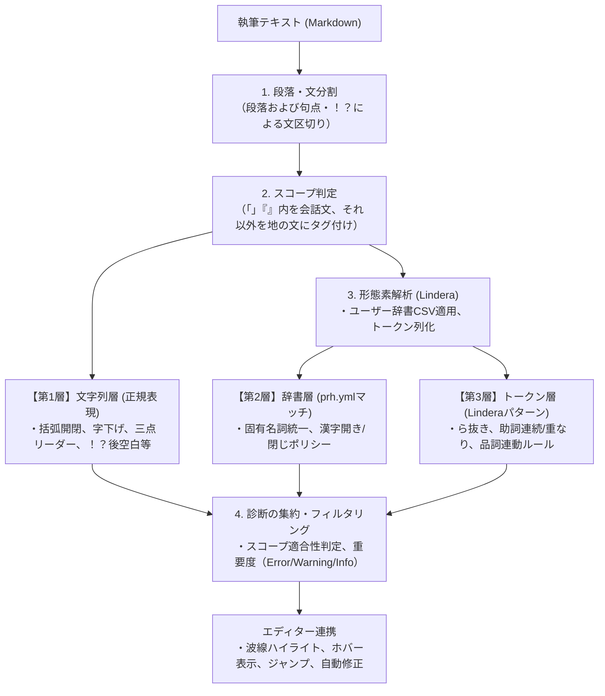

# 日本語文章校正および形態素解析共通仕様

## 1. 概要とシリーズ共通理念

本仕様は、小説執筆用エディターシリーズ（`novelaid-editor`, `novelaide`, `novelaid-cli`）における**日本語文章校正（Calibration / Proofreading）**および**形態素解析基盤**の共通アーキテクチャ、全校正ルール体系、および各アプリの対応状況・ロードマップを定義する。

### 1.1. コア設計方針
1. **技術文書用プリセットの無条件適用禁止と小説作法の優先**:
   - 一般的な技術文書向け校正（例: `preset-ja-technical-writing`）は一文の長さ制限、読点数制限、！？の禁止など、小説の表現技法と正面から衝突する。小説向けに大幅緩和・反転・スコープ限定したルール設計を標準とする。
2. **AIを使用しないルールベース・形態素解析の超高速ローカル処理**:
   - 外部APIやLLMに依存せず、完全ローカルかつオフラインで動作し、執筆中のエディター上でミリ秒単位の即時フィードバックを提供する。
3. **処理の3層アーキテクチャ（3-Layer Model）**:
   - すべてを形態素解析に依存させるのではなく、処理コストと誤検出率に応じて以下の3層に明確に分離する：
     - **第1層：文字列層（正規表現・段落処理）** - 括弧対応、字下げ、三点リーダー、記号重複等
     - **第2層：辞書層（prh.yml互換マッチ）** - 固有名詞統一、漢字開き／閉じ、表記統一等
     - **第3層：トークン層（Lindera形態素列パターン）** - ら抜き言葉、助詞の連続・重なり等
4. **スコープ制御（地の文／会話文の分離）の標準化**:
   - 会話文（セリフ）はキャラクターの口調や口語表現であるため、文法規則や文体統一の対象から除外（または個別制御）する。
5. **2種類の辞書資産の共通化**:
   - **Lindera ユーザー辞書CSV**（分割・読み用）と **prh.yml 辞書**（表記統一・ゆれ検出用）の役割を明確に分担し、アプリ間で辞書資産を共有する。
6. **形態素解析とルビ支援の統合**:
   - 形態素解析結果の「読み」情報を用いたルビ候補自動推測と、青空文庫形式ルビの動的生成を連携させる。

---

## 2. アーキテクチャと処理パイプライン

校正エンジンは「前処理で範囲を決定し、層ごとに判定して診断（Diagnostics）として集約する」パイプラインで動作する。

### 2.1. スコープ制御仕様
* **会話文の判定**:
  - `「` 〜 `」` および `『` 〜 `』` で囲まれた範囲を「会話文（Dialogue）」として抽出する。
  - 括弧が閉じられていない異常な箇所は「スコープ不明」として文法系ルールの適用をスキップする。
* **地の文の判定**:
  - 会話文以外のすべてのテキストを「地の文（Narration）」として扱う。
* **ルールの適用指定**:
  - 各校正ルールは `scope: "narration"`（地の文のみ）、`scope: "dialogue"`（会話文のみ）、`scope: "both"`（両方）の適用スコープ属性を持つ。

---

## 3. 校正ルール詳細仕様

全34ルールの定義、重要度、実装方式、および適用スコープの仕様を以下に定義する。

### 重要度の定義
* **◎ ほぼ必須 (Must / Error)**: 明らかな作法違反、タイプミス、固有名詞の誤用など。
* **○ あると助かる (Recommended / Warning)**: 助詞連続、送り仮名のゆれ、文体統一など。
* **△ 作品の方針次第 (Optional / Info)**: 二重否定、冗長表現、一文の長さ、読点数など。
* **× 小説では無効化推奨 (Disabled)**: 技術文書用の厳格な読点上限（3個）、！？の使用禁止など。

### 3.1. A分類：体裁・タイプミス系（文字列層中心）

| ID | ルール名 | 重要度 | 方式 | スコープ | 詳細仕様・判定条件 |
| :--- | :--- | :---: | :--- | :--- | :--- |
| **A-01** | **括弧の対応** | ◎ | 文字列 | 両方 | `「` `」`、`『` `』`、`（` `）`、`(` `)` の開閉不一致、閉じ忘れ、ネストの破綻を検出。 |
| **A-02** | **字下げ** | ◎ | 文字列 | 段落 | 段落冒頭の全角スペース欠落を検出。ただし、会話文の開始括弧（`「`、`『`等）から始まる行は字下げ不要（除外）。 |
| **A-03** | **閉じ括弧前の句読点** | ◎ | 文字列 | 両方 | `「〜〜。」` や `『〜〜、』` のように、閉じ括弧直前に句読点（`。` `、`）がある場合に除去を提案。 |
| **A-04** | **！？の後のスペース** | ◎ | 文字列 | 両方 | **【厳密仕様】** 感嘆符・疑問符（`！` `？` `!` `?`）の**直後に文章（文字）が続く場合のみ**全角スペースを要求。 ※ **直後が行末、閉じ括弧（`」` `』` `）` `)` `】` `〉` `》` `”` `"`等）、または別の感嘆符・疑問符（`！？` `！！`等）の場合はスペース不要（正常）。 |
| **A-05** | **三点リーダー／ダッシュ** | ◎ | 文字列 | 両方 | 三点リーダー（`…`）は2つ組（`……`）、ダッシュ（`―`）は2つ組（`――`）の偶数個で使用する作法。奇数個（1個、3個等）の連続を検出。中黒（`・・・`）の代用も警告。 |
| **A-06** | **同一文字・記号の重複ミス** | ◎ | 文字列 | 両方 | `、、` や `。。` の句読点連続、`っっ` や `ーー` の誤った打ち間違いを検出。 |
| **A-07** | **英数字の表記統一** | ○ | 文字列 | 両方 | 全角英数（`１２３` `ＡＢＣ`）と半角英数（`123` `ABC`）の混在を検出し、作品方針に合わせて統一を提案。 |
| **A-08** | **数字の表記方針** | △ | 辞書 | 両方 | 漢数字（`一〇〇` `百`）と算用数字（`100`）の混在検出。縦書き用・横書き用の方針に準拠。 |
| **A-09** | **行頭・行末の不要スペース** | ○ | 文字列 | 両方 | 行末に残った空白文字、文頭の連続空白、文中の不要な半角スペースを検出。 |
| **A-10** | **場面転換記号の統一** | △ | 文字列 | 文書 | 空行数（1行空き／2行空き）や、区切り記号（`◆` `＊` `***`等）の表記のばらつきを検出。 |

### 3.2. B分類：表記ゆれ・表記の統一（辞書層中心）

| ID | ルール名 | 重要度 | 方式 | スコープ | 詳細仕様・判定条件 |
| :--- | :--- | :---: | :--- | :--- | :--- |
| **B-01** | **固有名詞・用語の統一** | ◎ | 辞書 | 両方 | 設定資料に登録されたキャラクター名・地名・技名と本文のゆれ候補（例: `天霧みお` → `天霧澪`）を検出し置換提案。 |
| **B-02** | **同義語・言い換えのゆれ** | ○ | 辞書+トークン | 両方 | 「行う／おこなう」「様々／さまざま」「匂い／臭い」等の同語異表記・異体字の混在を検出。 |
| **B-03** | **漢字／ひらがな表記ポリシー** | ○ | 辞書 | 地の文中心 | 形式名詞・補助動詞の開き／閉じ（「事→こと」「時→とき」「所→ところ」「物→もの」「〜して見る→〜してみる」等）の統一。 |
| **B-04** | **送り仮名のゆれ** | ○ | トークン+集計 | 文書 | 原形が同一の動詞（「行う／行なう」「表す／表わす」等）で送り仮名が文書内で割れている場合に多数派へ統一を促す。 |
| **B-05** | **カタカナ語の長音** | △ | 辞書 | 両方 | 「サーバー／サーバ」「コンピューター／コンピュータ」など語尾長音の不統一を検出。 |
| **B-06** | **一人称・二人称の統一** | ○ | 辞書 | 地の文 | 地の文の一人称（「俺」「僕」「私」）が同一視点内で混在している事故を検出。 |

### 3.3. C分類：文法系（形態素トークン層）

| ID | ルール名 | 重要度 | 方式 | スコープ | 詳細仕様・判定条件 |
| :--- | :--- | :---: | :--- | :--- | :--- |
| **C-01** | **ら抜き言葉** | ○ | トークン | 地の文のみ | 一段動詞・カ変動詞の未然形 ＋ 助動詞「れる」（「見れる」「来れる」等）を検出。※会話文は口語として除外。 |
| **C-02** | **二重否定・否定のねじれ** | △ | トークン | 地の文中心 | 「〜ないこともない」等の過度な二重否定や、否定呼応（「決して〜である」等）の不整合を検出。 |
| **C-03** | **同じ助詞の連続** | ○ | トークン | 両方 | 一文内または短区間内での同一助詞（特に「の」が3回以上、「は」の連続）による読みにくさを検出。 |
| **C-04** | **助詞の重なりミス** | ◎ | トークン | 両方 | 「にはには」「をを」など、同一助詞トークンが連続する明らかなタイピングミスを検出。 |
| **C-05** | **誤用・慣用句の誤り** | ○ | 辞書+トークン | 両方 | 「的を得る（→的を射る）」「愛想を振りまく（→愛嬌を振りまく）」「汚名を取り戻す（→汚名をそそぐ）」等の慣用句誤用を検出。 |
| **C-06** | **冗長な表現** | △ | トークン | 地の文中心 | 「〜することが可能である（→〜できる）」「〜の検討を行う（→〜を検討する）」等の公用文的冗長表現の検出。 |
| **C-07** | **「たり」の並列漏れ** | △ | トークン | 両方 | 「〜したり、〜する」のように並列助詞「たり」が片側のみになっている構文の検出。 |
| **C-08** | **係り受け・主述のねじれ** | △ | トークン | 地の文のみ | 主語と述語の呼応破綻。形態素解析での特定パターンによる限定的検出。 |

### 3.4. D分類：文体・読みやすさ系（トークン＋集計層）

| ID | ルール名 | 重要度 | 方式 | スコープ | 詳細仕様・判定条件 |
| :--- | :--- | :---: | :--- | :--- | :--- |
| **D-01** | **文体の統一（地の文）** | ◎ | トークン+集計 | 地の文のみ | 地の文における「です・ます調（敬体）」と「だ・である調（常体）」の意図せぬ混在を検出（会話文は除外）。 |
| **D-02** | **一文の長さ** | ○ | 文字列 | 地の文中心 | 1文が極端に長い場合（150字以上など緩和設定）の目安表示（情報レベル）。技術文書の100字制限は不採用。 |
| **D-03** | **読点の数** | △ | 文字列 | 地の文中心 | 1文中の読点（`、`）が極端に多い場合のみ警告（6個以上など）。技術文書の3個上限は小説では無効化。 |
| **D-04** | **同じ接続詞の連続** | ○ | トークン | 地の文中心 | 段落冒頭等で同一接続詞（「そして」「だが」「しかし」等）が近接して連続する単調さを検出。 |
| **D-05** | **同じ文末表現の連続** | ○ | トークン+集計 | 地の文のみ | 「〜した。〜した。〜した。」のように同一助動詞・語尾が3文以上連続する単調さを検出。 |
| **D-06** | **弱い表現の検出** | △ | トークン | 地の文のみ | 「〜と思う」「〜かもしれない」等の過度な頻出。情報レベルの参考提示。 |

### 3.5. E分類：小説固有・WEB小説系（基盤・連携層）

| ID | ルール名 | 重要度 | 方式 | スコープ | 詳細仕様・判定条件 |
| :--- | :--- | :---: | :--- | :--- | :--- |
| **E-01** | **会話文／地の文スコープ制御** | ◎ | 文字列 | 基盤 | 「」『』による構文木タグ付けを行い、ルールごとに適用範囲をフィルタリングするコア基盤。 |
| **E-02** | **設定用語・伏線語の表記整合** | ◎ | 辞書 | 両方 | 作品設定資料（キャラクター、魔術、国家名等）と連動し、未登録の表記ゆれを設定ミスの芽として検出。 |
| **E-03** | **キャラクター口調の一貫性** | △ | 辞書 | 会話文 | キャラクターごとに登録された一人称や特有の語尾が崩れている箇所を参考提示。 |
| **E-04** | **ルビ対象語の読み登録との連携** | ○ | 辞書 | 基盤 | Lindera ユーザー辞書CSVの読み情報をルビ候補推測に直接再利用する統合機能。 |

---

## 4. 各アプリ対応状況マトリクス

小説執筆支援システム群における全34ルールの現行対応、実装予定、および将来検討の比較状況は以下の通りである。

* **凡例**:
  * **◎ 実装済み**: 実稼働・単体テスト済み
  * **◯ 実装予定**: Phase 1 または Phase 2 での実装予定項目
  * **△ 検討候補**: Phase 3 または実用性・誤検出率の検証後に検討する項目
  * **✕ 対象外**: 小説作法上無効化を推奨する項目

| 分類 | ID | ルール名 | novelaid-editor (現行Electron/textlint) | novelaide (先行開発Tauri/Rust) | novelaid-cli (AI特化CLI/TUI) |
| :--- | :--- | :--- | :---: | :---: | :---: |
| **A: 体裁** | A-01 | 括弧の対応 | ◯ (プラグイン) | **◯ (Phase 1予定)** | ◯ (パイプライン) |
| | A-02 | 字下げ | ◯ (general-novel) | **◯ (Phase 1予定)** | ◯ (パイプライン) |
| | A-03 | 閉じ括弧前の句読点 | ◯ (general-novel) | **◎ 実装済み** | ◯ (パイプライン) |
| | A-04 | ！？の後のスペース（厳密仕様） | ◯ (general-novel) | **◎ 実装済み** | ◯ (パイプライン) |
| | A-05 | 三点リーダー／ダッシュ | ◯ (general-novel) | **◎ 実装済み** | ◯ (パイプライン) |
| | A-06 | 同一文字・記号の重複ミス | ◯ (正規表現) | **◯ (Phase 1予定)** | ◯ (パイプライン) |
| | A-07 | 英数字の表記統一 | ◯ (jtf-style) | **◯ (Phase 1予定)** | △ (検討候補) |
| | A-08 | 数字の表記方針 | △ (prh運用) | **△ (Phase 3検討)** | △ (検討候補) |
| | A-09 | 行頭・行末の不要スペース | ◯ (正規表現) | **◯ (Phase 1予定)** | ◯ (パイプライン) |
| | A-10 | 場面転換記号の統一 | △ (自作) | **△ (Phase 3検討)** | △ (検討候補) |
| **B: 表記** | B-01 | 固有名詞・用語の統一 | ◎ (textlint-rule-prh) | **◯ (Phase 1 prh連携)** | ◯ (辞書連携) |
| | B-02 | 同義語・言い換えのゆれ | ◯ (no-synonyms) | **◯ (Phase 2予定)** | △ (検討候補) |
| | B-03 | 漢字／ひらがな表記ポリシー | ◯ (prh運用) | **◎ 一部実装 (形式名詞)** | ◯ (辞書連携) |
| | B-04 | 送り仮名のゆれ | △ (集計) | **△ (Phase 3集計)** | △ (検討候補) |
| | B-05 | カタカナ語の長音 | ◯ (jtf-style) | **△ (Phase 3検討)** | △ (検討候補) |
| | B-06 | 一人称・二人称の統一 | △ (prh運用) | **◯ (Phase 2予定)** | ◯ (辞書連携) |
| **C: 文法** | C-01 | ら抜き言葉 | ◯ (technical-writing) | **◯ (Phase 2 Lindera)** | ◯ (パイプライン) |
| | C-02 | 二重否定・否定のねじれ | △ (technical-writing) | **△ (Phase 3検討)** | △ (検討候補) |
| | C-03 | 同じ助詞の連続 | ◯ (technical-writing) | **◯ (Phase 2 Lindera)** | ◯ (パイプライン) |
| | C-04 | 助詞の重なりミス | ◯ (トークン) | **◯ (Phase 2 Lindera)** | ◯ (パイプライン) |
| | C-05 | 誤用・慣用句の誤り | ◯ (ja-no-abusage) | **◯ (Phase 2辞書)** | ◯ (辞書連携) |
| | C-06 | 冗長な表現 | △ (ja-no-redundant) | **△ (Phase 3検討)** | △ (検討候補) |
| | C-07 | 「たり」の並列漏れ | △ (prefer-tari-tari) | **△ (Phase 3検討)** | △ (検討候補) |
| | C-08 | 係り受け・主述のねじれ | △ (限定的) | **△ (Phase 3検討)** | △ (LLM側担当) |
| **D: 文体** | D-01 | 文体の統一（地の文） | ◯ (technical-writing) | **◯ (Phase 2 Lindera)** | ◯ (パイプライン) |
| | D-02 | 一文の長さ（緩和設定） | ◯ (max-ten緩和) | **◯ (Phase 2予定)** | ◯ (パイプライン) |
| | D-03 | 読点の数（緩和設定） | △ (緩和運用) | **△ (Phase 3検討)** | △ (検討候補) |
| | D-04 | 同じ接続詞の連続 | ◯ (no-doubled) | **◯ (Phase 2 Lindera)** | ◯ (パイプライン) |
| | D-05 | 同じ文末表現の連続 | △ (自作) | **◯ (Phase 2 Lindera)** | ◯ (パイプライン) |
| | D-06 | 弱い表現の検出 | △ (technical-writing) | **△ (Phase 3検討)** | △ (検討候補) |
| **E: 固有** | E-01 | スコープ制御（地の文／セリフ） | △ (フィルタ自作) | **◯ (Phase 1基盤設計)** | ◯ (基盤設計) |
| | E-02 | 設定用語・伏線語の表記整合 | ◯ (prh拡張) | **◯ (Phase 1予定)** | ◯ (辞書連携) |
| | E-03 | キャラクター口調の一貫性 | △ (手動辞書) | **△ (Phase 3検討)** | △ (LLM側担当) |
| | E-04 | ルビ対象語の読み登録連携 | ✕ (別体) | **◎ 実装済み (Lindera)** | ◯ (CLIツール連携) |

---

## 5. 実装ロードマップ

### Phase 1：体裁と辞書基盤（MVP）
* **文字列層の拡充**:
  * 括弧の対応（開閉整合性チェック）
  * 段落冒頭の全角字下げ（会話文除外）
  * 同一文字・記号の重複ミス
  * 感嘆符・疑問符（！？）直後の空白判定の厳密化（後続が文章の場合のみ要求）
* **スコープ制御基盤**:
  * 会話文（「」『』）と地の文の構造的境界タグ付け
* **辞書層の導入**:
  * `prh.yml` 形式の表記統一辞書ローダー設計

### Phase 2：文法系・トークン層（Lindera本番）
* **Lindera トークン列パターンマッチ**:
  * ら抜き言葉（一段動詞・カ変動詞 ＋ 「れる」）検出（地の文限定）
  * 同一助詞の重なりミス（「にはには」等）
  * 同じ助詞の近接連続（「の」の多用等）
  * 地の文の文体統一判定（です・ます調／だ・である調）
  * 同じ文末表現の3連続検出
* **ユーザー辞書連携**:
  * 作品ごとの設定資料からキャラクター名・造語を `lindera` ユーザー辞書CSVとして動的ロード

### Phase 3：読みやすさと集計レポート
* **文書全体集計ルール**:
  * 送り仮名のゆれ（原形同一動詞の割れ集計）
  * 一文の長さ・読点数の目安警告
* **例外登録機能**:
  * 作家が「この表現は意図的」とした箇所のインライン例外登録（ignore）
* **作品別ルールプロファイルの切替**:
  * ライトノベル向け／純文学向け／縦書き文庫向けのプリセット切り替え

---

## 6. 形態素解析エンジン（Lindera 6.x）組み込みアーキテクチャ

Tauri（Rust）環境における形態素解析基盤として **`lindera` (v6.x, `embed-ipadic`)** を採用し、以下の設計をシリーズ標準とする。

### 6.1. 構成とスレッドセーフ設計
* **辞書の内蔵化**: `embed-ipadic` によりバイナリに IPADIC 辞書を静的リンクし、外部ファイルパス探索や配布時のファイル欠損トラブルをゼロにする。
* **シングルトン・キャッシュ**: アプリ起動時に `load_dictionary("embedded://ipadic")` を1回のみロードし、`Arc<RwLock<Segmenter>>` で常駐保持する。
* **ユーザー辞書（動的CSV）**: 登場人物や世界観設定から `表層形,カスタム名詞,読み` の3列 CSV を動的生成し、`Segmenter` に追加ロード可能とする。
* **形態素素性（details）の抽出**:
  - 表層形、品詞、品詞細分類、活用型、活用形、原形、読みの7要素を遅延オンデマンド抽出。
  - カタカナ読みの文字コード演算（`c - 0x60`）による超高速ひらがな変換と青空文庫形式ルビ自動生成。
