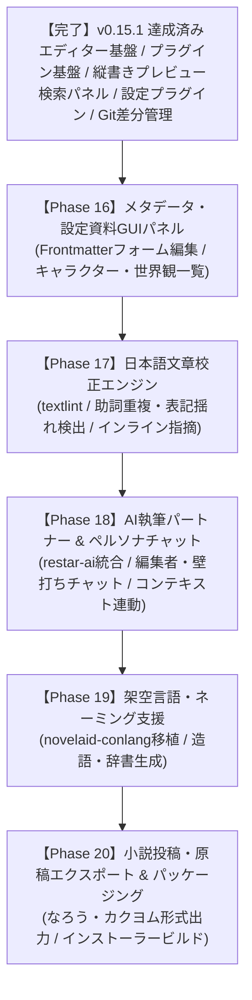

# novelaid 機能実装状況の総点検および開発ロードマップ改定

## 1. 概要

本ドキュメントは、小説執筆用デスクトップエディターの開発において、
先行プロジェクトである **`novelaid-editor`（Electron現行版）**、**`novelaid-editor-next`（Tauri初期再実装版・開発途中）**、および現在開発を進めている **`novelaide`（Tauri完全新設計版・コードネーム `novelaid-e`）** の機能実装状況を横断的に比較・再確認し、今後の開発ロードマップを整頓・改定したものです。

---

## 2. 3プロジェクトにおける機能実装状況の比較一覧

各機能を「エディター基盤」「ファイル・プロジェクト」「UI・レイアウト」「執筆支援・分析」「バージョン管理」「設定」「AI・創作支援」の大きなくくりで分類し、3つのプロジェクトにおける実装状況を一覧化しました。

| 大分類 | 機能項目 | novelaid-editor (現行Electron版) | novelaid-editor-next (Tauri初期版・途中) | novelaide (現在開発中版 v0.15.1) | 追いつき・進化状況 |
| :--- | :--- | :---: | :---: | :---: | :--- |
| **基盤・設計** | アプリフレームワーク | Electron | Tauri 2.x | Tauri 2.x | **最新化完了** |
| | プラグインアーキテクチャ | ✕ (固定設計) | ✕ (固定設計) | **◎ 完全プラグイン化** (View, Panel, Settings) | **大幅に先行・進化** |
| | クレート/パッケージ分離 | ✕ | △ (novelaid-fsのみ) | **◎ 3プラグイン完全分離** (fs, settings, git) | **大幅に先行・進化** |
| **プロジェクト・ファイル** | プロジェクト選択/作成 | ◯ (Launcher) | ◯ (restar-app) | **◯ (restar-app 統合)** | **同等達成** |
| | ファイルツリー・操作 | ◯ (新規/削除/変更) | ◯ (novelaid-fs) | **◎ (汎用エクスプローラー)** 原稿/ファイル/目次の3連 | **大幅に先行・進化** |
| | ファイル種別自動判定 | ◯ (Frontmatter/拡張子) | ◯ (DocumentIcon) | **◯ (アイコン・種別バッジ)** | **同等達成** |
| **エディターコア** | Monaco Editor統合 | ◯ | ◯ | **◎ 小説特化Monaco** | **同等達成** |
| | ルビ記法・シンタックス | ◯ (novelaid-ruby) | ◯ (novelaid-ruby) | **◎ (novelaid-ruby完全統合)** ルビ・傍点・リーダー補完 | **同等達成** |
| | マルチタブ・未保存検知 | ◯ | ◯ | **◯ (DocumentContext)** | **同等達成** |
| | 全角スペース可視化 | ◯ | △ | **◎ (装飾デコレーション)** | **完全追いつき** |
| **表示・プレビュー** | 縦書き文庫プレビュー | ◯ | △ (一部のみ) | **◎ (ビュープラグイン化)** フォント・行間・組版完全対応 | **大幅に先行・進化** |
| | スプリットビュー (2画面) | ◯ (左右分割) | ◯ (左右分割) | **◎ (ドラッグリサイズ連動)** | **同等達成** |
| | 拡張Markdown描画 | ◯ (novelaid-markdown) | ◯ (novelaid-markdown) | **◎ (MapLibre地図/Mermaid等)** | **同等達成** |
| **検索・アウトライン** | 全文検索 | ◯ (Search) | △ (簡易) | **◎ 汎用検索パネル** (本文・メタ・セリフプロバイダー) | **大幅に先行・進化** |
| | 見出しアウトライン | ◯ | ◯ (簡易) | **◎ (右ペインプラグイン)** | **同等達成** |
| **ステータス・集計** | リアルタイム文字数カウント | ◯ | ◯ | **◎ (全角半角/原稿用紙換算)** 選択範囲即時解析対応 | **同等達成** |
| | テーマ切替 (外観) | ◯ (Dark/Light) | ◯ (Dark/Light/Sepia) | **◎ (Dark/Light/Sepia)** CSS変数+Monaco完全連動 | **同等達成** |
| **環境設定** | 設定UI画面 | ◯ (モーダル) | △ (簡易モーダル) | **◎ 独立プラグイン化** (restar-app-settings) | **大幅に先行・進化** |
| | 設定のOS永続化 | ◯ | △ | **◎ (Rust IPC JSON永続化)** | **大幅に先行・進化** |
| **バージョン管理** | Git初期化/ブランチ | ◯ | △ (APIのみ) | **◎ (tauri-plugin-restar-git)** | **大幅に先行・進化** |
| | コミット/ステージ操作 | ◯ | ✕ (未実装) | **◎ (Stage/Unstage/Commit)** | **大幅に先行・進化** |
| | コミット履歴グラフ | ◯ (Graph) | ✕ (未実装) | **◎ (SVG履歴グラフ描画)** | **大幅に先行・進化** |
| | 差分比較 (Diff) | ◯ (Diff) | ✕ (未実装) | **◎ (Monaco DiffEditor)** 左右/インライン文字差分比較 | **大幅に先行・進化** |
| **設定・メタデータ** | Frontmatter詳細編集UI | ◯ (MetadataPanel) | ◯ (MetadataPanel) | **△ 計画中** (エディター直接編集は可能) | *未着手（次フェーズ）* |
| **AI・創作支援** | 日本語校正 (textlint等) | ◯ (Calibration) | △ (ProofreaderPanel) | **✕ 未着手** | *未着手（次フェーズ）* |
| | AIチャット (壁打ち) | ◯ (Chat) | ◯ (novelaid-chat) | **✕ 未着手** | *未着手（次フェーズ）* |
| | ペルソナ切替 (編集者等) | ◯ (AI) | ◯ (novelaid-ai) | **✕ 未着手** | *未着手（次フェーズ）* |
| | 架空言語支援 (conlang) | ◯ (ch/conlang) | ◯ (novelaid-conlang) | **✕ 未着手** | *未着手（次フェーズ）* |
| **投稿・エクスポート** | 小説投稿サイト形式出力 | ◯ (Submission) | ✕ (未実装) | **✕ 未着手** | *未着手（将来）* |

---

## 3. `novelaid-editor-next` に実装が追いついたかの詳細検証

### 3.1 結論：基盤・エディター・バージョン管理・設定機能は「完全追いつき＆追い越し」を達成
結論として、**小説を「書く」「プレビューする」「検索する」「設定を変更する」「Gitで履歴管理・差分確認する」というエディターとしてのコア機能全般において、`novelaide` はすでに `novelaid-editor-next` に完全に追いつき、アーキテクチャの完成度においては遥かに追い越しています。**

特に以下の4点において、`novelaid-editor-next` で課題・未着手だった部分を根本から解決・高度化しています。

1. **アーキテクチャの完全プラグイン化**:
   - `novelaid-editor-next` ではビューやサイドペインが単一の巨大コンポーネントに結合していましたが、`novelaide` では `ViewRegistry`（ビュープラグイン）、`PanelRegistry`（左右ペインプラグイン）、`SettingsRegistry`（設定タブプラグイン）として完全に疎結合化されています。
2. **プラグインの独立クレート/NPMパッケージ化**:
   - `tauri-plugin-novelaid-fs`（ファイル操作）、`tauri-plugin-restar-settings`（設定UI・OS永続化）、`tauri-plugin-restar-git`（Git CLI・差分取得）の3つを独立したプラグインとして切り出し、別アプリへの転用可能な共通資産として確立しました。
3. **本格的な Git ソース管理 & Monaco Diff Editor**:
   - `novelaid-editor-next` ではプロトタイプのクライアント関数のみでUIが存在しませんでしたが、`novelaide` ではブランチ表示、ステージング、SVGコミット履歴グラフ、および Monaco Diff Editor による左右/インライン差分比較まで完全に動作しています。
4. **汎用検索パネル**:
   - `novelaid-editor-next` には無かった、本文全文・メタデータ・セリフを切り替えて横断検索できるプロバイダー分離型の検索エンジンを確立しました。

### 3.2 まだ `novelaid-editor-next` の方が進んでいた（未追いつきの）領域
`novelaid-editor-next` に実装されており、`novelaide` でまだ着手していない領域は **「AI・校正・創作特化ツール」** と **「メタデータ専用GUI」** のみです。

1. **AI支援機能 (`novelaid-ai` / `novelaid-chat`)**:
   - LLM（Gemini等）と連携したAI執筆相談チャットパネル
   - 編集者・校正係・登場人物などの「ペルソナ切り替え」
2. **日本語校正パネル (`ProofreaderPanel`)**:
   - textlint や形態素解析、AIを活用した助詞重複・表記揺れの指摘UI
3. **架空言語支援 (`novelaid-conlang`)**:
   - ファンタジー等の固有名詞・造語の文法や語彙を生成・辞書管理するツール
4. **メタデータ専用GUIパネル (`MetadataPanel`)**:
   - 小説本文のYAMLフロントマター（登場人物、伏線、タグ等）をフォーム形式で一覧・編集するサイドパネル

---

## 4. 今後の開発ロードマップの整頓（新フェーズ計画）

これまでの成果を踏まえ、今後の開発フェーズを以下のように再整頓します。

### 次期フェーズの詳細

#### フェーズ 16: メタデータ・設定資料GUIパネルの実装
- **目的**: 小説ファイルのFrontmatter（登場人物、舞台、ステータス等）を視覚的に管理する右ペイン用プラグイン（`novelaid.panel.metadata`）の実装。
- **内容**:
  - 本文を開いた際、YAMLフロントマターを自動パースしてフォーム表示
  - キャラクター一覧・世界観設定の逆引きパネル

#### フェーズ 17: 日本語文章校正支援（校正パネル）の実装
- **目的**: 執筆中の原稿の誤字・脱字、助詞連続使用、表記揺れを検知・修正。
- **内容**:
  - 校正ルールエンジンの組み込み
  - 問題箇所のハイライトとワンクリック置換

#### フェーズ 18: AI執筆パートナー & ペルソナチャット（`novelaid-ai`）の実装
- **目的**: 執筆者が孤独にならず、エディター内でいつでも相談・ブレストできるAI環境の構築。
- **内容**:
  - `restar-ai` / Gemini API を活用したストリーミングチャット
  - 「担当編集者」「校正係」「作中キャラクター」などのペルソナ切り替え
  - 現在開いている原稿・プロットを自動文脈（コンテキスト）として注入

#### フェーズ 19: 架空言語・ネーミング支援（`novelaid-conlang`）の移植
- **目的**: 独自の世界観・造語を持つファンタジー作品のネーミング支援。
- **内容**:
  - 音韻規則に基づいた単語生成
  - プロジェクト固有の辞書管理

#### フェーズ 20: 原稿エクスポート・投稿支援 & アプリパッケージング
- **目的**: 「小説家になろう」「カクヨム」等への投稿フォーマット出力およびWindows/macOS向け配布インストーラー（MSI/DMG）の生成。
