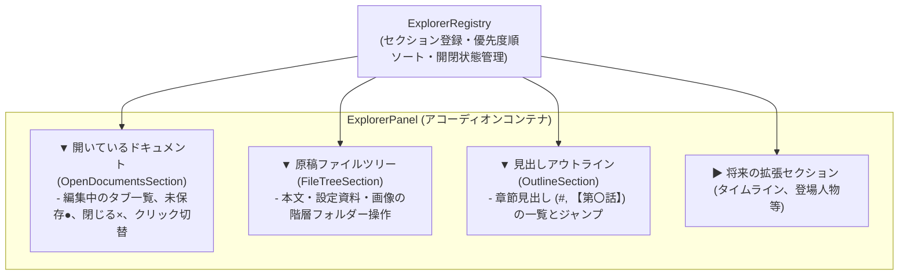

# 汎用エクスプローラーパネル仕様（ExplorerPanel）

## 1. 概要と設計理念

本ドキュメントは、`novelaid` シリーズにおける **ファイル一覧にとどまらない、多角的な情報閲覧・操作を提供する「汎用エクスプローラーパネル（`ExplorerPanel`）」** の仕様と設計理念を定義するものです。

### 1.1 背景と目的
従来の `FileExplorerPanel` は、ファイルツリーの表示・操作（フォルダの展開、ファイル作成等）に特化した単一のパネルでした。
しかし、小説執筆のワークスペースにおいては、以下のように **「原稿に関する複数の閲覧視点」** を一箇所で素早く切り替え・確認できることが強く求められます：
1. **開いているドキュメント（Open Documents）**:
   - 現在タブで開かれている作業中の原稿一覧。未保存（Dirty）状態の確認や、タブの切り替え・一括保存。
2. **原稿ファイルツリー（Novel File Tree）**:
   - プロジェクト全体のファイル・フォルダ構成。小説本文、設定資料、画像素材の階層管理。
3. **見出しアウトライン（Outline）**:
   - 現在編集中の原稿に含まれる章・節・シーン見出し。執筆中の場面把握や目次ジャンプ。

これらを別々の大きなパネルとして切り替えるのではなく、VSCodeのエクスプローラーのように **「折りたたみ可能なアコーディオンセクション（`ExplorerSectionPlugin`）」** として1つのパネル内に統合し、さらにプラグインとして自在にセクションを追加・並び替えできる構造とします。

---

## 2. アーキテクチャ構造



---

## 3. プラグインインターフェース定義

### 3.1 セクションプロパティ (`ExplorerSectionProps`)
各セクションコンポーネントが受け取る標準プロパティです。

```typescript
export interface ExplorerSectionProps {
  activeDocument: DocumentState | null;
  projectPath: string | null;
}
```

### 3.2 セクションプラグイン仕様 (`ExplorerSectionPlugin`)

```typescript
export interface ExplorerSectionPlugin {
  /** 一意なセクションID (例: 'novelaid.explorer.openDocs', 'novelaid.explorer.fileTree') */
  readonly id: string;
  /** セクションヘッダータイトル (例: '開いているドキュメント', '原稿ファイル') */
  readonly title: string;
  /** 初期開閉状態 (true: 展開 / false: 折りたたみ、デフォルト: true) */
  readonly defaultExpanded?: boolean;
  /** 表示優先順位 (数値が大きいほど上部に配置) */
  readonly priority: number;
  /** ヘッダー右端に配置するクイックアクションコンポーネント (任意) */
  readonly headerActions?: React.ComponentType<{ sectionId: string }>;
  /** ヘッダー右端に表示するバッジ (開いているファイル件数など) */
  readonly badge?: () => number | string | null;
  /** セクション本体コンポーネント */
  readonly component: React.ComponentType<ExplorerSectionProps>;
}
```

---

## 4. 組み込みセクション仕様

### 4.1 開いているドキュメント (`OpenDocumentsSection`)
- **ID**: `novelaid.explorer.openDocs`
- **優先度**: 100（最上部）
- **表示内容**:
  - `DocumentContext` で開かれているドキュメント一覧を縦並びで表示。
  - ファイル種別アイコン（`DocumentIcon`）、ファイル名、未保存インジケータ（`●`）。
  - 各項目のホバー時に「閉じる（`×`）」ボタンを表示。
  - クリックで該当ドキュメントをアクティブ化。

### 4.2 原稿ファイルツリー (`FileTreeSection`)
- **ID**: `novelaid.explorer.fileTree`
- **優先度**: 90（中央）
- **表示内容**:
  - プロジェクトフォルダー配下の階層ツリー（従来の `FileExplorer`）。
  - 新規ファイル・フォルダ作成、削除、リネーム、再読み込み。

### 4.3 見出しアウトライン (`OutlineSection`)
- **ID**: `novelaid.explorer.outline`
- **優先度**: 80（下部）
- **表示内容**:
  - 現在アクティブなドキュメントの章・節見出し（`#`, `##`, `【第〇話】` 等）。
  - ドキュメント未選択時は「ドキュメントが開かれていません」と表示。

---

## 5. 設計上のメリット

1. **左ペインの省スペース化と情報密度の向上**:
   - 執筆者が最も頻繁に参照する「開いているファイル」「ツリー」「目次」を、ペインを切り替えることなく1画面で同時に確認可能。
2. **アコーディオンによる柔軟な視覚調整**:
   - 長大なツリーを操作したいときは「アウトライン」を折りたたみ、章構成の推敲に集中したいときは「アウトライン」だけを広げるなど、作業フェーズに応じた伸縮が可能。
3. **高い拡張性**:
   - 将来的に「作中登場人物セクション」「原稿バージョンセクション」などを追加する際も、既存のツリー実装に手を加えることなく独立したプラグインとして追加可能。
