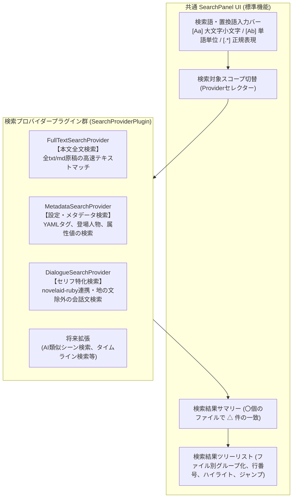

# 汎用検索パネル仕様（SearchPanel）

## 1. 概要と設計理念

本ドキュメントは、`novelaid` シリーズにおける **作品全体の多角的な検索・置換を提供する「汎用検索パネル（`SearchPanel`）」** の仕様と設計理念を定義するものです。

### 1.1 背景と課題
一般的なコードエディターの検索は、単一のテキスト走査（Grep検索）が標準です。
しかし、小説執筆における検索には以下のような作家特有のニーズが存在します：
- **本文全文検索**: 作品全体の全話（`.txt` / `.md`）から伏線やキーワード、言い回しを横断検索する。
- **メタデータ・設定検索**: キャラクターシートやYAMLフロントマターのタグ（例: `tag: 伏線`, `character: ルナ`）や属性情報を検索する。
- **セリフ特化検索**: 地の文を除外し、登場人物の会話文（「」内）だけを対象にして口調のブレや頻出ワードをチェックする。
- **将来の高度な検索**: AIによる文脈類似検索、作中タイムラインでの年代検索など。

これらを別々の検索窓として乱立させるのではなく、**「共通の標準検索UI（入力バー・オプション・置換・結果リスト）」** を核とし、背後の検索ロジックや対象スコープを **「プラグイン式検索プロバイダー（`SearchProviderPlugin`）」** として自在に追加・切り替えできる構造とします。

---

## 2. アーキテクチャ構造



---

## 3. プラグインインターフェース定義

### 3.1 検索クエリ (`SearchQuery`)
検索実行時にプロバイダーへ渡される標準パラメータです。

```typescript
export interface SearchQuery {
  /** 検索文字列 */
  text: string;
  /** 置換文字列 (任意) */
  replacement?: string;
  /** 大文字・小文字を区別するか */
  caseSensitive: boolean;
  /** 単語単位で一致させるか */
  wholeWord: boolean;
  /** 正規表現を使用するか */
  useRegex: boolean;
}
```

### 3.2 検索結果マッチ項目 (`SearchMatch`)

```typescript
export interface SearchMatch {
  /** 対象ファイルの絶対パス */
  filePath: string;
  /** ファイル表示名 */
  fileTitle: string;
  /** マッチした行番号 (1始まり) */
  lineNumber: number;
  /** マッチした開始列 (1始まり) */
  column: number;
  /** マッチした文字の長さ */
  matchLength: number;
  /** 一致箇所を含む行プレビュー文字列 */
  previewLine: string;
  /** 付加情報 (メタデータ検索時の属性名、セリフ検索時の話者名等) */
  extraInfo?: string;
}
```

### 3.3 検索プロバイダー仕様 (`SearchProviderPlugin`)

```typescript
export interface SearchProviderPlugin {
  /** 一意なプロバイダーID (例: 'novelaid.search.fulltext', 'novelaid.search.dialogue') */
  readonly id: string;
  /** 表示名 (ドロップダウンやタブに表示される名称) */
  readonly name: string;
  /** 説明文 (ツールチップ等) */
  readonly description?: string;
  /** 表示優先順位 (セレクターでの並び順) */
  readonly priority: number;

  /**
   * 検索の実行
   */
  search: (query: SearchQuery, projectPath: string) => Promise<SearchMatch[]>;

  /**
   * 一括置換の実行 (サポートする場合)
   */
  replace?: (query: SearchQuery, projectPath: string, matches?: SearchMatch[]) => Promise<void>;
}
```

---

## 4. 組み込みプロバイダー仕様

### 4.1 本文全文検索 (`FullTextSearchProvider`)
- **ID**: `novelaid.search.fulltext`
- **表示名**: 本文・設定全文
- **優先度**: 100（デフォルト）
- **対象**: プロジェクトフォルダー配下の全 `.txt` / `.md` 原稿。
- **動作**: 全テキストを行単位でスキャンし、一致箇所を行番号・プレビューテキスト付きで返却。

### 4.2 設定・メタデータ検索 (`MetadataSearchProvider`)
- **ID**: `novelaid.search.metadata`
- **表示名**: 設定・メタデータ
- **優先度**: 90
- **対象**: YAMLフロントマターおよび設定資料内の属性（`character`, `tag`, `role`, `location` 等）。
- **動作**: タグ名や属性値に一致する原稿を抽出し、該当属性名と値を返却。

### 4.3 セリフ特化検索 (`DialogueSearchProvider`)
- **ID**: `novelaid.search.dialogue`
- **表示名**: セリフのみ
- **優先度**: 80
- **対象**: `novelaid-ruby` の `extractRubyText` / `DIALOGUE_PATTERNS` により抽出された「」会話文。
- **動作**: 地の文を除外し、キャラクターの発言内容だけを高速検索。

---

## 5. 設計上のメリット

1. **小説創作に特化した検索の集約**:
   - 汎用エディターでは不可能な「セリフ内だけの検索」や「伏線タグ検索」を、作家が普段使う同一の検索パネルから直感的に切り替えて実行可能。
2. **標準UIの再利用と一貫性**:
   - どのような検索プロバイダーを追加しても、大文字小文字切替、正規表現、結果リスト、ジャンプナビゲーションは標準UIが保証。
3. **完全な拡張性**:
   - 将来的にAIによる「感情検索」「類似シーン検索」などの先進的プロバイダーもプラグイン登録だけで容易に統合可能。
