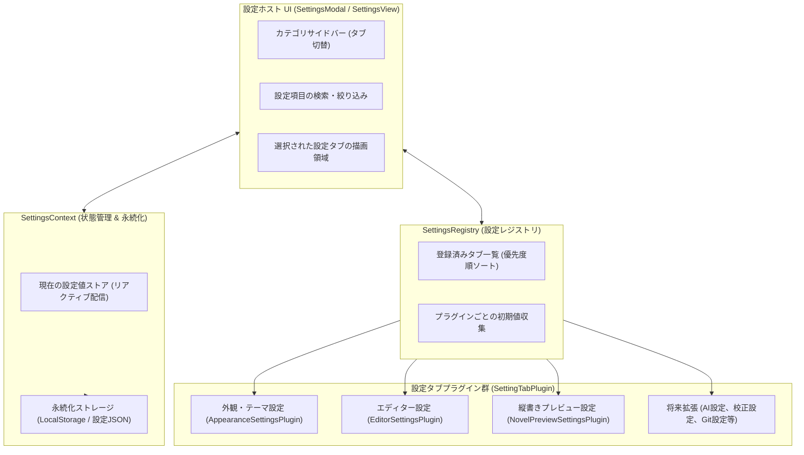

# 設定プラグインアーキテクチャ仕様書

## 1. 概要

本ドキュメントは、**`novelaid`**（および `novelaid-editor` シリーズ）における **設定システム（Settings / Preferences）のプラグインアーキテクチャ** について定義するものです。

エディターの機能拡張に伴い、フォント・テーマ・組版・文字数換算・将来のAIアシスタント機能など、多種多様な設定項目が必要となります。これらを単一の固定画面にハードコードするのではなく、**各機能プラグインが自身の設定項目・UI・デフォルト値を「設定タブプラグイン（`SettingTabPlugin`）」として自己完結的に登録できる構造** を採用します。

---

## 2. アーキテクチャ設計



---

## 3. インターフェース定義

### 3.1 設定タブプロパティ (`SettingTabProps`)

```typescript
export interface SettingTabProps {
  /** 全設定値オブジェクト */
  settings: Record<string, any>;
  /** 設定値の更新関数 */
  updateSetting: <T>(key: string, value: T) => void;
  /** 設定値をデフォルトに戻す関数 */
  resetSetting: (key: string) => void;
  /** 検索フィルター文字列 */
  searchQuery: string;
}
```

### 3.2 設定タブプラグイン (`SettingTabPlugin`)

```typescript
export interface SettingTabPlugin {
  /** 一意なタブ識別子 (例: 'appearance', 'editor', 'preview') */
  id: string;
  /** タブの表示名 (例: '外観・テーマ', 'エディター') */
  title: string;
  /** アイコン識別名 */
  icon?: string;
  /** サイドバーでの表示優先度 (昇順) */
  order: number;
  /** 検索用の追加キーワード一覧 */
  keywords?: string[];
  /** このプラグインが提供する設定キーとデフォルト値の辞書 */
  defaultValues: Record<string, any>;
  /** 設定UIコンポーネントの描画関数 */
  render: (props: SettingTabProps) => React.ReactNode;
}
```

---

## 4. 組み込み設定タブ一覧

初期段階で提供する組み込み設定プラグインは以下の通りです。

| タブID | タブ名 | 管理する主な設定項目 |
| :--- | :--- | :--- |
| `appearance` | **外観・テーマ** | アプリケーションテーマ（ダーク / ライト / セピア）、UIフォント |
| `editor` | **エディター** | フォントファミリー、フォントサイズ、行の高さ、行番号表示、ミニマップ、折り返し、原稿用紙換算行数・文字数（20×20等）、自動保存 |
| `preview` | **縦書きプレビュー** | 縦書き／横書きデフォルト、文庫本フォント、ルビ・圏点（傍点）スタイル、見開き・単一ページ表示 |

---

## 5. UIとユーザー体験

1. **アクセス方法**:
   - 左アクティビティバー最下部の歯車アイコン（⚙️）をクリック。
   - グローバルショートカット `Ctrl + ,`（Macでは `Cmd + ,`）。
2. **検索・フィルタリング**:
   - 設定モーダル上部に検索バーを配置。
   - タブ名や設定項目名、説明文、登録キーワードから即座に目的の設定を検索。
3. **即時反映（ホットリロード）**:
   - 設定を変更した瞬間、エディターやプレビュー画面へリロードなしで即座に設定値が反映される。
