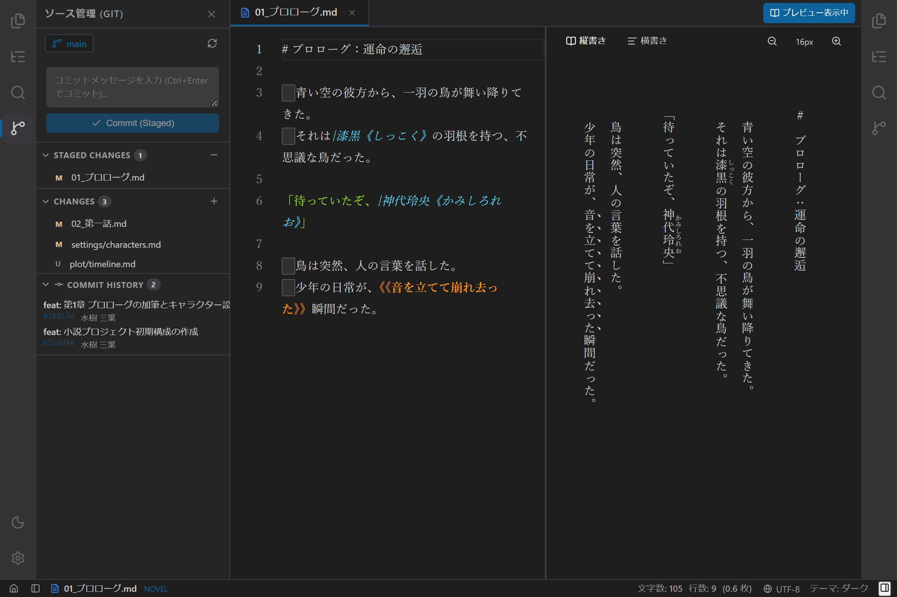

# Gitソース管理の使い方

## 1. 概要

`novelaide` は、小説執筆における原稿の推敲・履歴管理を確実に行うための **Gitソース管理機能（`tauri-plugin-restar-git`）** を標準搭載しています。

VS Code や GitHub と同等の本格的な Git 機能をエディター内部に統合しており、専門用語を曖昧にせずダイレクトな Git 用語（Commit, Stage, Branch, Diff, Discard 等）を採用しています。さらに、原稿の加筆・修正・削除を行単位・文字単位で左右比較できる **Monaco Diff Editor** を搭載しています。

---

## 2. 画面構成

左アクティビティバーの **ソース管理（Git）アイコン**（上から3番目）をクリックすると、左サイドペインに Git パネルが開きます。

| セクション | 主な機能・役割 |
| :--- | :--- |
| **ヘッダー部** | 現在チェックアウトしているブランチ名（例: `🌿 main`）と、リポジトリ状態の再読み込み（Refresh）ボタン |
| **コミット入力部** | コミットメッセージの入力エリア、`Commit`（ステージ済みをコミット）/ `Commit All`（全変更を自動ステージしてコミット）ボタン |
| **Staged Changes** | コミット対象としてステージされているファイル一覧。個別・一括でのアンステージ（`-`）が可能 |
| **Changes** | 変更または新規作成された未ステージのファイル一覧。個別・一括でのステージング（`+`）や変更破棄が可能 |
| **Commit History** | 過去のコミット履歴を視覚的に描画するコミット履歴グラフ（SVG）。コミットハッシュ、メッセージ、作者、経過時間を表示 |

---

## 3. 基本的な使い方

### 3.1 差分の確認（Monaco Diff Editor）
`Changes` または `Staged Changes` リスト内のファイル名をクリックすると、中央エディター領域に **差分比較ビュー（`DiffEditor`）** が開きます。
- **左画面（Original / HEAD）**: 前回のコミット時点の原稿内容
- **右画面（Modified / Working Tree）**: 現在編集中の最新原稿内容
- **ハイライト**: 追加された行・単語は緑色、削除された箇所は赤色で視覚的に強調表示されます。

### 3.2 変更のステージングとアンステージ
- **個別ステージング**: `Changes` リストのファイル右側にある `+` ボタンをクリックすると、該当ファイルが `Staged Changes` に移動します。
- **一括ステージング**: `Changes` ヘッダー右側の `+` ボタンをクリックすると、すべての変更ファイルが一括でステージされます。
- **アンステージ**: `Staged Changes` リストの `-` ボタンをクリックすることで、いつでもステージを解除できます。

### 3.3 コミットの実行
1. コミットメッセージ入力欄に、執筆・推敲の内容（例: `第3章 ルナとの対話シーンを加筆`）を入力します。
2. `Commit` ボタンをクリックするか、キーボードショートカット **`Ctrl + Enter`**（macOS: `Cmd + Enter`）を押すとコミットが完了します。
3. 未ステージの変更がある状態でメッセージを入力して `Commit All` を押すと、全変更のステージングとコミットをワンアクションで実行できます。

### 3.4 誤った編集の破棄（Discard Changes）
未ステージのファイル右側にある「元に戻す（矢印）」アイコンをクリックすると、変更を破棄して直前のコミット（HEAD）の状態に安全に戻すことができます。

---

## 4. コミット履歴グラフ（Commit History）

パネル下部のアコーディオンを展開すると、直近のコミット履歴がブランチグラフとともに一覧表示されます。
- **コミットグラフ**: ブランチの分岐や合流を直感的なSVGグラフィックで描画します。
- **コミット情報**: 短縮ハッシュ（例: `a1b2c3d`）、コミットメッセージ、執筆者、経過時間（例: `2 hours ago`）を確認できます。
- 過去のコミットにおける改変内容を振り返りながら、執筆の道筋を俯瞰して管理できます。
